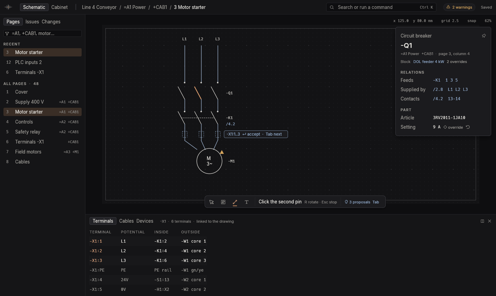

# KoperCAD design

How KoperCAD works for the person using it, and what its window looks
like. This is the single design reference for UI pull requests. It merges
the workflow thread's interaction model and the layout thread's screen
architecture after two critique rounds with the main reviewer; the
integration lead arbitrates changes. It replaces `docs/WORKFLOW.md` and
`docs/design/interaction-model.md`.

KoperCAD is not EPLAN with fewer clicks. Tadjiro's EPLAN complaints
(appendix) are treated as symptoms of page-first CAD, not as a feature list.
The visual language (colours, type, spacing, icons) is in
`docs/design/ui-guidelines.md`.

## 1. How a designer thinks

- **Functions, not sheets.** "Feed pump 3, 4 kW, direct on line, running
  signal to the PLC" is the unit of thought. A page is how a function is
  printed.
- **Four questions, all day.** What connects to what, where things sit,
  what each thing is, and how the drawing reads. Page-first tools put all
  four on one sheet and then need a navigator for each.
- **Repetition with variation.** Twenty motor feeders that differ in power
  and tag.
- **Drawing is thinking.** Placing and connecting must stay direct and
  immediate.
- **Big edits are data edits.** Renaming 400 terminals is table work.

## 2. What the user works with

The user manipulates five kinds of things. Everything else is derived.

| The user manipulates | Examples | Mostly through |
| --- | --- | --- |
| Structure | `=A1 Supply`, `+CAB1`, `+FIELD` | The structure board, the breadcrumb, the outline filter |
| Devices | `-K1` with its coil and contacts | Placing on the drawing, the inspector |
| Connections | `-K1:2` to `-F1:1` | Dragging from pin to pin |
| Rules | Numbering, terminal joining, text style, colours | The Rules document |
| Blocks | "Motor feeder DOL" with power as a parameter | The command surface, the inspector |

| Derived | From | Automatic or proposed |
| --- | --- | --- |
| Wire routes and corners | Routed once when a connection is made, then stored | Automatic; `tidy` re-routes on request |
| Junction dots and T-junctions | Where stored routes meet | Automatic; a dot can be dragged. A dot means three or more conductors join: a straight run of two connections through a point, a corner and a crossing without a connection get no dot (IEC 60617) |
| Connections between placed pins | Where a placed or moved symbol's pins land | Automatic when pins touch or a pin lands on a connection. Free pins that face each other at a distance follow the Preferences choice (§4, Auto connections): drawn solid by default, or proposed (dashed, for Enter or Tab), or left alone; the placement preview shows them either way, so the click is informed. Moving a symbol never makes a connection the preview did not show |
| Potentials (L1, L2, L3, N, PE, 24 V) | The declared source, flowing through conductors, contacts and terminals | Automatic. Recognising PE, N and PEN by name (`X4:PE`) is a visible, switchable rule; one conductor can be overridden |
| Cross references and contact images | Which device a contact belongs to | Automatic |
| Terminals and cables | Connections that cross a location boundary (`+CAB1` to `+FIELD`) | Proposed |
| Parts for block devices | Block parameters | Proposed where more than one part fits |
| Terminal, cable and report pages | The model | Automatic and live |
| Problems | The model and the rules | Automatic, marked in place |

**Automatic or proposed:** anything with exactly one correct answer happens
on its own. Anything that needs judgement (which strip, which cable type,
which part, where a page breaks) is proposed: drawn as a proposal mark where
it applies and accepted with Enter. Proposals never block work and never
become dialogs. A declined proposal is remembered and does not return.

**How intent reaches the model:** each gesture or command is one novo-core
`Command` and one undo step, including a renumber of 400 tags or accepting
all proposals. Derived things are computed, never written behind the user's
back. Scripts (WS-28) and the AI assistant (WS-23) use the same commands.

## 3. The window: Workbench



```
+--------------------------------------------------------------------------+
| mark | Schematic Cabinet | project / =A1 / +CAB1 / page  [Search or run] |  42 px
+---------------+----------------------------------------------------------+
| Pages Issues  |                                      hud  +------------+ |
|       Changes |                                           | Inspector  | |
| [filter =/+ ] |               canvas                      | (overlay,  | |
| ALL PAGES     |          [ tools | hint | proposals ]     +------------+ |
+---------------+----------------------------------------------------------+
| Terminals | Cables | Devices   (drawer, linked to the selection)      |
+--------------------------------------------------------------------------+
```

What the screen must do:

1. **The drawing never moves because of chrome.** Panels that appear on
   selection float over the canvas; only pinned panels take space. When the
   drawer opens or closes, the world point at the canvas centre stays put.
2. **One way in for commands:** the command surface reaches every command,
   page, device and symbol.
3. **Information sits where it applies:** problems on the object, the hint
   next to the tool, properties beside the selection.
4. **Quiet until needed:** at rest, the drawing plus one thin bar.
5. **Works on a site laptop:** 1366x768 and 1536x864 effective (1920x1080 at
   125%) are design targets. With the outline as a flyout and the drawer
   closed, the canvas gets 92% of the window (the 22 px status bar,
   docs/design/workspaces.md §4 and §7, replaced the earlier 95% target).

**Top bar (42 px).**
- The **mark** opens a short project menu: New, Open, Recent, Export PDF,
  Print, Project settings, Preferences, Quit. Every item is also in the
  command surface; the mark is a shortcut list, not a second index. The
  Parts window (browse and import maker parts) is opened by the `parts`
  command only for now; it is not in the mark menu.
- **Schematic | Cabinet:** the two canvases, as a segmented switch.
- **Breadcrumb:** project / `=function` / `+location` / page. A click on a
  segment filters the outline to it.
- **Search or run** (Ctrl+K): the command surface.
- **Issue pill:** the issue count; a click opens Issues. Each count lives
  in exactly one place: the pill counts issues, the dock counts proposals.
- **Saved:** the only save signal, reading Saving, Saved or Not saved yet.
  See Saving below.

**Outline (left, 248 px).** Pinned above 1700 px wide, a flyout below;
pinned from its pin button or the "Pin outline" command. Three modes:
- **Pages:** All pages, grouped by function or location (no Recent list). The filter takes text and structure
  (`=A1`, `+CAB1`, `motor`): the 81346 tree filters pages rather than
  owning them, because one page can hold several functions.
- **Issues:** problems and proposals in one sortable list with filter
  chips, worked through with F8 and Shift+F8.
- **Changes:** what changed since the last revision, by page (§7, Revisions).

**Canvas.** Two floating things:
- The **tool dock** (bottom centre): Select, Place, Connect, Text, the hint
  for the current step ("Click the second pin · R rotate · Esc stop") and
  the proposals count. There are no terminal or potential tools, and no
  cable chip: the cable tool (C) shows as the Select chip with the hint
  "Cable: click along the wires that belong to it · Esc to stop". The
  "Compact dock" setting leaves only the hint and the count. It moves aside
  while a gesture is in progress near it (it never fades), and can be
  dragged to any edge.
- The **HUD** (top right, `TEXT_FAINT`, 4.5:1 on the canvas): cursor position in mm, grid, snap, zoom.

**Inspector (overlay, 276 px).** Appears with a selection and slides away
when it clears. It opens on the side away from the selection, flipping to
the left edge when the selection is under it, so it never hides what you
selected. Content: **Relations** first (feeds, supplied by, contacts,
strip, cable, block "DOL feeder 4 kW, 2 overrides"), then the part, then a
search over every other property. Overridden fields show a reset arrow. A
pin makes it a real panel; pinned with nothing selected it shows the page.

**Drawer (bottom, linked).** Three tabs, all tables of the same model with
the drawing still in view:
- **Terminals:** strips, levels, jumpers, spares.
- **Cables:** cables, cores and shields. Besides the proposals at location
  boundaries, C draws a cable by hand: the line takes every wire on the
  current page that is on no cable yet and lies within a few millimetres of
  it, whatever its locations. The cable gets the smallest usual type those
  wires fit (L1, L2, L3, N and PE give 5G1.5; signals give a numbered
  cable), the next free `-W` tag in the function of the first device a wire
  lands on, and each wire on its core. It is one undo step, and a line that
  touches no free wire says so in the status line.
- **Devices:** every device with its part and location; on the Cabinet
  canvas, unplaced devices come first and the drawer opens there by
  default.
Selecting on the drawing selects rows and the other way round. Ctrl+3,
Ctrl+4 and Ctrl+5 toggle the tabs. The drawer takes at most 35% of the
height, keeps the canvas-centre world point fixed, docks right above
1800 px wide (layout C) and below 800 px of height.

| Screen (effective) | Outline | Drawer | Canvas |
| --- | --- | --- | --- |
| 1920x1080 at 100% | pinned, 248 | bottom, 30% | 1672 x 692 |
| 1536x864 (1080p at 125%) | flyout | closed | 1536 x 800 (92%) |
| 1536x864 | flyout | bottom, 35% | 1536 x 498 |
| 1366x768 | flyout | closed | 1366 x 704 (92%) |
| 1366x768 | flyout | bottom, capped at 35% | 1366 x 435 |

**Focus mode** (Ctrl+Shift+F) hides every unpinned panel, for reviewing
and presenting (layout B). F11 is full screen.

**Structure board.** A new project opens on its structure: functions as
columns, locations as chips, typed in place. "Add page" under a function
opens the Schematic canvas. Afterwards structure is reached through the
breadcrumb and the outline filter, not as a separate place.

**Rules document.** `rules` (or Project settings) replaces the canvas with
the project's rules as sentences with inline choices: "Devices are numbered
[per letter code ▾]". Esc returns. The drawing standard is one of these
rules ("Symbols follow [IEC 60617 ▾]", default IEC, or NFPA 79); until the
Rules document is built, `standard` opens a small Project settings window
with the same choice.

**Page frame.** Every page is drawn and printed in a frame, chosen by a rule
("Pages use [A3 landscape, company frame ▾]"), never per page by hand. The
frame carries:
- a numbered column grid (ten columns on A3 by default, set by the frame),
  which is what references point at;
- a title block: project, page title, page n of m, the page's `=function`
  and `+location`, revision letter and date, drawn by and checked by.

References read `page.column` (`3.4`), with the structure prefix only when
it differs from the reader's page (`=A2/3.4`). The dot belongs to
references, so a page name never contains one: a page inserted where no
whole number fits takes the next free letter (`3a` between `3` and `4`,
then `3b`; the same 23 letters as generated sheets, §8), and a reference
to it reads `3a.4`. Renaming a page to a name with a dot is refused with
that reason. Between `3` and an existing `3a` no letter fits, so the
lettered run moves up one letter (`3a` becomes `3b`) and the new page takes
`3a`; references follow, since they point at pages. Frozen names never
move: if the run has a frozen page, the new page goes at the end of the run
and the status line says so ("inserted as 3d: 3a–3c are frozen").
Revision fields come from the project's revisions, which also drive
Changes mode and the pinned-flow freeze (§8). Owners: WS-03 draws the frame (`PageScene::frame`), WS-10 owns
the reference format, and the frame choice is a rule like any other.

**Saving.** There are no save prompts and no Save step to remember. A named
project is written into its own `.novo` file continuously, about half a
second after each change and on close, so reopening shows exactly what was
left. An untitled project closed with work in it is kept in
`%LOCALAPPDATA%\NovoElectric\Unsaved` and offered back (under Unsaved with
Recent, and reopened at start-up if it was the last one open); naming it
moves it to `<Documents>\NovoElectric\<name>.novo`. The
deliberate checkpoints are revisions (§7, §8), not Save. Ctrl+S
names an untitled project and otherwise only confirms Saved; Ctrl+Shift+S
saves a copy under a new name and keeps working in the original.

**Start-up.** The app opens the last project where it was left: same page
and zoom, nothing selected. There is no start screen to click through. With
no project open (first run, or after Ctrl+W) the canvas area shows New
project, Open, Open example and Recent; it is the only time the canvas is
empty. New projects are saved to `<Documents>\NovoElectric\<name>.novo`,
with Documents resolved through the known-folder lookup because company PCs
redirect it to OneDrive. Nothing is written outside the user's profile, and
nothing needs admin rights.

**Language.** Every command word, parameter and label has an English name
and per-language aliases, Dutch first (`voeding 400V 32A` and
`supply 400V 32A` both work; `alles accepteren` is `accept all`). Both
always match, whatever the UI language, so a colleague's habit still works.
Device tags, IEC letter codes, units and potential names (L1, PE) are never
translated.

## 4. Commands

Every command lives in these places, in this order of preference. Nothing
lives only in a menu, and nothing opens a modal dialog in the drawing loop.

1. **Direct manipulation** for the most frequent things: drag from a pin to
   connect; drag a symbol, a junction dot or a text to move it (a drag that
   starts on a text moves only that text); drop a contact on a coil to give
   it its device; drag a device onto a location in the outline.
2. **The command surface.** Ctrl+K opens it at the top; Q and a tapped
   Space open it at the pointer, acting on what is under it. Empty, it
   lists every command grouped (Project, Draw, Edit, Navigate, View, Check,
   Export) with shortcuts and disabled reasons: this is the menu, and there
   is no separate menu index: the menu bar is generated from the same commands
   (`docs/design/workspaces.md` §5). Its grammar:
   - a noun selects or jumps: `K1`, `12`, `X2:1`. Enter on an exact tag
     jumps to the device's main location, and every other location is
     listed below;
   - a verb with a noun acts: `no K1`, `dol 4kW x3`, `renumber page`;
   - a bare verb runs a command: `rules`, `export pdf`, `problems`.
   **Every grammar form is reachable by picking rows** (verb · object ·
   parameter chips) without knowing the syntax, with a live preview on the
   drawing. Typing is a shortcut, never the only way.
3. **The context menu.** On an object, that object's actions first, best
   guess first. On empty canvas, "repeat last tool" first.
4. **Keys** (below). Letter keys act only while the drawing has focus.
5. **The inspector** for properties of the selection.

**Pin or body.** Pins win over the symbol body within 10 screen pixels of
a pin's connection point, at every zoom; "Grabbing a pin" below has the
full rule. Hovering there shows the pin as the connect target (a
steel-blue ring and the connect cursor) before the press, so a drag that
starts there connects and a drag anywhere else on the symbol moves it.

**Selection.** A click selects a device. A double-click on its text selects
the text and edits it. Alt+click selects the deepest item under the
pointer. Clicking empty canvas clears the selection.

**Double click and drag.** A double click means one thing per place, and
the tool decides whether it is a wire gesture or an edit gesture, so it
never changes meaning in the middle of work.

| Double click on | Select tool (default) | Connect tool (W) |
| --- | --- | --- |
| Text (tag, wire number, label) | Rename in place, as F2 | Nothing |
| A device | Properties open, cursor in the tag | Nothing |
| A wire | Selects the whole wire (F2 edits its number) | Ends or starts a wire |
| A pin | Starts a wire | Starts a wire |
| Empty canvas | Starts a free wire (below) | Starts a free wire, or ends the one in progress |
| A page tab | Rename the page | Rename the page |

A double click in the Place mode places like a click and has no further
meaning. The first click of a double click does what a click does, so a
double click on text selects it first and a double click on a device
selects it first; nothing is lost if the second click is slow.

**Moving needs no key.** Press on a device and drag more than 4 px and it
moves, selected or not: the press selects it (as a click would) and the
drag moves the whole selection if the device was already part of it. Pins
still win within their grab zone, so a drag from a pin connects (§4, pin
or body). The move snaps to the grid and Esc during the drag puts everything
back. A plain drag takes the symbol's wires along, stretching them under
the no-overlap rules, so nothing is left open (an open end is never what
a person wanted from moving a device). Shift+drag moves the symbol alone:
its wires stay where they are, and every wire end that was on one of its
pins stays behind as an open end (ring and Unconnected flag, `wire.open`,
§4 open ends). Where the
moved pins land on a wire or face another pin, the Auto connections
setting decides whether they connect. Preferences, Moving, has the
choice "Moving a symbol: takes its wires along (default) / leaves its wires"; the
choice only sets the default, and Shift always does the other one (the
dock hint says "Shift: take the wires along" or "Shift: leave the wires"
and follows the key while it is down, and the status line after the drop
says how many wire ends were left open ("3 wire ends left open ·
Ctrl+Z"). M
keeps working as the keyboard move: it picks the selection up at the
pointer and a click puts it down. Undo takes back one whole move. A
press and drag on a wire moves the corner or segment under the pointer
("Selecting a wire" below).

**Placing a row.** With a symbol on the pointer (any way of getting it
there), a click places one; a press and drag of more than 4 px places a
row of them, evenly spaced, as far as the pointer stretches.

- **Direction.** The row runs along the axis the pointer has travelled
  furthest from the press, locked to horizontal or vertical; it switches
  axis only when the other distance leads by more than 8 px, so a shaky
  hand does not flip it. The first symbol sits at the press point.
- **Spacing.** The pitch is the symbol's own (its width or height plus its
  clearance, rounded up to the grid; a terminal takes its strip's pitch).
  The mouse wheel or + (wider) and - (narrower) change it by one grid
  step while dragging, and the hint shows the pitch. Every symbol sits on
  the grid.
  Per kind: a terminal takes its strip's pitch (so a row of terminals
  matches the strip it joins); fuses, breakers and contacts take their
  width plus one grid step; anything else its bounding box plus one grid
  step.
- **Count.** The number of symbols is the pointer's distance divided by
  the pitch, rounded down, plus the first, at most 50. A ghost of every
  symbol is shown live with the count beside the pointer ("×6"). Moving
  back under one pitch shows the single symbol again.
- **Collisions.** The row stops before the first position that would
  overlap another device and shows that position with the refusal mark of
  §5; it never places over something. Wires are not created between the
  symbols of a row.
- **With the wheel and Q.** A symbol picked from the wheel or the place
  surface is on the pointer like any other, so the row drag works the same.
  A flick through the wheel only picks the symbol; the row is a second
  press and drag.
- **Release** places the whole row as one undo step. R and X during the
  drag turn or mirror all of them. Esc cancels the drag and keeps the
  symbol on the pointer.
- **Tags and proposals.** Auto tags run in order from the press point
  outward (-F1, -F2, ...), as if placed one by one; terminals continue
  the strip's numbering (-X1:1, -X1:2, ...).
  Each symbol raises its usual proposals; Tab and Enter work through them
  in row order, so the row is wired by accepting, not by hand.

**Linking a contact to a coil.** Four routes make one action, one undo
step, no confirmation: drag the contact onto the coil (a drag of a
contact that ends with the pointer over a coil links instead of moving:
the hint reads "Link to -K1" while the pointer is over the coil, and Esc
cancels; over anything else it moves as usual); right-click the
contact and pick "Link to coil…"; `link` in the command surface (pick the
contact, then the coil; or `link -K3 -K1`); and renaming the contact (F2
or the double click) to the tag of an existing coil. The contact takes the
coil's device and cross reference, and a toast says "Linked to -K1". A tag
that belongs to something a contact cannot link to is refused with the
reason in the hint and nothing changes.

**A click on a pin.** In every tool except Place, a click on a pin
(anywhere in its grab zone) starts a wire there, so the Connect tool need
not be chosen first, and the next click or drag continues it. A drag from
a pin connects as before (§4, pin or body). The device is selected by
clicking its body, never its pin. While a symbol is on the pointer (Place)
a click places it, whatever is underneath.

**Box selection.** Pressing on empty canvas and dragging more than 4 px
draws a selection box. Dragging right encloses: only items wholly inside
are taken (a solid box). Dragging left crosses: every item the box
touches is taken (a dashed box). The two modes are the two directions of
one gesture, so nothing is chosen in advance.

- **Live highlight.** While the pointer moves, every item the box would
  take is shown in the hover colour (steel blue, never copper) and the
  hint counts them ("5 selected"). Release takes exactly what the
  box covers; Esc cancels and leaves the selection as it was.
  Above 2000 items in the box the highlight stops (the cap keeps a large
  sheet responsive) but the box and the count go on updating, and release
  still takes everything. The count shows once the box has started (past
  the 4 px threshold), never as "0 selected" before it.
- **Modifiers.** Shift adds to the selection and Ctrl toggles, both
  decided at release, so the highlight shows the result of the gesture.
- **What counts as an item.** A device is taken as a whole (its tag and
  text come with it), a wire as one wire, and a page frame or title block
  never. Pins alone are not items.
- A press that moves under 4 px is a click and clears the selection, as
  before.

**Grid dots.** The canvas shows the grid as dots so placing and snapping
can be seen. A dot sits on every grid point and every fifth is a little
larger (a major dot); the dot colour is Layout's and stays faint enough
never to compete with wires. Dots are screen sized (1 px, major 2 px) and
thin out with zoom: when the grid pitch on screen falls under 8 px only
the major dots show, and when the major pitch falls under 8 px none do.
The HUD still names the grid. Snap works the same whether or not the dots
show. `grid` in the command surface shows and hides them; it is a
per-user setting like the wiring mode.

### Selecting a wire, auto connections, feeds, PE and bridged terminals

**Selecting a wire.** A single click never selects a whole wire. Every
corner of every wire is drawn as a small handle (a 5 px square on screen,
shown whenever the wire is shown and left out only when zoomed out so far
that wires are hairlines), so each corner can be seen and aimed at.

- A click on a **corner** selects that corner only. Dragging it moves just
  that corner; the two segments at it stay horizontal or vertical.
- A click on a **straight segment** selects the segment and lights its two
  corners individually. Dragging it moves it sideways, and its two corners
  move with it.
- A **double click** anywhere on the wire selects the whole wire (for its
  number, Delete, or properties).
- Shift adds to the selection and Ctrl toggles. Delete on a corner removes
  the bend; on a segment or a whole wire it deletes the wire.
- Moves follow the no-overlap rules of the wiring modes: a corner or
  segment dragged over another wire is refused live, as in §5.
- Box selection (above) still takes whole wires it touches.

**Auto connections.** The setting lives in Preferences, Connections, per
user, as "Auto connections" with three choices:

| Choice | What happens when pins end up facing each other |
| --- | --- |
| Draw them (default) | The connections are drawn solid when the symbol is dropped, in the same undo step as the placement; the placement preview still shows them before the click |
| Ask me each time | They are proposals (dashed): Enter accepts, Tab cycles, as in §5 |
| Never | Nothing is drawn or proposed; only touching pins connect |

The wording in Preferences is exactly those three phrases. Moving a symbol
follows the same choice and never connects something the preview did not
show. The §2 row for connections between placed pins is read through this
setting.

**Potential feeds.** A feed is a symbol on the drawing that declares a
potential (L1, L2, L3, N, PE, 24 V, 0 V). Wires and terminals connected to
it take its potential, and the potential shown on the drawing is the
declared one; a simulation may show a different live state for a moment
(a contact opening) without changing what is stored.

- A new feed takes the next free name of its system in order: L1, then L2,
  then L3, then N, then PE; a row of three feeds placed by dragging reads
  L1, L2, L3.
- **Right-click a feed** gives: a Potential caption over a grid of chips
  (L1 L2 L3 N PE +24 V 0 V and Other…, which lists the project's other
  potentials and "New…"), then Number automatically, Rename (F2), Show
  where it goes (lights every wire and terminal on that potential) and
  Delete. Clicking a chip is one click and one undo step, and with
  several feeds selected it sets all of them. Number automatically
  restores the L1, L2, L3 order of the selected feeds.
- Tags, terminal numbers and feed names all sit to the left of every
  symbol, mirrored with it, so they never differ. The exception is a
  semiconductor with a control terminal on the left, which keeps its
  text on the right. Layout's mock is docs/design/workflow-looks.png.
- A hand toggle of a PE terminal needs a stored override flag on the
  terminal (WS-02 describes it; the Potentials thread uses it), so that
  the automatic PE rule never undoes a choice made by hand.

**PE terminals.** Select one terminal or several and right-click:
"Toggle PE terminal" (also `pe` in the command surface). A terminal
becomes a PE terminal on its own when it is connected to a wire of PE
potential or to a ground or PE symbol, and the menu row shows that state.
A toggle by hand is an override (the override diamond of §5) and sticks
until reset. With a mixed selection the toggle turns them all on.

**Bridged terminals.** Select two or more terminals of one strip that sit
next to each other and right-click: "Connect terminals". Their symbol
changes to the connected-terminal form and they carry one conductor
between them; "Separate terminals" reverses it, both as one undo step.
Terminals that are not neighbours on the same strip are refused with the
reason in the hint, and nothing changes.

### Pages navigator, and strip naming

**Pages navigator.** Pages are reached through the outline (§3), which is
the navigator: there is no second one. Its filter has two views of the
same pages, **Function** (the page groups, `=20D41`) and **Location** (the
panels, `+BAY1G1`). Each page has both: the group it sits in and the panel
it is drawn for.

**DXF background.** A page can carry one imported DXF as a reference
underlay (File › Import, command `file.import_dxf_background`): grey, under the
wiring, never selected, snapped to or printed, and it creates no devices or
wires. The breadcrumb names it and a click hides it (`view.background`); it
is placed at the page corner, and move and scale come later.

- Right-click in the outline: New page here (it takes the group and panel
  of the row), New group, New panel. New group asks for its name and,
  optionally, its panels as chips; a panel is named once in the project
  however many groups use it.
- Two pages in `=20D41 +BAY1G1` and two in `=21D21 +BAY1G1` are four pages
  of one panel: the Cabinet canvas and the cabinet layout are per panel,
  so they appear on the same layout though the groups differ. The panel
  row in the Location view lists all four.
- A link icon marks a panel name that appears under more than one group
  (it means one shared layout). Layout's mock is
  docs/design/workflow-looks.png.
- Dragging a page onto another group or panel row moves it (its prefix
  changes, references follow, one undo step). Page names and numbers keep
  the rules of §3 and §8.

**Strip naming.** Terminal strips are numbered by position, not by habit.

- A terminal placed next to an existing strip (within one pitch of its
  end, in line with it) joins it and takes its name; placed directly on
  the left or above the first terminal it joins too, becomes number 1 and
  the numbers after it move up by one. The status line says what moved
  ("renumbered -X1:1..6") and it is one undo step.
- A terminal placed anywhere else starts a new strip with the next free
  strip number (-X2 if -X1 exists), never a second -X1.
- If a terminal joined a strip you did not want, select it (or several)
  and press Up to move their strip name up by one number (-X1 becomes
  -X2), Down to move it down, or Ctrl+Up to give them the lowest free
  number. With only terminals selected these arrow keys do this and the
  hint says so. There is no arrow-key nudge of a selection; if one is added
  it uses Shift+arrows, so these keys stay as they are.
- A terminal placed by a row drag follows the same rule once for the
  whole row.

**Escape ladder.** Cancel the step in progress, then leave the tool, then
clear the selection.

### Keys

| Key | Action |
| --- | --- |
| Ctrl+K | Command surface at the top |
| Space tapped | Command surface at the pointer |
| Space held and dragged (over 4 px) | Pan; middle drag also pans |
| Ctrl+1 / Ctrl+2 | Schematic / Cabinet |
| Ctrl+3 / Ctrl+4 / Ctrl+5 | Terminals / Cables / Devices drawer |
| Ctrl+T | Table face of the Cabinet canvas |
| Ctrl+Shift+F / F11 | Focus mode / full screen |
| Q | Place (command surface in place mode at the pointer); held, the place wheel |
| 1 to 9 | Favourite symbols, only while the place query is empty |
| W | Connect, for chains (one connection is a drag from a pin); Shift+W switches Corners / Lines, also in the middle of a wire; in the middle of a wire Q ends it on the part under the pointer and Tab cycles that part's connection points (the highlighted pin is the one Q takes) |
| C | Cable: click a line over the wires that belong together, Enter (or a click on the last point) finishes; the wires it touches go on one cable (see Cables, below) |
| R / X | Rotate / mirror while placing or on the selection |
| + / - | While dragging a row: wider / narrower pitch |
| M | Move the selection with the pointer (a drag does the same, no key needed) |
| F2 | Edit the selected tag or text |
| Enter | Accept the highlighted proposal |
| Tab | Next proposal |
| G / Shift+G | Go to partner / every occurrence |
| Alt+Left / Alt+Right | Back / forward through jumps |
| F8 / Shift+F8 | Next / previous problem |
| Shift+P | Hide or show marks (counters stay) |
| Shift+L | Live potentials: close and open contacts, see what each wire carries; a coil badge switches the coil on by hand, and the contacts of a device with a coil follow the coil (push buttons stay hand-set); on-delay and off-delay contacts wait for the coil's delay, and the card shows the seconds left |
| Shift+O (held) | Show override marks |
| Page Up / Page Down | Previous / next page |
| Home | Zoom to fit (also double middle click) |
| Ctrl+Z / Ctrl+Y (Ctrl+Shift+Z) | Undo / redo |
| Ctrl+C / Ctrl+X / Ctrl+V | Copy, cut, paste with the next free tags |
| Ctrl+Shift+V | Paste with the original tags |
| Ctrl+D | Duplicate with the next free tags: the copy lands two grid steps to the right of the selection and is selected, so Ctrl+D again repeats it (one undo step each) |
| Ctrl+S / Ctrl+N / Ctrl+O | Name an untitled project (otherwise confirms Saved), new, open |
| Ctrl+Shift+S / Ctrl+W / Ctrl+Q | Save a copy, close project, quit |
| Delete | Delete the selection and its dangling connections |
| Esc | The Escape ladder |
| ? | Shortcut overlay |

**Your own keys.** A text file `keymap.txt` in the KoperCAD folder under
`%APPDATA%` overrides the keys above, one line per binding:
`tool.cable = Ctrl+Shift+C`, `edit.duplicate = Alt+D` (a second line adds a
second chord), `tool.repeat = none` (no key). A scope can be given
(`canvas:`, `anywhere:`, `panel:`); by default a command keeps the scope it
has, else Ctrl, Alt and F keys work anywhere and plain keys on the canvas
only. It is read at start. A line that names no command, has a chord that
does not parse or takes a chord another command uses is skipped, and one
warning at start names the first of them. The palette and the shortcut
overlay show the user's keys.

A jump (G, an exact tag, F8, Alt+Left/Right, a drawer row, Tab to an
off-screen proposal) moves the view only when it has to. If the target is
already readable (2.5 mm text at 10 px or larger) and at least 48 px inside
the view, nothing moves. Otherwise the view centres on the target and zooms
in to readable size (a closer zoom the user already had is kept), unless
the target is too big to fit, when it zooms out just enough.

There are no keys for T-pieces, terminals or potentials, because the user
does not place those. C draws a cable over wires that already exist; it
places nothing itself. Corners are clicks in a wire being made,
never symbols. "Repeat last tool" is the first item
of the context menu on empty canvas and the first row of an empty command
surface; it has no key, so Enter always means accept.

**Wiring modes.** The Connect tool has two modes, named for the two ways
CAD programs let you wire. Both make the same thing: a connection with a
stored route (corners here are the bend points of a route, never pieces
the user places, §9), so a project drawn in one mode edits the same in the
other.

- **Corners** (the default, EPLAN style): click where the wire should turn
  and the lines between your clicks connect by themselves, with at most two
  bends per leg. Each leg's elbow runs first along the axis the pointer has
  moved furthest from the last point; the preview shows it before the click
  and R flips it (R is already rotate while placing, so no new key; in
  Lines R does nothing, and it never rotates the wire in progress). Click
  a pin, a junction or a wire to finish.
  *Corner and T pieces (a default Tadjiro can overrule after trying
  it).* In Corners a click places a corner piece with an orientation, as
  in EPLAN: the preview shows which two arms it has and R flips it. The
  piece is drawn as a visible handle on the stored route, so the route
  model is unchanged (no tag, no list entry, §9). Clicking on a wire while
  wiring drops a T piece there, with its branch pointing the way the
  pointer is; a T is a junction like any other (a dot per §2).
- **Lines** (AutoCAD style): you draw the lines. Each click commits one
  straight segment from the previous point, locked to the axis the pointer
  is nearer to (a diagonal pointer snaps to the nearer axis), and nothing is
  routed for you. Click a pin, a junction or a wire to finish; Enter
  finishes on the last point when it is on a pin or a wire; a double click
  ends the wire where it is (open ends, below).

**A drag from a pin is not a mode.** In any tool and either mode, pressing
on a pin and moving more than 4 px (the same threshold as pan) is the quick
connection: release on a pin or a wire and the router picks the whole
route; release on nothing and it cancels, as Esc does. A press that moves
less than 4 px is a click, so a shaky click never becomes a line. The
connection budget of 1 in §6 is the drag; a wire with N corners costs N + 2
clicks in either mode.

In both modes, Backspace takes back the last corner or segment and Esc
cancels the whole wire in progress (then the rest of the Escape ladder). A
wire that ends on another wire of the same potential makes a T-junction; on
a wire of a different declared potential it is refused with the reason. A
route never passes through another conductor's pin or junction. Lines are
orthogonal only (§12 for diagonals).

**The toggle.** Shift+W switches mode, from anywhere on the drawing and
also in the middle of a wire (the points already placed stay and the next
click follows the new mode). W is the wire, Shift+W is how wires are
drawn, the same pairing as G and Shift+G. A small two-segment chip
`Corners | Lines` sits right of the Connect icon in the tool dock, always
visible and never behind a hover. It is quiet (faint text) while another
tool is active, and clicking either segment selects Connect in that mode,
so tool and mode change in one action. The selected segment is the usual
lift, not copper, which stays on the active tool's underline. The Connect
icon itself carries the mode (an L for Corners, a straight segment for
Lines). The tooltip reads "Connect · W · Shift+W switches". The mode is
also named in the dock hint ("Lines: click a pin · click each corner ·
click a pin · Backspace undo · Shift+W corners"). Compact dock keeps the mode word in
the hint. A held Shift+W does not flip back and forth: key repeat is
ignored. The command surface lists `Wiring mode: corners` and `Wiring
mode: lines` under Draw (command `wire.mode`, typed "mode" or "lines").
The mode is a Preference of the user, not of the project, so two people
on one project each keep their own. Switching never changes a wire that
already exists.

**Lines never overlap.** The rule holds for every way a wire is made,
moved or edited, in both modes, and is enforced by the editor engine, not
the screen:

- two wires on a page never share any length; they may cross (a crossing
  without a connection gets no dot, §2) and may meet at a pin or a
  junction;
- two wires of one conductor that would run over each other from a shared
  pin diverge at a derived junction; the stretch is stored and drawn once;
- in Corners, a new or edited route that would lie over another wire (of
  any conductor) is nudged one grid step sideways, up to three steps,
  keeping its ends on their pins, and the preview shows the nudge before
  the click ("adjusted to avoid -W3 L1" in the dock hint); if that cannot
  clear it, the gesture is refused;
- in Lines, a segment that would lie over another wire is refused before
  it is placed, never nudged, because the line is exactly what the user
  drew. In Corners a clicked corner that lies on another wire is refused
  the same way, and the user's placed corners are never moved. The
  refusal is live while the pointer moves, not only on click, so there is never a dead click, and never colour alone
  (the transient mark in §5): not-allowed cursor, the clashing segment
  tinted with the Error colour, a dashed outline of the refused corner or
  line with a cross, the preview kept up to the last legal point, and the
  dock hint in Error text ("Overlaps -W3 L1"). Nothing opens a dialog;
- the reason is returned as data (the other conductor and the stretch), not
  only drawn as text, so the dock, the tester and scripts read the same
  answer;
- an interactive move (dragging or nudging a symbol) is held to the same
  rule: the check runs on its wires while the ghost moves, a wire that
  would overlap is nudged where it can be, and where no nudge clears it the
  move is refused live with the same cursor, tint, outline and hint. The
  owner's words are that lines are never allowed or able to overlap, so a
  person's action cannot create one;
- paths that cannot ask (scripts, AI edits, undo and redo, opening a file)
  accept an overlap and report it: the file is not rewritten on load, and
  novo-checks reports each overlap as a warning (`wire.overlap`) that
  marks both segments, with the nudge as its fix. It is a warning, not an
  error: connectivity lives in the model, not in where the lines are, and
  an overlap can only arrive from these paths;
- a refusal changes nothing and leaves the undo depth as it was. There is
  no merging of overlapping wires, so a wire's number and text are never
  at stake.

A hand-drawn route (Lines, or Corners with clicked corners) is kept by
`tidy`; selecting it and choosing `tidy` re-routes it on purpose. Dragging a
symbol takes its wires along (below); Shift+drag moves the symbol alone.
When wires go along, routed wires stretch as before and hand-drawn ones stretch by moving only
their end segments, so every corner the user placed stays where it was
put. If the pin leaves the axis of its end segment, a bend is added at
the corner next to the moved pin; the stretch is never diagonal.

Acceptance, for testers and reviewers, run in both modes unless marked:

1. W, drag pin to pin: a routed wire, no overlap (identical in both modes).
   Releasing a drag on nothing cancels. A press under 4 px is a click.
2. Shift+W: the chip and the hint change mode; Shift+W again: back. Holding
   Shift+W does not flip repeatedly. Shift+W in the middle of a wire keeps
   the points placed and the next click follows the new mode.
3. Corners, EPLAN style: click pin, click two corners, click pin: a wire
   through those corners, every segment horizontal or vertical; R flips an
   elbow, shown in the preview before the click.
4. Lines, AutoCAD style: click pin, click two corners, click pin: the same
   wire, with no segment the user did not click.
5. Lines: a segment over another wire is refused live, with the
   cursor, tint, outline and reason in the hint, and nothing changes.
   Corners: a clicked corner over another wire is refused the same
   way; a router leg is nudged clear or refused.
6. Two wires of one conductor leaving a shared pin store the shared
   stretch once, with a junction where they diverge; a wire laid over a
   wire of the same conductor elsewhere is nudged or refused like any
   other. A refusal leaves the undo depth unchanged.
7. Ending on a wire of the same potential makes a T-junction; ending on a
   different declared potential is refused with the reason.
8. Esc mid-wire cancels the whole wire; Backspace removes one corner or
   segment; undo removes one whole wire.
9. Shift+dragging a symbol so that a wire would lie over another wire nudges
   that wire, or, where no nudge clears it, is refused live with the
   reason. A script, an AI edit or an undo that would overlap goes through
   and shows in Issues, marking both segments. A file with existing
   overlaps opens unchanged and shows them in Issues.
10. Quit and reopen: the mode is the one last used, read from the user's
    Preferences and not from the project file.

### Right-click menu, place wheel, open ends, grabbing a pin

Four things the first real use showed. They are one section because they
share a rule: the pointer should be able to do the common thing without
the keyboard, and show its result before it happens.

**The right-click menu.** At most nine rows in groups, the best guess
first (§4, command 3). Every row shows its key on the right, so the menu
teaches the keys. Rows that do not apply are left out, except Paste, which
is greyed with its reason ("Clipboard is empty"). The menu opens under the
pointer and never covers the object it is about.

| Over | Rows, in order |
| --- | --- |
| Empty canvas | Repeat last tool · **Place component ▸** (opens the wheel) · Connect (W) · Add text · Paste (Ctrl+V) · Select all (Ctrl+A) · Zoom to fit (Home) · Page properties |
| A device | Properties (F2) · Go to partner (G) · Rotate (R) · Mirror (X) · Duplicate (Ctrl+D) · Assign part · Copy / Cut · Delete |
| A pin | Connect from here (W) · Go to partner (G) · Pin properties |
| A wire | Properties (number, text) · Re-route (`tidy`) · Show potential · Delete wire |
| An open wire end | Connect from here · Delete wire |
| Text | Edit (F2) · Copy · Delete |

On a selection of several objects the rows act on all of them, and the
top row is the action common to all.

**Place wheel.** "Place component" opens a radial picker at the pointer,
the fast way for a mouse hand to put down the common parts. Holding Q
(over 250 ms) opens the same wheel; a tap of Q stays the command surface
in place mode. The wheel has two rings and no hidden level.

- Inner ring, five sectors: **Terminal**, **Switch** (switches, buttons,
  contacts), **Relay** (coils, contactors), **Breaker** (MCB, MPCB,
  fuses) and **Points** (interruption points, potential feeds, ground and
  PE symbols). The centre is **Other…**, which opens the place surface
  for everything else. Wedges run from an inner radius of 38 px to an
  outer 110 px.
- Outer ring, up to eight items for the sector under the pointer, shown on
  hover: the favourites used in this project first, then the defaults of
  that category. Relays, for example: coil, normally open, normally
  closed, changeover, timer coil.
  The first sector's items show at once; moving onto a different sector
  switches the outer ring only after the pointer has rested there for
  180 ms, so a sweep across the sectors toward an item never flickers or
  swaps the items under the pointer. Clicking a wedge keeps its items up
  until an item is clicked, and only a click on an outer-ring item places;
  a click on a wedge alone never does.
- Pick by clicking, by press-drag-release (a flick), or by keys 1 to 5 then
  1 to 8 (1 to 5 on the inner ring); Backspace goes back a ring and Esc
  closes. Picking an item attaches the symbol to the pointer exactly as the
  place mode does, so R, X and the auto tag work the same.
- Wedges are large (at least 56 px wide at the outer edge) and the wheel
  never opens partly off-screen; it shifts to fit. The categories are
  fixed in v1 so muscle memory forms; the items inside follow use.

**Open ends.** A double click while drawing ends the wire where the
pointer is, in either mode and on empty canvas, on a pin or on a wire (on
a pin or wire it connects, as a click does; on nothing it leaves an open
end). The first click of the double click is the last corner; a double
click adds no extra corner and no zero-length segment.

- An open end carries an end cap (an open copper ring, hollow where a joint
  is filled, 4 px radius on screen at every zoom; Layout sets the colours)
  and the Warning flag of §5 with the text "Unconnected" on hover, counted
  in the Issues total as "Unconnected wire end". It is listed in Issues as
  `wire.open`, a warning, not an error, so a half-drawn page can be saved
  and printed with the flags visible.
- **A wire can also start in empty space.** In every tool except Place, with
  no wire in progress, a double click on empty canvas starts a wire at that
  grid point (on a pin, a junction or a wire it starts connected, as a click
  does). The two clicks land on one point, so there is no zero-length
  segment. It then goes on like any wire: in Corners the router elbows each
  leg to the pointer, in Lines each click commits one axis-locked segment,
  and Shift+W, Backspace, Esc and a double click to end work as above. The
  free start shows the same end cap and the Unconnected flag as a free end,
  so a wire can be open at either or both ends (`wire.open` once per open
  end). A wire that ends where it started with no segment is discarded,
  never stored. A single click on empty canvas with no wire in progress
  still does nothing, so a stray click never starts a wire. From another
  tool the wire is drawn in the Connect tool and the previous tool returns
  when the wire ends (Esc or a double click), so no wire is left dangling.
- Pressing on the end cap and dragging pulls the end; releasing on a pin
  or a wire connects it and the flag disappears. W on the end cap resumes
  the wire. Backspace in a resumed wire takes back its last corner.
- In the Select tool a double click on a finished wire selects the whole
  wire and F2 edits its number; in the Connect tool see the table under
  Double click and drag.
- The model needs a wire with a free end: WS-02 describes the flag
  (an endpoint that is a position, not a pin) in its pull request.

**Grabbing a pin.** Starting a wire from a pin must work every time.

- The grab zone is a circle of at least 10 screen pixels around the
  connection point, plus the pin stub itself. In a dense strip the zone
  shrinks to half the distance to the nearest neighbour but never below
  6 px; the nearest pin wins. Pins beat the body, text and wires inside
  the zone.
- The hit test uses the position of the **press**, not the pointer's
  position when the 4 px threshold is crossed. The wire starts at the pin,
  not where the pointer was when it started to move, and the preview is
  visible from the first pixel past the threshold.
- A press in the zone always starts a wire (a click starts it, a drag
  connects); it never does nothing and never moves the device. A drag
  released on empty canvas cancels as before.
- On a small symbol the zones never reach into the middle third of the
  symbol's bounding box, so its body can always be clicked to select it;
  box selection and Alt+click select it as well.
- Hovering the zone shows the ring and the connect cursor immediately (no
  delay), so the user sees the grab before pressing.

**Seeing the connection points.** A pin with a wire shows a small filled
dot in the wire colour where the wire attaches; a free pin shows a hollow
ring of the same size, so every place a wire can start or end is visible
without hovering. The copper dot stays for junctions only (§2: three or
more conductors join: a T, or the derived junction where two wires leave
one pin), so a pin end and a junction never look alike. Wires keep a
stroke of at least 1.5 px on screen at every zoom and differ from pins and
from the background by at least a 3:1 contrast ratio; the exact colours are
Layout's, checked against this ratio.

Acceptance:

11. Press 9 px from a pin, move 12 px, release on another pin: a wire, 20
    times in 20 attempts, in both modes. Pressing 12 px from a pin on the
    body moves the symbol.
12. Right-click on empty canvas, a device, a pin, a wire, an open end and
    text each give the rows above, with the keys shown; Place component is
    on the first menu.
13. Place component, then Relays, then coil: a coil follows the pointer
    with an auto tag; click places it; R and X work; Esc cancels. The same
    through Q held, keys 3 then 1, and a flick.
14. Double click on empty canvas mid-wire: the wire ends there with the
    end cap and the Unconnected flag, one new corner at most, and a
    `wire.open` warning in Issues. Dragging the cap onto a pin connects it
    and clears the flag and the warning. Undo removes the whole wire.
15. Free pins show a ring and connected pins a wire-coloured dot, and only
    junctions a copper dot, at every zoom; a
    wire against its pins and the background meets 3:1.
16. Connect tool, double click on empty canvas, click, double click: a
    wire open at both ends, two caps and two flags, in both modes, drawn
    in the mode's way. A double click on a pin starts connected. A single
    click on empty canvas starts nothing. Dragging either cap onto a pin
    connects it.
17. Select tool: double click on a tag renames it in place; on a device
    opens its properties with the cursor in the tag; on a wire edits its
    number; on a page tab renames the page. The same gestures in the Connect
    tool do the wire meanings in the table and nothing else.
18. Click a device, then drag it: it moves without M and its wires stretch
    live and stay connected; Shift+drag leaves them as open ends, a refused position
    shown as in check 9; Esc mid-drag restores
    it; undo takes back one move. Dragging an unselected device selects and
    moves it in one gesture. M still picks up and drops.
19. A slow second click of a double click never loses the selection or
    starts a drag.
20. Place a fuse, press and drag right over 5 pitches: a ghost row with
    "×6", tags -F1 to -F6 in order, release gives one undo step; the
    wheel widens the pitch; dragging into another device stops the row
    before it with the refusal mark. A plain click places one.
21. Rename a contact to an existing coil's tag: it links in one undoable
    step with the toast and no dialog. The same with `link`, the context
    menu and drag. A tag of a motor is refused with the reason.
22. Drag right over two devices and a wire they touch: the enclosed ones
    highlight live and the hint counts them; release selects exactly
    those. Drag left over the same area: the touched ones highlight, the
    box is dashed. Shift adds, Ctrl toggles, Esc cancels with the old
    selection kept.
23. Zoom out: grid dots thin to major dots then to none, never shimmer;
    zoom in: all dots return. `grid` hides them and the choice survives a
    restart. Snap is unchanged either way.
24. Click a straight wire segment: the segment and its two corners show;
    drag it sideways and both corners move. Click a corner: only it moves.
    Double click: the whole wire. A single click never selects a whole
    wire.
25. Preferences, Connections: the three auto connection phrases; Draw
    them drops solid connections in the placement's undo step, Ask me
    shows dashed proposals, Never shows nothing.
26. Right-click an L2 feed: Set potential ▸ lists the potentials; picking
    N changes it and the wires on it in one undo step. Three feeds placed
    in a row read L1, L2, L3. Wheel: centre reads Other…, sector 5 reads
    Points.
27. Connect a terminal to a PE wire: it becomes a PE terminal by itself.
    Select two terminals, right-click: Toggle PE terminal turns both on.
    Select two neighbours on a strip: Connect terminals changes their
    symbol; two non-neighbours are refused with the reason.
28. Corners mode: a click places an oriented corner piece shown in the
    preview, R flips it, clicking a wire drops a T. The stored route is
    unchanged. A plain drag of a device stretches its wires;
    Shift+drag leaves them as open ends; Shift can be pressed or released mid-drag and
    the preview follows.
29. Outline, Location view: right-click, New panel, then add pages to it
    from two different groups; both groups' pages show under the panel and
    the Cabinet canvas of that panel shows them together.
30. Place a terminal next to -X1: it is -X1:n+1. Place one far away: -X2.
    Place one left of -X1:1: it is -X1:1 and the rest move up. Select the
    terminal, Up: its strip number goes up by one; Ctrl+Up: lowest free.

Keys match the logical character, not the physical position, so `?`,
Ctrl+Z and Ctrl+Y work on Dutch, German (QWERTZ) and US layouts alike.
While the drawing has focus it consumes Tab as "next proposal" instead of
letting focus move into the inspector; inside a focused field, Tab moves
between fields as usual.

## 5. Marks on the drawing

| Mark | Look | Text |
| --- | --- | --- |
| Selection | Copper, 2.5 px thicker than the object with a halo | none |
| Hover | Steel blue | none |
| Proposal (terminals, cable, part) | Dashed steel blue at 55%, 1 px; the highlighted one dashed at full strength, 2 px. Proposals are never solid, so none can be mistaken for a drawn wire | "↵ accept · Tab next" on the highlighted one only |
| Warning | Small amber triangle, top right of the object, screen sized | on hover |
| Error | Small red octagon, same place | on hover |
| Refused wire (transient, never stored) | The clashing segment tinted Error, a dashed Error outline of the refused corner or line with a cross, the Error icon in the dock hint | "Overlaps -W3 L1" in the dock hint; the not-allowed cursor |
| Override | Hollow grey diamond, top left, while Shift+O is held | the inspector shows "override" and a reset arrow |
| Change (Changes mode only) | Added green, modified amber, removed faint red dashed ghost | listed in the outline |

- Marks keep their screen size at every zoom and cluster into a count per
  area when zoomed out. Shift+P hides them; counters remain.
- Copper is never a mark (a proposal, problem, override or change), so
  selection is always unambiguous. Copper also draws junction dots
  (filled, one fixed size, 3.5 px radius), which are
  not marks; selection never relies on colour alone, because it is
  thicker and haloed, and a junction dot never changes size.
- Proposal, problem and override differ in colour, line style and
  position at once, so they stay apart for colour-blind users.
- Change marks appear only in Changes mode, so they never compete with
  proposals and problems.
- **Which proposal Enter takes.** Exactly one proposal is highlighted, and
  it carries the hint, so Enter never acts on something unmarked. The
  highlight follows the pointer to the nearest proposal on the page; Tab
  moves it to the next one in page order and holds it there until the
  pointer travels more than 24 px. Delete on the highlighted proposal
  declines it.

## 6. Journeys and budgets

An action is one click, one key press, one chord or one drag; typed words
are listed separately. A budget is a ceiling for the default path; anything
slower fails review.

### From a blank project to a finished panel drawing

A supply and three pumps:

| Step | What the user does | Actions | Typed |
| --- | --- | --- | --- |
| 1. Start | Ctrl+N, name, Enter. The structure board opens with the template's `=A1 Supply`, `=A2 Loads`, `+CAB1`, `+FIELD`; "Add page" under `=A1`. | 4 | name |
| 2. Supply † | `supply 400V 32A`, Enter, click. Incoming terminals, main switch and PE bar, with "3~ 400 V + N + PE" declared at the source. | 4 | `supply 400V 32A` |
| 3. Three feeders † | `dol 4kW x3`, Enter, click. Three tagged feeders with parts sized. | 3 | `dol 4kW x3` |
| 4. Field devices † | Ctrl+5, select the three motors, set `+FIELD` once in the inspector. | 4 | `+FIELD` |
| 5. Terminals and cables † | `accept all` shows "9 terminals on -X1, 3 cables -W1..3"; Enter. | 3 | `accept all` |
| 6. Control by hand | Place two push buttons and a lamp, connect five pins. | 14 | `pb`, `lamp` |
| 7. Parts left over † | Issues shows "2 devices without a part"; select both in Devices, pick the part once. | 4 | part search |
| 8. Cabinet † | Ctrl+2, `place all`, review the preview, Enter. Rails that would overflow are warned about first. | 3 | `place all` |
| 9. Output | `export pdf`, Enter. Export is never blocked; its summary lists remaining warnings. | 2 | `export pdf` |
| **Total** | | **41** | |

† Needs something §10 puts after Gate 1: blocks (steps 2 and 3), the
Devices drawer (4), terminal proposals in the editor (5), the parts
database (7) or the Cabinet canvas (8). Review Gate 1 work against the Gate
1 benchmark below, not against these steps. In Gate 1 the supply is
declared by hand (3 actions, see supporting journeys).

### The first five minutes

Someone who has never seen KoperCAD, with no manual, gets to a
connected circuit and finds a command without a menu bar:

| Step | What they see and do | Actions | Typed |
| --- | --- | --- | --- |
| 1. Launch | The canvas area shows New project, Open, Open example and Recent. Click New project, type a name, Enter. | 2 | name |
| 2. Structure | The board's hint reads "Add a page under a function". Click Add page. | 1 | |
| 3. First symbol | The empty page reads "Press Q or Space to place a symbol · ? for keys". Q, type `contactor`, Enter, click. | 3 | `contactor` |
| 4. Second symbol | The dock hint reads "Click to place another · Esc stop"; click once more (tools are sticky). | 1 | |
| 5. Connect | Hovering a pin shows the connect ring and the dock hint "Drag from a pin to connect"; drag. | 1 | |
| 6. Keys | ? shows the shortcut overlay; ? or Esc closes it. | 2 | |
| 7. A command | Ctrl+K: the empty surface lists every command by group. Pick Export PDF. | 2 | |
| **Total** | | **12** | |

Every hint names the next action and its key, sits next to where the eye
already is (the page, the dock, the hovered pin), and stops showing once it
has been followed three times. "Show hints again" is in the command surface.

### Gate 1 benchmark

One direct-on-line starter over two pages, on the hand path: **54 actions**
(new project and pages 6, supply declaration 3, nine placements 27, 17
connections by drag, one proposal accept). With a block: 11.

### Supporting journeys

| Task | Actions |
| --- | --- |
| Place a further device of the same kind | 1 click (tools are sticky) |
| Place a contact of `-K1` | 3 (Q, `no K1`, Enter, click) |
| Connect two pins | 1 drag |
| T-junction onto a connection | 1 drag onto the line |
| Rename a device | 2 (F2, Enter) plus the tag; renaming a coil renames its contacts |
| Renumber a page | 3, with a preview, one undo step |
| Move one text | 1 drag |
| See everything a device switches | 0 (select it: the page lights up, the rest is in Relations) |
| Go to partner / back | 1 (G) / 1 (Alt+Left) |
| Every occurrence of a device | 1 (Shift+G) |
| Find a device by exact tag | 2 (Ctrl+K, Enter) plus the tag |
| Declare a supply | 3 (select the incoming terminals, choose the system in the inspector) |
| Override one conductor's potential | 2 |
| Accept one proposal / every proposal | 1 (Enter) / 3 (`accept all`, preview, Enter) |
| Same property on 50 devices | 3 plus the value (select, inspector search, set) |
| Rename 400 terminals by pattern | 3 plus the pattern (Ctrl+3, find and replace, Enter) |
| Work through every problem | F8 per problem |
| Change a project rule | 3 (`rules`, pick the chip, choose) |

**Numbering:** per letter code (`-K1`, `-K2`) or per page within the product
aspect (`-K301` for the first contactor on page 3). Typing `-K5` keeps the
page's function and location. A duplicate is refused while typing.

**Letter codes** follow IEC 81346-2 by what a device is for, and come from
the symbol or part, not from the user: a miniature circuit breaker that
protects a circuit is F (`mcb`), a motor protective circuit breaker or a
circuit breaker that switches a feeder is Q (`mpcb`), an overload relay is
F. Contactors and relays are K by default: IEC 81346-2:2019 codes a
power contactor Q, but K is what most existing projects and panel builders
use, and a default that renumbers every contactor would cost more than it
teaches. Because companies differ here, each class has a rule sentence
("Circuit breakers are coded [by purpose ▾ | always Q | always F]",
"Contactors are coded [K ▾ | Q]"), and a typed tag always wins. The
contactor rule recodes contactor coils and main contacts only; control
relays and their auxiliary contacts stay K, as 81346-2 codes them.

Letters follow the 2019 edition, which codes by purpose rather than by
component type: inductors, filters, diodes and rectifiers are R
(restricting a flow), transistors are K and thyristors and triacs Q
(switching signals or energy), and the older V for semiconductors and L
for inductors (DIN 40719, IEC 60750) are not used. A PLC
and its I/O modules are K (processing signals), not A: A is for objects
with several purposes, and K is also what the 2019 edition lists for a
PLC. Panel builders used to the older V, L and A will see these change.
The one table lives in `novo_symbols::letter_code`.

**Undo:** Ctrl+Z undoes the last gesture in every canvas, drawer and field,
and brings the affected page into view. Text fields keep their own Ctrl+Z
while focused. The undo history lives for the session; crash recovery
restores the project, not the undo stack.

## 7. Rules and blocks

**Rules** are written once per project as sentences: numbering scheme,
terminal joining ("terminals with the same name are one terminal, joined
with jumpers"), text style and position, wire numbering, conductor colours,
name recognition for PE, N and PEN. Changing a rule updates the project
live. An instance that differs from a rule is an override: marked, counted
and resettable.

**The part works the same way for each device.** Its data (rating, size,
look) is the default, and any per-device value is an explicit override,
marked and resettable to the part (WS-07). Rules decide how things are
drawn; parts decide what they are. Together they are why 400 identical
terminals stay identical, and why "why does this one differ?" always has an
answer in the inspector.

**Blocks** are parametric circuits. Placing one, changing a parameter and
applying a definition update are each one undo step. For an instance the
user has edited:
- layout edits survive as overrides (moved symbols and texts, re-routed
  connections);
- identity edits survive (a hand-changed tag is never undone by a renumber
  or update);
- parameter values survive;
- structural edits (adding or removing a device or connection inside the
  block) detach the instance, and the inspector says why;
- an update previews what changes and which overrides stay.

**Where blocks live.** A definition lives in the project, so a `.novo` file
is always complete on its own. Libraries are sources to copy from: the
user's own `%APPDATA%\KoperCAD\Macros` and, optionally, a company
folder the user points at (any readable path, no admin rights). A project
copy remembers its source and version, so a newer library version is
offered as an update, never applied silently.

**What a block substitutes.** Tags are allocated, not substituted: each
member keeps its letter code and gets the next free number from the
numbering rule (`dol 4kW x3` places three instances, not one with a count).
Property values (power, current) and texts that name a parameter
("{power} kW") are filled in. Parts are not parameters: after placement the
part proposals run on the members' sizing, automatic where one part fits.

### Revisions

A **revision** is a deliberate issue of the drawing set: index, date,
author and a one-line description ("B · 2026-10-15 · TV · Motor M3 added").
It is the checkpoint that saving is not (§3).

**Making one.** "Issue revision" is one command and one undo step. It
proposes the next index from the revision rule ("Revisions are indexed
[A, B, C, ... ▾]", skipping I and O; or 0, 1, 2, ...; or `01`, `02`), today's
date and the user's initials, and takes only the description. The model
records a `Revision` (index, date, author, description); storage keeps a
snapshot of the whole project under the revision's id beside the records,
so the `.novo` file stays one file and an older revision can be opened
read-only or compared. Snapshots are stored compressed, so twenty
revisions cost little more than a few copies of the project. Undo removes
the record and puts every page's freeze back as it was before the issue
(undoing B restores the A freezes). A snapshot whose revision is undone is
kept while the undo history can still redo it, and dropped only on open or
close, so undo, autosave and redo never bring back a revision without its
snapshot. Issuing with nothing changed since the last revision is allowed
(a reissue is a real event), and the command line says "no changes since
B".

**Pinned flow.** Issuing a revision freezes every schematic page with that
index (`FreezePage`, #119), so a `page.column` reference in the issued set
never moves. Issuing the next revision re-takes every freeze, so the new
set prints where things are now. The freeze carries the project's index,
which is what the issued set was; a page deleted after A is simply absent
from B's set, and Changes lists it as removed. Generated sheets are never
frozen; they reflow (§8). A plain export is not a checkpoint: it prints the current
state and freezes nothing. Issuing is the way to say "this set went out".

**Title block.** The project revision is the latest one. Each page shows
its own revision: the latest one in which that page changed, with its date
(an untouched page keeps "A" while the project is at "D"), worked out
from the change sets between revisions rather than stored. Frames with a
revision table list every revision: index, date, author, description.

**What changes compare.** Changes (Outline) and the change marks compare
two states, by default the latest revision and now; any two revisions can
be picked. The comparison is on the model, not on pixels. Records are
matched by id and each one is added, removed or changed (with the fields
that differ). A change lands on every page it shows on: a symbol, wire,
junction or text on its own page; a device, terminal or cable on every
page that draws it; a renamed or moved page on that page. Changes with no
page (parts, potentials, rules, structure) are listed under Project. On the
canvas, Changes mode shows the change marks (§5); removed objects are
drawn as ghosts from the older state, so the user sees what went. Pages
with changes are marked in Pages and in the PDF bookmarks.

Owners: WS-02 the `Revision` record and its commands, WS-04 the snapshot
table, WS-18 (`novo-revisions`) the index rule, issuing, the per-page
change set and the title block fields, WS-03 and WS-06 the marks and
Changes mode, WS-09 the PDF.

## 8. Decided alternatives

| Question | Options considered | Decision |
| --- | --- | --- |
| Pages | Hand-made; flowing; pinned flow | **Pinned flow:** automatic pagination, user page breaks never move, and pages freeze when a revision is issued so `page.column` references never move under a printed set |
| Generated pages under pinned flow | Freeze them too; append new sheets at the end; reflow | **Reflow.** Generated pages (BOM, terminal and cable diagrams, lists) sit in their own numbered sections after the schematic pages, so their growth never renumbers a schematic page. In page order the contents list opens the set and every other generated page comes after every drawn (schematic or overview) page, whatever its structure; generated pages sort among themselves by structure, then name. A project wants every kind of generated page until the user deletes one: deleting a generated page turns its whole kind off in the project rules, so it does not come back on open. Deleting one terminal diagram (strip -X3) therefore drops the diagrams for every strip, so the status line says what happened ("Terminal diagrams turned off · Rules to turn back on"); the delete is one undo step, and undo turns the kind back on; and Rules lists the turned-off kinds, each with a rule sentence that turns it back on. No reference points into them, so they reflow freely inside their section; the PDF bookmarks and the contents list name each sheet by what it shows (strip -X1, cable -W3), and a revision marks the generated sheets whose content changed; anything that ever links into a generated sheet points at it by name, never by `page.column`. A generated sheet's "n of m" counts within its own section, and a schematic title block's "n of m" counts schematic pages only, so a growing section never changes a frozen title block. A generated sheet is named by its section number plus a letter (`20a`, `20b`, ... `20z`, `20aa`, skipping `i`, `l` and `o` so `20l` never reads as `201`), never with a dot, so a sheet name can never be read as a `page.column` reference. Inserted schematic pages use the same letters (§3); generated sections are numbered after the schematic pages (the contents list alone opens the set as section `0`; it reflows like any other section and is not counted among schematic pages), and if a name ever clashes the schematic page keeps it and the sheet takes a `'` mark (`20b'`) |
| Routing | Manual; always automatic; route once and keep | **Route once and keep:** a plain drag takes the symbol's wires along and leaves nothing open; Shift+drag moves the symbol alone and leaves its wire ends open where its pins were; `tidy` re-routes on request |
| Where a project starts | Page-first; structure-first; intent-first | **Structure-first**, with the empty page offering "type what you are building" |
| Window | A Workbench; B Focus; C Split | **A**, with B as Focus mode and C as the drawer docked right |
| Top-level places | Five lenses; two canvases plus drawers; workspaces | **Five workspaces (Schematic, Cabinet, 3D, Reports, Commissioning)** with a drawer whose tabs depend on the workspace (`docs/design/workspaces.md`); reports are also commands |
| Menu | Menu bar; empty command surface | **Both, one registry:** the menu bar is generated from the command registry, so it is the same index drawn where a new person looks first (`docs/design/workspaces.md` §5; reversed from "no menu bar" on 2026-10-15) |
| Command line | Permanent; on demand | **On demand**, at the top or at the pointer |
| Tab | Orientation; next proposal | **Next proposal**; R and X orient |
| Facing pins at a distance | Connect on placement; propose; ignore | **Propose**, in the placement preview; touching pins connect |
| Command language | English only; translated words; aliases | **Aliases**: English and Dutch words both match; tags and IEC codes never translate |
| Start-up | Start screen; last project | **Last project**, where it was left; the empty canvas offers New, Open, Example and Recent |
| Saving | Save command and prompts; continuous | **Continuous**, into the project's own file; revisions are the checkpoints (see Checkpoints) |
| Checkpoints | Every export; revisions only; both | **Revisions only:** issuing a revision freezes the schematic pages and keeps a snapshot; a plain export prints the current state and checkpoints nothing, so Changes always compares against something with a name |
| Junction dots | Every meeting point; three or more conductors | **Three or more**; straight runs, corners and crossings get none |
| Wiring modes | One automatic mode only; Corners and Lines as one merged mode; Corners and Lines as two modes | **Two modes, Corners (default) and Lines.** They match the two ways Tadjiro knows from EPLAN and AutoCAD, and they differ in a real way: Corners lets the router join the points and nudges its own legs clear, Lines routes nothing and refuses an overlap instead of nudging it. A drag from pin to pin stays the cheapest connection in both. Overlaps are refused wherever a person is acting (drawing, an interactive move) and only reported where nothing can ask (scripts, AI edits, undo, opening a file) |

## 9. What we leave behind

| Convention | Seen in | Why not |
| --- | --- | --- |
| The page as the source of truth | EPLAN, AutoCAD Electrical | Root cause of navigators, manual linking and update steps |
| A navigator per object type | EPLAN | One outline with a structure filter and one inspector |
| Separate editors for terminals and cables | EPLAN | They hide the schematic when you need it; the drawer keeps them beside it |
| Insert centre, symbol trees, ribbon | EPLAN, AutoCAD Electrical | Spatial hunting; the command surface finds by name |
| Frozen macros | Most CAD | Go stale on placement; blocks stay linked |
| Corner and T-piece symbols | EPLAN | Drawing artefacts of connectivity, not intent. The corners of a wire are bend points of its route, not objects |
| Linking cross references by hand | EPLAN | References follow ownership |
| Assigning potentials wire by wire | EPLAN | The source declares it once |
| Save prompts and "save before closing?" | Most desktop software | Work is never lost and never asked about |
| Autoconnect at any distance, without warning | EPLAN | Connections the user never saw; facing pins are proposed in the preview |
| Start screens and tips of the day | Most CAD | A click between the user and their project; hints sit where the next action is. The empty-canvas New/Open/Recent view is not one: it appears only when no project is open, never in front of one |
| Tabbed property dialogs | Windows CAD | Relations first, then search |
| Update, build and check runs | EPLAN | Everything is live; problems are marked in place |
| A hand-written File/Edit/View menu bar | Windows applications | A second, worse index of commands. A bar generated from the one command registry is not this (`docs/design/workspaces.md`) |
| Permanent command line and jargon commands | AutoCAD | Splits attention; our surface opens where you look and every form is pickable |
| A status bar of unrelated readouts | Most CAD | Returns as a 22 px bar with five defined slots (`docs/design/workspaces.md` §7); the HUD moves into it |
| Page tab strip | Most CAD | Fails at 500 pages; the outline's filter and groups do its job |
| Infinite canvas | Figma, Miro | IEC documentation is printed and referenced by page and column |
| Floating panels everywhere | Figma-style tools | Weak spatial memory; only the dock and inspector float |
| New-project wizards | Most CAD | A name and Enter; the rest is defaults and rules |

## 10. What the model needs, and what Gate 1 needs

Model additions for WS-02:
- a feed on a terminal or pin, so a source is not a fake symbol;
- a `PotentialSystem` record grouping L1, L2, L3, N and PE with the line
  voltage;
- `Wire.potential: Option<PotentialId>` for a single-conductor override;
- a stored dismissal for declined proposals (WS-11 uses a wire property
  until then);
- `BlockDefinition` and `BlockInstance` with member back-references;
- an enclosure flag on locations, so terminal proposals pick the cabinet
  side reliably;
- a `Revision` record (index, date, author, description) and an
  "issue revision" command that freezes the schematic pages (§7).

| In Gate 1 | Later |
| --- | --- |
| Schematic canvas, drag to connect, routes stored once | Symbol-avoiding routing, `tidy` |
| References by ownership, G, Shift+G | Linked blocks (parametric placement only for now) |
| Potentials from a source | Live restyling from rules |
| Command surface with nouns, verbs and pickable rows | Cabinet canvas |
| Numbering rule, F2 rename, renumber | Drawer tabs beyond Terminals |
| Problem marks, Issues list, F8 | Terminal proposals in the editor (WS-11 derives them already) |
| Page frame with column grid, `page.column` references | Dutch command aliases |
| Start-up, first-run hints, `?` overlay | Revision fields filled from revisions |
| | Part proposals (needs the WS-07 parts database) |
| | Revision clouds in the PDF |

## 11. Principles and review checklist

Principles:
1. No modal dialog in the drawing loop.
2. Defaults first: every new object gets a valid tag, number and position.
3. State intent; the program does the bookkeeping.
4. Rules over instances; overrides are visible and resettable.
5. The drawing never moves because of chrome.
6. Every command is in the command surface and pickable without syntax.
7. Problems and proposals are marked where they are, before they become
   problems.
8. One gesture, one undo step; no save prompts.
9. Plain names; no family of navigators.
10. Live everywhere: a 50-page project opens in under 2 seconds and
    generated pages update within a second.

Checklist for every UI pull request:
- Does it add a dialog, a mode, a panel or a key where intent and a rule
  would do?
- Does it add an object the user must place or rotate that the program
  could derive?
- Is every new command in the command surface, pickable, with its key?
- Does anything move the drawing when a panel opens?
- Does Escape follow the ladder, and is each gesture one undo step?
- Do letter keys act only while the drawing has focus?
- Does a new look come from a rule, with overrides marked?
- Does the journey stay within its budget?

## 12. Open questions

- Does the dock moving aside during gestures feel calm in a real build?
- Diagonal lines in Lines mode (Shift to release the axis lock, 45 degrees).
  They add a second geometry to every overlap, junction and hit-test rule
  and to the PDF; left out until someone draws a sheet that needs one.
- A light theme for review in bright rooms. Dark stays the default; tokens
  are named by role, so a light set can be added without touching screens.
- How much of the structure board is a form and how much is drawing?
- The inspector flips sides when the selection is under it, which is the
  one place the window moves under the eye. Would a fixed right-hand
  inspector that turns compact or translucent over the selection be
  calmer? Decide in a real build.

## Appendix: EPLAN symptoms and where they are answered

| Symptom in EPLAN | Answered by |
| --- | --- |
| Hundreds of panels all called "navigator" | §3 outline with structure filter, §9 |
| Single texts hard to move, rotate, change | §4 drag a text; F2; R |
| Texts and 400 identical terminals look different | §7 rules and overrides |
| Unclear when terminals connect | §2 boundary proposals; terminals show through or end |
| Same-named clamps should join with 1-in/1-out terminals | §7 terminal joining rule |
| Layout generator manual, no heads-up | §6 step 8, warnings before placement |
| Potential assignment sluggish | §2 potentials from sources |
| Numbering painful | §6 numbering, §7 rules |
| Long build times | Principle 10 |
| Cryptic properties screen | §3 inspector, Relations first |
| T-pieces cannot be rotated; scattered shortcuts | §2 no connection pieces |
| Cross references hard to link | §2 references follow ownership |
| No reliable shortcut to all references | Shift+G |
| Autoconnect surprises | §2 facing pins are proposed in the preview |
| Search cannot find a device by exact name | §4 exact tag jumps, all locations listed |
| Selecting a relay does not highlight what it switches | §6 select to light up, Relations |
| Insert centre hunt for common parts | §4 command surface, favourites, blocks |
