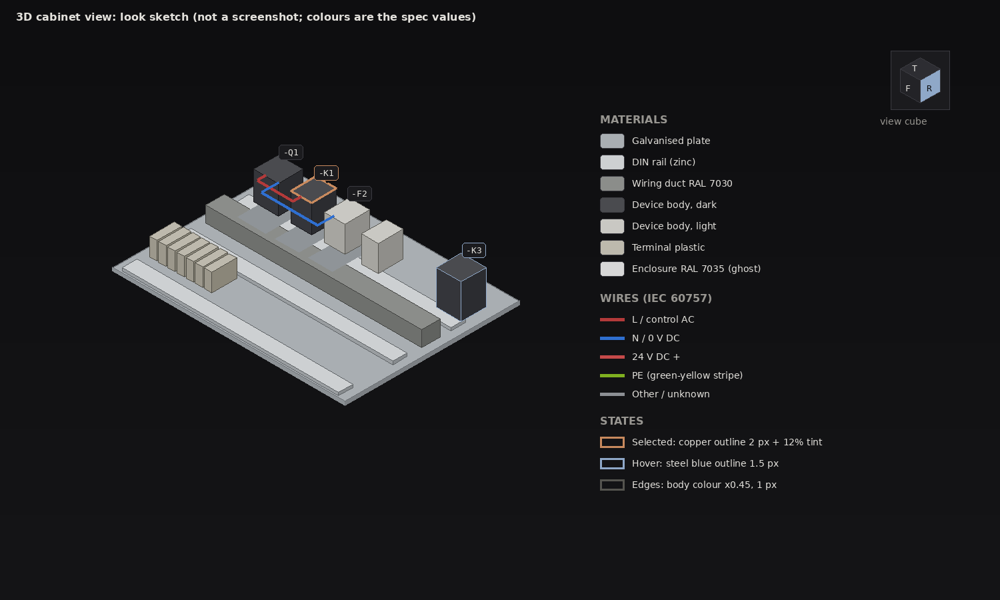

# 3D cabinet view: look and feel

How the 3D view looks and moves. Owned by the "3D view: look, materials and camera feel" thread. The
renderer, scene and crate layout are in `docs/design/3d-view.md` (architecture thread); this page only
decides what the pictures and the motion should be, and the numbers to build them with. Where the two
disagree on structure, 3d-view.md wins; where they disagree on look, this page wins.

The sketch is a hand drawn reference (`docs/design/3d-look-sketch.png`), not a render: it fixes colours,
states and proportions. Real screenshots replace it once the view exists.

## 1. Principles

1. **A drawing, not a game.** The 3D view is a technical document you can walk around. Calm light, no
   reflections, no bloom, no sky, no lens effects. A neutral grey room with one soft light.
2. **Same language as the rest of the app.** Chrome and overlays use `novo_theme::tokens` (graphite, one
   copper accent, steel blue for hover). Copper means *selected* here too and nothing else.
3. **Materials say what a thing is.** Galvanised plate, zinc rail, grey duct, dark and light plastic,
   coloured wires. A designer should recognise the panel they will build.
4. **Edges carry the shape.** A thin dark edge on every solid makes small devices readable on integrated
   graphics without expensive lighting.
5. **Cheap by construction.** Light is fixed to the world so shadows are baked once per scene change, not
   per frame, and the view redraws only when something changed.
6. **The camera never fights you.** No roll, no gimbal surprises, motion eases and can be turned off.

## 2. Lighting

| Light | Setting | Why |
| --- | --- | --- |
| Hemisphere ambient | sky `#D8DCE2`, ground `#6F6C68`, 0.55 | soft fill, no black faces |
| Key | directional, world fixed, from front left above (azimuth -35 deg, elevation 50 deg), 0.85 | shadows do not swim while orbiting |
| Camera fill | directional from the eye, slightly up, 0.25, no shadow | back views are never dark |
| Shadow | one 1024 map over the plate, PCF 3x3, softened by a 2.5 mm blur radius, depth bias tuned per scene size | soft, stable |
| Ambient occlusion | cheap contact term: devices and ducts darken the plate 0 to 35% within 6 mm of their footprint (baked into a plate texture on scene change) | grounds the parts; replaces SSAO on low tier |

Shading is Lambert plus a weak Blinn highlight (specular 0.15, power 24) for plastic and 0.35 for metal.
No image based lighting, no PBR textures. Output is the sRGB surface; shading in linear, no tone mapping,
so the token colours of overlays match exactly.

## 3. Materials

Colours are straight sRGB. `kind` names are the cabinet model's device kinds; a part's own colour wins
when it has one, otherwise the kind default.

| Thing | Colour | Spec | Notes |
| --- | --- | --- | --- |
| Mounting plate, galvanised | `#A9AEB2` | 0.35 | faint 0.5 mm procedural brushed noise |
| Mounting plate, orange | `#C9742B` | 0.10 | project setting, same shading |
| DIN rail | `#CDD0D2` | 0.35 | slot pattern drawn in geometry at close zoom only |
| Wiring duct (RAL 7030) | `#8B8D8A` | 0.10 | comb fingers as geometry, lid line as edge |
| Enclosure shell (RAL 7035) | `#D7D7D7` | 0.10 | ghost: back wall solid, other walls 12% opaque, door 8%; "Cutaway" hides them |
| Device body, dark (breakers, contactors, drives) | `#4A4B4F` | 0.15 | |
| Device body, light (relays, PSUs, controls) | `#C9C8C3` | 0.15 | |
| Terminal block | `#BDB9AD` | 0.15 | PE block gets a green and yellow stripe |
| Unsized or guessed device | `#C9C8C3` at 55%, dashed edge | 0 | same "guessed size" meaning as the 2D canvas |
| Marking tags and nameplates | `#ECEAE5` | 0 | |

Wires are tubes, 6 sides near, flat ribbons beyond 400 mm eye distance, lines beyond 1.5 m. Radius from
the cross section (1.5 mm2 radius 1.0 mm, 2.5 mm2 radius 1.3 mm, 6 mm2 radius 2.0 mm, at least 1 px on
screen). Colour follows the wire's own colour in the model, else IEC 60757 by potential: line `#B33A3A`
(AC control red, power black `#101012` when the potential says power), neutral and 0 V `#2F6FD0`, 24 V DC
`#C64A4A`, PE green with a yellow stripe (`#7FB020` over `#E3D34A`), unknown `#8C8F94`. Control AC red and 24 V DC red are close on purpose (they are both red in IEC); nobody should tell them apart by colour, the label does. Colour is never the only carrier:
the wire label (tag or number) shows on hover and in the inspector.

Colour of selection, hover and problems is **not** a material: it is drawn by the overlay pass (section 5).

## 4. Edges, anti-aliasing, quality tiers

- Edges: geometric crease edges where the face angle exceeds 35 degrees plus silhouette edges, 1 px,
  colour = base colour times 0.45 (never pure black), drawn after shading with a small depth offset.
  Silhouettes come from an inverted hull pass on the id buffer outline, so no extra geometry is needed.
- Anti-aliasing: MSAA, 4x on Standard and High, 2x on Low. Lines and tubes at distance use analytic
  coverage so thin wires do not shimmer.
- Quality tier is chosen from the adapter (`wgpu::AdapterInfo.device_type`): integrated GPU starts on
  **Low**, discrete on **Standard**. A frame governor steps down one tier when the 95th percentile frame
  time stays above 20 ms for two seconds, and never steps up on its own (no flicker); the user can pick
  a tier in settings.

  Implemented: one governor (`View3d::govern`, fed with egui's frame interval while the view moves) steps
  through a `Level`: screen-space occlusion first (discrete GPUs start with it, the others without), then the
  adapter tier (resolution while moving, MSAA, shadow map), and a hardware adapter never goes down to Software.
  One restore path, `View3d::reset_quality`: the "Restore quality" buttons, the command `view.3d_quality`, and
  switching **Occlusion** (3D toolbar Layers menu, View > 3D > Ambient occlusion) off and on again.

| Tier | MSAA | Shadow | Contact term | Edges | Wires |
| --- | --- | --- | --- | --- | --- |
| Low | 2x | none (contact term only) | baked | crease only | ribbons and lines |
| Standard | 4x | 1024 map, PCF | baked | crease and silhouette | tubes near, ribbons far |
| High | 4x | 2048 map, PCF | baked plus half resolution SSAO | all | tubes |

Budget for the integrated GPU target (Intel UHD 620 class, 1920 x 1080, 200 placed devices, 300 wires):
at most 8 ms GPU per frame, at most 300 draw calls (instance each part geometry), no per frame
allocation, no redraw while the camera is still, and scene rebuild (shadow and contact bake) under 50 ms
on edit. The renderer exposes a frame time readout in the debug HUD so this is measured, not assumed.

## 5. Selection, hover and labels

| State | Look |
| --- | --- |
| Hover | steel blue (`INFO`) outline 1.5 px, fades in over 80 ms; a tooltip card (BG_2, 6 pt corners) with tag, part number, kind and position |
| Selected | copper (`ACCENT`) outline 2 px and a 12% copper tint on the faces; the rest of the scene stays at full strength |
| Selected, focus mode (toggle, off by default) | everything else dims to 70% |
| Multi selection | each item outlined; one bounding box hint in copper at 40% |
| Problem on a device | status icon at the top corner of its label: a cross glyph in `ERROR` for an error, a bang (!) glyph in `WARNING` for a warning; never a tinted body and never colour alone |
| Proposal (not yet placed) | the 2D proposal look: steel blue at 55%, dashed edges, plus the proposal mark glyph on its label so it reads without colour |

Outlines use the object id buffer, so they cost one fullscreen pass whatever the object count.

**Labels** show the short device tag (`-K1`, drop `=plant +location`) in monospace 12 pt, as screen space
billboards anchored at the top centre of each device, on a BG_2 chip at 85% with a 1 px `BORDER_STRONG`
line (copper when selected, steel blue when hovered). A label is shown when the device is at least 28 px
wide on screen, hidden otherwise; overlaps are resolved by priority (selected, hovered, larger first) and
fade in 120 ms. Hover over a hidden label's device always shows it. Text and chip meet the app's contrast
floor (TEXT on BG_2 is above 7:1). Labels never block picking: they are not pickable, only the device is.

## 6. Camera

Axes and units are those of `docs/design/3d-view.md` section 4: millimetres, +Y up the plate, +Z out of the plate towards the door. A new view opens fitted from the front, the way the door opens.

- **Turntable orbit**, no roll: yaw free, pitch clamped to -89 to 89 degrees.
- **Projection**: perspective, 35 degree vertical field of view, the contract's `Camera` default (low distortion, reads as CAD). Orthographic
  is a toggle and is chosen automatically when a standard view (front, top, left) is entered by view cube
  or key, and left again on the first orbit.
- **Mouse**, the 2D habits: middle drag pans, Space plus left drag pans; right drag past 4 points orbits (under it, release is a plain right click and opens the context menu); Alt plus left drag orbits for trackpads; wheel zooms **to the cursor** (the world point under the pointer stays fixed;
  the point comes from the CPU pick under the pointer, falling back to the plate plane); two finger drag pans and pinch zooms where the platform reports it. Left click
  selects, left drag is a rubber band, as in the other canvases.
- **Feel**: orbit speed 0.25 degrees per pixel; wheel zoom is exponential, 12% per notch; after a drag
  release the motion keeps going with a 90 ms half life (inertia) and stops at once on any click. Pan
  speed is one screen pixel per pixel at the focus depth. Distance clamps: at least 20 mm from the
  target, at most 10 times the enclosure diagonal. The orbit pivot is the selection centre if there is a
  selection, otherwise the point under the cursor at drag start, otherwise the plate centre.
- **Animated transitions** (view cube, saved view, fit, double click to focus): 220 ms, ease out cubic,
  interpolate yaw by the shortest arc, pitch, distance and target. Any user input cancels it. When the
  system or app "reduce motion" setting is on (`device-animation.md`), transitions and inertia are off
  and the camera jumps.
- **View cube** (top right, 88 px square, margin 12 px): six labelled faces, edges and corners clickable;
  click animates to that view, dragging the cube orbits, hover lights the face in steel blue. Drawn in
  token colours (BG_2 faces, BORDER_STRONG lines), always in front of the scene.
- **Standard views**: Front, Back, Left, Right, Top, Bottom, Isometric. Home is `view.fit` exactly as in the 2D
  canvases (fit all, keeping the current direction); it is not a view of its own. Isometric lives on the view cube
  and a `view.iso` command. Fit all and fit selection use the bounding sphere plus 8% margin.
- **Saved views**: a named camera (eye, target, projection, cutaway on or off). Per user, like the other
  camera and display options (nothing 3D goes in the project file, `3d-view.md`); storing them with the project is a
  later WS-02 request (section 10). Listed in the view menu. This page names only the commands (`view.save`,
  `view.recall`, `view.fit`, `view.fit_selection`, `view.iso`, the standard views); the Workflow thread assigns every
  key, and nothing here depends on the numpad.
- **Cutaway**: one toggle hides the enclosure walls and door so the plate and parts are seen
  from any side; part of a saved view.

## 7. Themes

The scene materials are physical colours and stay the same in both themes. The theme changes only the
room and the overlays.

| | Dark (default, follows the app) | Light |
| --- | --- | --- |
| Background | vertical gradient `BG_0` `#0E0E10` to `BG_1` `#151517` | `#ECEAE6` to `#DEDCD7` |
| Ground reference (faint grid under the enclosure, 100 mm) | `#232327` | `#CFCDC8` |
| Edge colour factor | 0.45 | 0.55 (a little softer on white) |
| Label chip | `BG_2` at 85%, `TEXT` | `#FFFFFF` at 90%, `#1B1B1E` |
| Ambient intensity | 0.55 | 0.65 |

Selection copper and hover steel blue are the same in both. The light theme exists for printing and
screenshots; until the app has one, the view follows the dark theme and the palette type already carries
both so the switch is one value.

## 8. UI entry points

An engine with no UI entry is not done, so every part of the look has a place the designer reaches it. Command
names go through the command palette and keymap (`novo-workflow`); the UI integration thread places the widgets.

| What | Entry point | Command or setting |
| --- | --- | --- |
| View cube | top right of the 3D view, 88 px | click a face, edge or corner; drag to orbit; double click the cube to fit |
| Fit all, fit selection | palette, keymap, 3D toolbar | `view.fit`, `view.fit_selection` (same names as 2D) |
| Isometric | view cube corner, palette | `view.iso` |
| Standard views | view cube faces, palette | `view.front`, `view.back`, `view.left`, `view.right`, `view.top`, `view.bottom` |
| Perspective or orthographic | 3D toolbar toggle, palette | `view.projection_toggle` |
| Cutaway (hide enclosure walls and door) | 3D toolbar toggle, palette | `view.cutaway` |
| Focus mode (dim the unselected) | 3D toolbar toggle, palette | `view.focus` |
| Saved views | View menu list, palette ("View: name") | `view.save`, `view.recall`, `view.delete_saved` |
| Labels on or off | 3D toolbar toggle | `view.labels` |
| Quality tier | Settings, 3D view: Auto, Low, Standard, High (Auto is the default) | per user setting |
| Theme | follows the app; Settings, 3D view: Follow app, Dark, Light | per user setting |
| Reduce motion | follows the system; Settings, 3D view: Follow system, On, Off | per user setting |
| Frame time readout | debug HUD only | `debug.frame_time` |

Hover tooltips show tag, part number, kind and position; right click on a device opens the same context menu as
in the 2D canvases (so a right drag under 4 points must stay a click). Keys and menu placement are decided with the
workflow and layout threads; this page fixes names and what each does.

## 9. What this uses from the architecture contract

- Picking: the CPU pick of `novo-view3d` (`ItemId`, hit point and distance) gives the object under the
  pointer and the depth for zoom to cursor; outlines are drawn for items by id. No GPU id buffer.
- Instanced geometry per part so the draw call budget holds, and overlay passes (outline, labels, view cube)
  after the scene.
- `Scene::revision` and `pose_revision` as the scene change signal, so the shadow and contact bake run only on edits.
- `Look` as plain data filled by `Look::for_theme`, and the feel layer (`feel`, `cube`, `labels`, `governor`) as
  plain Rust beside `Camera`, unit tested without a window. Room and overlay colours move to the design system
  palette once it has a 3D section.

## 10. Implementation order

1. Palette and light rig data, with tests (contrast of labels, selection never uses material colours).
2. Camera: orbit, pan, zoom to cursor, transitions, standard views, saved views, with unit tests.
3. View cube geometry and hit testing.
4. Renderer passes: ambient and key light, contact bake, edges, outline, labels.
5. Quality tiers and the frame governor, measured on an integrated GPU (the governor logic and values are in `novo-view3d`).
6. Later WS-02 request: store saved views with the project.
