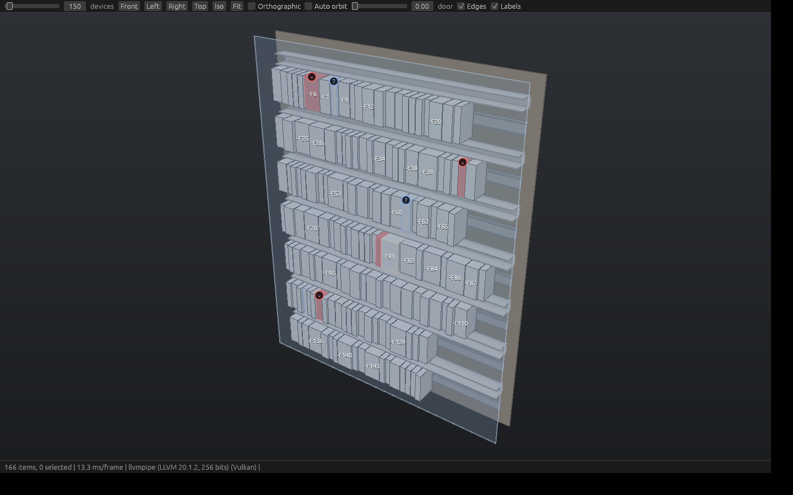

# 3D cabinet view (WS-29)

How KoperCAD draws a cabinet in 3D inside the egui/wgpu app, and the small
interface three more threads build against. This extends `docs/DESIGN.md`
(Cabinet canvas) and `docs/design/cabinet-layout.md`; where they disagree,
DESIGN.md wins. It is ranked R9 in `docs/PRO-PANEL-GAP-ANALYSIS.md`: 3D is the
presentation of the layout chain (schematic, placement, routing), never a
second place where the cabinet is edited.

Status: architecture and contract. The crate `novo-view3d` starts with the
spike that follows this document.

## 1. What the designer thinks

"Show me the panel as it will be built: does the door close, is it crowded at
the top, what does the second row look like from the left?" The questions are
answered by orbiting a clean model within a second of opening it, finding a
device by clicking it, and getting back to the 2D plate with the same
selection.

What goes wrong in other tools: the 3D view needs a gaming laptop, opening it
takes many seconds because it loads every maker mesh first, the model is a
second copy that drifts from the layout, and the fan spins while nothing moves.

Goals, in order:

1. **Instant and light.** First frame with boxes in under 200 ms, 60 frames
   per second while orbiting a cabinet of 1000 parts on an integrated GPU
   (Intel UHD 620 class) at 1920x1080, and **no GPU work while nothing moves** (one sharp frame after the camera stops).
2. **Always true.** The scene is derived from the project on every change.
   Nothing about the cabinet is stored in 3D.
3. **Elegant.** A calm technical-illustration look with crisp edges, not a
   game engine look. No reflections, no bloom, no noise.
4. **Boxes first, real shapes later.** Every part is a box of its stored width,
   height and depth. A better shape only replaces the box, it never changes
   the footprint.

Not goals now: editing in 3D, mesh-level collision, STEP rendering of whole
assemblies, ray tracing, shadows from lights, VR.

## 2. Decisions

| Question | Decision | Why, and what was left out |
| --- | --- | --- |
| Renderer | Our own small `wgpu` renderer in a new crate `novo-view3d`, using the device the app already has. | `novo-canvas` already proves the pattern. `bevy` brings its own app loop and ECS, `three-d` owns a GL context, `rend3` is unmaintained. We need about 1500 lines, not an engine. No new external crate for the spike (`wgpu`, `glam`, `bytemuck`, `egui-wgpu` are already in the workspace). |
| Where it draws | **Offscreen**: the renderer draws into its own colour and depth textures in `CallbackTrait::prepare`, and the paint callback blits the result into egui's pass. | eframe's pass has no depth buffer by default and changing that would change the 2D canvas. Offscreen also gives free resolution scaling, our own MSAA and resolve, rendering only when something changed, and rendering to an image without egui (tests, PNG for reports and the PDF). |
| Scene shape | **Flat list of items** with world transforms, plus a few hinge groups. | A cabinet is a flat set of boxes. The hierarchy (devices on a rail, parts on a door) lives in the model; the builder resolves it into world poses. One level of groups covers the door animation. |
| Instancing | Every box is one instance of one unit-cube mesh scaled by the item size. Rails are instances of a profile mesh scaled along its length. Maker meshes are instanced per distinct part. | 1000 boxes are 1 draw call plus 1 for their edges. Instance data goes in **vertex buffers**, not storage buffers, so it runs on downlevel and old integrated adapters. |
| Picking | **CPU**: ray against each item's oriented box, nearest opaque item wins (translucent door and shell only when nothing opaque is hit); a triangle test on the coarse mesh can refine this later. Marquee by projecting the boxes. | A cabinet has hundreds of items, so a linear scan costs microseconds, is deterministic and unit-testable without a GPU, and has no read-back latency. A BVH is added when a scene passes about 20 000 items. |
| Culling | CPU frustum cull of item bounds, plus a screen-size level of detail for meshes (below 24 px the box, below 3 px nothing). | Cheap, and it is the lever that keeps imported meshes from costing frames. No occlusion culling: a closed door hides the inside by drawing it. |
| Look of edges | Box and feature edges are drawn as lines over the shaded faces. | Crisp, readable and cheap, no post-process pass. |
| Labels, view cube, dimensions | Drawn with the egui painter over the 3D image, from `View3d::project`. | No text rendering in wgpu, and the labels follow the app theme and font for free. |
| Quality | Two tiers, chosen from the adapter type (`Tier`: discrete, integrated, software). **Interactive** (while the camera moves): no MSAA, render scale 1.0 on discrete, 0.75 on integrated, 0.5 on software adapters. **Settled** (a moment after input stops): full scale, 4x MSAA, one extra frame. | Fill rate is what an integrated GPU lacks, not triangles. Refine-on-settle gives a sharp still image and a smooth orbit. |
| Redraw | On demand. The view asks egui for a repaint only while the camera animates, input arrives, or the scene changes. | Idle cabinets cost nothing, so laptops stay quiet. |
| Motion | Camera transitions ease over 250 ms; with the app's reduced-motion setting they jump. | Same rule as the Live view animation (#377). |
| Dependencies at runtime | Pure Rust, no native library, no installer, no network. Works on whatever wgpu backend the app already runs (DX12 or Vulkan). | Hard requirement: no admin rights. |

## 3. Crates and boundaries

One new crate, registered by the coordinator in its own small PR (the crate
list in `CLAUDE.md` and one line in `[workspace.dependencies]`; threads do not
edit those):

| Crate | Owner | Purpose |
| --- | --- | --- |
| `novo-view3d` | WS-29 | 3D cabinet view: scene, camera, picking, culling, renderer, widget |

Layering, from the bottom:

```
novo-view3d (no model dependency)        scene types, camera, pick, cull, mesh library
   |  feature `gpu`      wgpu renderer, offscreen, shaders
   |  feature `egui`     View3d widget and paint callback (implies gpu)
   |  feature `model`    scene builder from novo-core + novo-layout (the only place that reads the project)
   |  feature `import`   part geometry import (STEP / generic shapes) into MeshData
novo-app                                  hosts the widget as a face of the Cabinet canvas; owns selection sync and commands
```

Rules:

- The scene, camera, picking and culling are plain Rust with no `wgpu` and no
  `novo-core`. They are unit-tested headless and are usable from the CLI.
- Only the `model` feature reads the project, and only through queries
  (`novo_layout::model::load`, `device_size`, the placement and rail records).
  Nothing in `novo-view3d` changes the project; a click gives an `ItemId`, and
  `novo-app` turns it into a selection or a command, like on the 2D canvas.
- Only WS-02 changes `novo-core`. The 3D thread asks (enclosure interior,
  door, mounting surface) are listed in section 9.
- Nothing 3D is saved in the `.novo` file. Camera and display options are a
  per-user setting.

## 4. Coordinates

Millimetres, right-handed, **+X right across the plate, +Y up the plate, +Z out
of the plate towards the door.** The plate's front surface is `z = 0` and its
lower left corner is the origin.

The 2D plate of `cabinet-layout.md` has the origin top left with y down.
`PlateFrame` is the one conversion, used by every builder:

```rust
pub struct PlateFrame { pub width: f32, pub height: f32 }   // the mounting plate, mm (not the enclosure)
impl PlateFrame {
    /// 2D plate point (x right, y down) and height above the plate (z).
    pub fn world(&self, x: f64, y: f64, z: f64) -> Vec3 { Vec3::new(x as f32, self.height - y as f32, z as f32) }
}
```

An item's local box is `x in [-sx/2, sx/2]`, `y in [-sy/2, sy/2]`,
`z in [0, sz]`: the origin is the **middle of the back face**, the face that
touches the surface it is mounted on. `pose.translation` is where that point
sits in the world. A 2D placement rectangle (already swapped when rotated)
gives `translation = world(rect centre, mount height)`, and `rotated` is a
turn of -90 degrees about +Z (clockwise as seen from the door), so a
non-symmetric maker mesh turns the way R turns the 2D symbol.

**The footprint wins.** `size` always comes from the stored part width, height
and depth (or the guessed default, marked). An imported mesh is fitted into
that box; if its own bounds differ by more than 2 mm the scene builder flags
the item `Mark::GeometryMismatch` instead of drawing outside the footprint.

## 5. The scene contract (what siblings build against)

These types are the whole interface between the threads. They live in
`novo-view3d::scene` and `novo-view3d::mesh`, are `#[non_exhaustive]` where they
may grow, and carry `CONTRACT_VERSION` (starts at 1). A change to them is a
change to this section in the same pull request.

```rust
/// Stable identity of a thing in the scene. `raw` is the model's raw id, so a
/// click maps back to the model. novo-layout's ids are unique across kinds; the
/// key is still `(kind, raw)`, so a clash could never select the wrong kind, and
/// the builder asserts that ids are unique in the scene.
pub struct ItemId { pub kind: ItemKind, pub raw: u64 }

#[non_exhaustive]
pub enum ItemKind { Enclosure, Plate, Rail, Duct, Device, Door, Wire, Other }

pub struct Pose { pub translation: Vec3, pub rotation: Quat }   // world, mm

#[non_exhaustive]
pub enum Shape {
    /// Fills `Item::size`.
    Box,
    /// A rail or duct section extruded along local X; `size.x` is the length.
    /// The section is drawn at its real size in mm (`size.y`, `size.z` are its
    /// width and height, used for picking and, for `Channel`, for the shape).
    Profile(Profile),
    /// Maker or generated geometry from the `MeshLibrary`. Drawn as a box
    /// until the library has it, so the view never waits.
    Part(GeometryKey),
    // Meshes are authored in the item's local frame, centred in x and y and
    // starting at z = 0. The renderer scales each axis by size / lod.bounds.size,
    // so the footprint wins whatever the mesh measures.
}

#[non_exhaustive]
pub enum Mark { None, Collision, TooClose, Outside, GuessedSize, GeometryMismatch }

pub struct Item {
    pub id: ItemId,
    pub shape: Shape,
    pub pose: Pose,
    pub size: Vec3,                 // mm, extents of the local box
    pub tint: Option<[u8; 3]>,      // maker colour, if the part has one
    pub mark: Mark,                 // set by the builder from novo-layout queries
    pub label: Option<Arc<str>>,    // "-K1", shown by the overlay
    pub translucent: bool,          // doors, covers
    pub group: Option<GroupId>,
}

/// A hinge: its items rotate by `angle` about `axis` through `pivot`.
pub struct Group { pub id: GroupId, pub pivot: Vec3, pub axis: Vec3, pub angle: f32 }

/// A wire or cable path in world mm, drawn as a thin tube. Wires are not boxes,
/// so they live beside the items; their id has kind `ItemKind::Wire`.
pub struct Wire { pub id: ItemId, pub points: Vec<Vec3>, pub radius: f32,
                  pub tint: Option<[u8; 3]>, pub mark: Mark, pub label: Option<Arc<str>> }

pub struct Scene {
    pub frame: PlateFrame,
    pub items: Vec<Item>,
    pub wires: Vec<Wire>,
    pub groups: Vec<Group>,
    /// Bumped by the builder when items change; the renderer re-uploads on a change.
    pub revision: u64,
    /// Bumped when only group angles change (door animation).
    pub pose_revision: u64,
}
impl Scene {
    pub fn bounds(&self) -> Aabb;
    pub fn get(&self, id: ItemId) -> Option<&Item>;
}

// -- geometry (section 7) --
pub struct GeometryKey(pub u64);          // hash of the part id and source file hash
pub struct MeshData {                     // indexed triangles in the item's local frame
    pub positions: Vec<[f32; 3]>, pub normals: Vec<[f32; 3]>,
    pub indices: Vec<u32>,
    pub edges: Vec<[u32; 2]>,             // feature edges (creases over about 30 degrees)
    pub bounds: Aabb,
}
pub struct PartGeometry { pub lods: Vec<MeshData> }  // lods[0] detailed ... last is cheapest
pub struct MeshLibrary { /* insert(key, PartGeometry), get(key) */ }

// -- what the user is doing, kept outside the scene --
pub struct ViewState {
    pub selection: BTreeSet<ItemId>,
    pub hover: Option<ItemId>,
    pub hidden: BTreeSet<ItemKind>,        // layer switches: hide the door, the shell, wires
    pub display: Display,                  // edges, labels, projection, quality override
}
```

Flows:

- **Project to scene** (scene-model thread): `build::scene(project, structure, &Options) -> Scene`. Pure; called when the project revision or the Cabinet's panel changes. A full rebuild is fine up to a few thousand items (a few hundred microseconds); incremental diffing is a later optimisation behind the same function.
- **Scene to pixels** (this thread): `Renderer` reads `Scene`, `ViewState`, `Camera`, `MeshLibrary` and `Look`. It never mutates them.
- **Pixels to model** (this thread and `novo-app`): `View3d::show` returns `View3dOutput { hover, clicked: Option<(ItemId, Modifiers)>, marquee: Option<Vec<ItemId>>, camera_changed, plate_point: Option<(f64, f64)> }`. `plate_point` is the 2D plate position under the pointer (from the ray through the plate plane), ready for a later "drag in 3D". `novo-app` maps `ItemId` to a selection through the same path as the 2D Cabinet canvas, and the other way round (selection in the 2D canvas or the Devices drawer arrives as `ViewState::selection`).
- **Geometry to library** (geometry thread): implements `GeometryProvider`.

```rust
pub trait GeometryProvider {
    /// Cheap, never blocks. `Pending` while a background job runs; the view asks again after `ready_signal`.
    fn geometry(&self, key: GeometryKey) -> GeometryState;
}
pub enum GeometryState { None, Pending, Ready(Arc<PartGeometry>), Failed(String) }
```

- **Look** (visual design thread): `Look` is a plain data struct of colours and constants, rebuilt whenever the app theme changes (no function pointers, so a theme can fill it from its own state), and the only thing that decides how things look. The renderer has no colour literals.

```rust
pub struct Look {
    pub background: [Color; 2],                 // top and bottom, behind the cabinet
    pub surfaces: [SurfaceStyle; ItemKind::COUNT], // by ItemKind::index: colour, edge colour, alpha
    pub marks: [MarkStyle; Mark::COUNT],           // by Mark::index: tint, edge colour and glyph
    pub selection: Highlight, pub hover: Highlight, pub related: Highlight,
    pub light: Vec3, pub ambient: f32,          // one directional light and a hemisphere term
    pub ground_shadow: f32,                     // soft contact shadow under the plate, 0 = off
}
```

**Marks never rely on colour alone** (the same colour-blind rule as the 2D
marks). Every `Mark` other than `None` also draws a glyph at the item, a cross
for a collision or a device outside the plate (as in the 2D Cabinet), a bang for
too close and mismatch, a dashed edge for a guessed size, drawn by the overlay from `MarkStyle::glyph`, so a red and an
amber tint are never the only difference.

### Decisions after the first reviews (2026-10-15)

- **Who owns which types.** `novo-view3d` owns every scene type above. The
  scene-model thread's code becomes `novo-view3d::build` (feature `model`),
  `build::scene(project, structure, &Options) -> Scene`; it keeps no second set
  of types and its `scene::diff` goes away, because a full rebuild is cheap and
  `Scene::revision` is the change signal. Its defaults become `Options`: rail
  35 x 7.5 mm, devices on a rail start at z = 7.5, unknown device depth 60 mm
  (`Mark::GuessedSize`), unknown duct section 40 x 60 mm, enclosure depth 250 mm
  until R2 gives real fields.
- **Wires** are `Scene::wires` (polylines with a radius), not items, because
  they are not boxes. They are selectable like items (kind `Wire`). The
  renderer draws every segment as one thin box instance (`wire.rs`, culled and
  skipped below 3 px), and picking and marquee test the same boxes, with a
  minimum pick radius of 1.5 mm so a 1 mm wire stays clickable.
- **How meshes reach the renderer.** STEP parsing lives in `novo-interop`,
  which returns its own neutral triangle mesh and knows nothing of 3D.
  `novo-view3d::geometry` (feature `import`) calls it, fits and reduces the
  result into `MeshData` LODs, and implements `GeometryProvider`. The renderer
  only ever sees `MeshLibrary`. Nothing starts a STEP importer before the owner
  has decided that maker meshes are wanted (section 12).
- **Look and renderer split.** The look thread owns GPU-free data and logic:
  palette, light numbers, quality tiers, view cube, label layout and highlight
  fades. This thread owns wgpu and applies those values as uniforms. What the
  look thread asked for is answered without new GPU work: an object id per
  selectable is the `ItemId` of a CPU pick; a depth at a pixel is the hit
  distance and point of the same pick; the scene-changed signal is
  `Scene::revision` and `pose_revision`. A GPU id buffer or depth read-back is
  not built unless a CPU pick proves too slow.

### Overlays and the door (2026-10-16)

- **Overlays** (`overlay.rs`, `View3d::set_overlays`) are coloured geometry the
  host draws over the cabinet: `OverlayMesh` (triangles with a colour per
  vertex, shaded flat from the triangle itself, `translucent` flag, `order`
  key) and `OverlayLines` (polylines of constant pixel width, drawn as
  screen-space ribbons). Positions are in the scene frame, millimetres. They
  are not scene items: picking, marquee, labels and the camera fit ignore
  them. Opaque meshes are drawn after the opaque scene and write depth;
  translucent meshes and lines are drawn last, low `order` first, depth test
  on, depth write off. The list is replaced as a whole and uploaded only when
  it changes; an empty list clears. The heat layer (novo-heatview, CFD-F
  thread) is the first user. Limits: 4 million vertices per overlay; invalid
  overlays are skipped, never drawn half.
- **Door animation** (`door.rs`, `View3d::set_door`) eases a hinge group's
  angle in 0.5 s (jump with reduced motion). The angle is view state: the
  widget draws a copy of the scene with the animated angle, the project is not
  touched and the angle survives scene rebuilds. `door::open_angle` gives the
  signed angle for "open by N degrees" for either hinge side.

### Layers, wires and the door control (2026-10-16)

- **The enclosure's own shell.** `build::model::shell` takes the depth (from
  the plate surface to the inside of the door: interior depth minus plate
  setback), the hinge side and the door from the enclosure the Cabinet stores;
  an enclosure without an interior keeps the default shell, one with an
  interior and no door is drawn without a door. `model::door_limit_deg` is how
  far its door opens (0 to 180).
- **Wires.** `model::wires` turns the Cabinet's routes (`novo-routing`, the
  same call as the wire list and the Cabinet's route overlay) into
  `WireInput`s with the wire's drawn diameter; `model::options` bundles shell
  and wires. Wires in free air carry the Outside mark.
- **Layers** (`layers.rs`): enclosure, door and wires, all on by default.
  `Layers::apply` filters a built scene (item order and ids of what stays are
  unchanged); the host rebuilds the scene when the layers change, and skips
  routing while the wires layer is off.
- **Host controls** (`novo-app`, `view3d_controls.rs`): a toolbar in the top
  left of the 3D face with the three layer toggles (ticked, never colour only),
  an Open/Close door button and a door angle slider up to the enclosure's
  limit. Commands `view.3d_door`, `view.3d_shell`, `view.3d_wires` (View > 3D,
  palette, Dutch names), keys Ctrl+6 for the 3D workspace and Shift+D for the
  door. The door angle is view state and eases through `View3d::set_door`.

### Wire colours (2026-10-16)

- **Where the colour comes from.** `model::wire_colour` reads the wire's own
  colour (the Colour field of the wire panel), else the name of its cable core
  when that is a colour code, and parses it with the standards checks' colour
  reader (`novo_checks::standards::Colour`: `BK`, `black`, `GNYE`, Dutch and
  German names), so the 3D view and the checks never disagree on what a text
  means. `model::insulation` gives the drawn colour; the palette's red, blue and
  green-yellow are the ones of 3d-look.md section 3.
- **Bi-colour wires.** `Wire.stripe` is a second colour; the renderer draws
  the tube in bands of about six radii alternating body and stripe colour,
  only while a segment is at least 12 px on screen (farther away it is the body
  colour, which also keeps the instance count down). Green-yellow is the
  protective conductor, white with a blue stripe the grounded dc one.
- **No colour set.** The wire stays the neutral grey of 3d-look.md. The spec's
  colour by potential (AC control red, neutral blue, 24 V red, PE green-yellow
  when the potential says so) is not done: it needs the potential's role from
  the editor, which the model does not store yet. A colour is never the only
  carrier: the label and the inspector name the wire.
- **Seen through the closed door.** The door and the enclosure are ghosts
  (translucent), wires and ducts are opaque and drawn first, so wires show with
  the door closed; a GPU test renders a blue wire behind the closed door and
  counts its pixels, and a second one checks that a bi-colour wire shows both
  colours.

### Dimensions and the frame governor (2026-10-16)

- **Dimensions** (`dimension.rs`, GPU free; painted by `widget`). Off by
  default; toolbar toggle "Dimensions", command `view.3d_dimensions`
  (View > 3D, palette "dimensions" or "measure", Dutch "maatvoering", also in
  the right-click menu of the 3D view). With nothing selected the
  enclosure's overall width, height and depth (its shell, else the plate) are
  drawn standing off the box. With exactly one part selected (device, rail,
  duct) its width, height and depth are added, and the clear distance to the
  nearest neighbour on each of the four sides, or to the plate edge when
  nothing is there. Distances are along the plate and in millimetres, written
  with one decimal only when needed (`50 mm`, `54.5 mm`): what a hand-drilled
  layout needs. Touching parts have no line; several selected parts add no
  part lines (a distance needs one part). Lines too short on screen to carry
  their text are left out and appear when zoomed in. Colour: overall muted, part
  size in the text colour, distances in the selection blue; the text is on a
  chip, never colour alone.
- **Frame governor connected** (`governor.rs` is now generic over the tier
  type). While the view moves, the widget feeds each frame interval to a
  governor on the adapter's `render::Tier`; when the 95th percentile stays over
  20 ms for two seconds it steps Discrete to Integrated to Software (less
  resolution while moving, no MSAA on software, no shadow map there) and never
  steps up by itself. Idle intervals are not counted (an idle view repaints
  rarely). The statistics panel says "quality stepped down to ..." when it did
  and `View3d::reset_quality` starts again from the adapter's tier. The tier
  steps are the renderer's existing ones (`Quality::new`), not the palette's
  `QualityTier`, which stays unused until the renderer has more than two
  settings to move.

## 6. Camera and input

Turntable orbit around a target point, +Y up, so the cabinet never rolls.

```rust
pub struct Camera {
    pub target: Vec3, pub yaw: f32, pub pitch: f32, pub distance: f32,
    pub fov_y: f32,                 // radians, 35 degrees default
    pub projection: Projection,     // Perspective | Orthographic
}
```

- `fit(bounds, aspect)` frames the whole panel (key **F**), `fit_selection` frames the selected items.
- Presets from a view cube drawn by the overlay: Front (looks at the plate), Back, Left, Right, Top, Bottom, Iso. Clicking one eases the camera there. The view cube, **F** and **Home** are all the keys 3D needs; there is no numpad dependency (laptops). Home stays `view.fit`, as on the 2D canvas. Iso is a corner of the view cube and the command `view.iso` in the command surface; a key for it is the Workflow thread's to assign.
- Near and far planes are computed each frame from the scene bounds and the camera, with **reversed-Z** and a `Depth32Float` buffer, so a 2.4 m cabinet seen from 30 cm has no z-fighting between a rail and the plate.
- Pitch is clamped to +-89 degrees. Distance is clamped so the camera cannot enter the model by accident.

Input, matching the 2D canvas (`DESIGN.md` Keys: middle drag pans, Space held and dragged pans):

| Input | Action |
| --- | --- |
| Right drag beyond 4 px, or Alt + left drag | Orbit around the target. A short right press (under 4 px) still opens the context menu, exactly as on the 2D canvas |
| Middle drag, or Space held and left drag | Pan |
| Wheel | Zoom towards the point under the pointer (the ray hit, else the plate plane, else the target) |
| Left click | Select the nearest item under the pointer; Shift adds, Ctrl toggles; clicking empty space clears |
| Left drag on empty space | Marquee select |
| Alt + click | Select the deepest item under the pointer (the plate, or the rail under a device), ignoring everything in front of it; repeating Alt + click at the same spot steps back up through the items in front, one per click |
| Double click on an item | Fit it |
| F / Home | `view.fit`: fit the selection (or the panel when nothing is selected) / fit the whole panel |
| Esc | The Escape ladder, below |

**Escape ladder** (the same ladder as the 2D canvas, `DESIGN.md` Keys): cancel the
gesture in progress (a drag, a marquee), then close the context menu or
popup, then clear the selection. Esc never leaves the 3D face; switching face
is the Plate / Cabinet switch or its command.

Keys are routed by `novo-app` exactly like the 2D Cabinet canvas (ignored while
the palette or a text field has the keyboard). Zoom and pan scale with the
distance, so a wheel step feels the same on a 600 mm plate and a 2400 mm row.

## 7. Geometry: boxes now, meshes later

Three levels, each a drop-in for the one before:

1. **Box** (now). Unit cube scaled to `size`. A part with no depth gets the
   default depth of a device of that kind (builder table), marked
   `GuessedSize`.
2. **Generated shapes** (visual design and geometry threads). Procedural
   profiles that look right at a glance: the hat-profile DIN rail, the slotted
   duct, a stepped breaker front with its toggle, a terminal block with its
   screw heads. These are `MeshData` made in code from the stored size, so they
   cost no files and always match the footprint.
3. **Maker meshes** (geometry thread, optional, later). STEP read and
   tessellated by a pure Rust importer, reduced to LODs, cached under the
   user's profile (`%LOCALAPPDATA%\KoperCAD`) keyed by the SHA-256 of the file
   (the same record `novo-parts` keeps for its library), and fitted to the
   footprint. Import runs on a background thread; the view shows the box until
   `Ready` and never blocks a frame.

Budgets the geometry thread must meet: 2000 triangles for `lods[0]` of a
device, 300 for `lods[1]`, 12 for the last (the box); 1.5 million triangles for
a scene in total (the renderer drops detail before it exceeds this); an import
that does not finish in 10 s is reported as `Failed`, never retried silently.
No native library may be required (nothing that needs an installer or admin
rights); a geometry crate with a C or C++ build step is not acceptable.

## 8. Performance contract

Measured on the spike and kept in the section "Measured" at the end of this
file. A pull request that makes any row worse says so.

| Scenario | Budget |
| --- | --- |
| 1000 boxes + 200 rail/duct profiles, orbiting, 1920x1080, UHD 620 class | 60 fps, GPU frame at most 8 ms |
| CPU per frame for that scene (cull, instance write, draw encode) | at most 0.5 ms |
| Scene rebuild from the project for 1000 devices | at most 2 ms |
| Camera idle | 0 frames submitted; one settled frame after input stops and one if the adaptive scale changes |
| First frame after switching to the 3D face (boxes) | under 200 ms |
| GPU memory, 1000 items, no maker meshes | under 64 MB |

Design consequences:

- A box is 12 triangles, so triangle count is never the cost; fill rate is.
  Hence interactive scale, MSAA only when settled, one cheap fragment shader
  (hemisphere light, one directional term, edge line from a barycentric trick),
  no per-fragment texture reads except the final blit.
- No compute shaders, no storage buffers, no timestamp queries are required.
  Features such as timestamp queries are used only to measure, when present.
- The renderer clamps the offscreen size to the adapter's
  `max_texture_dimension_2d` and halves the scale again when a frame takes more
  than 20 ms for three frames in a row (adaptive scale, back up when it is
  stable under 10 ms).
- If there is no usable adapter, or the device is lost, the face shows the same
  notice the 2D canvas shows and the app keeps working.

## 9. Work split

Four threads, one module tree each, so pull requests do not touch the same
files. `lib.rs` re-exports are the only shared lines; add yours in a line of
your own to keep conflicts trivial.

| Thread | Owns | Delivers | Needs from others |
| --- | --- | --- | --- |
| **Renderer and architecture** (this thread, WS-29) | `scene`, `camera`, `pick`, `cull`, `view_state`, `render/`, `widget`, `docs/design/3d-view.md`, the perf example | The crate, the contract, the renderer, the widget, the app face (thin) behind a flag, measured budgets | Nothing |
| **Scene model** | `build/` (feature `model`) | `build::scene(project, structure, &Options) -> Scene`: enclosure shell and plate, rails and ducts with correct profiles and heights, devices with `size`, rotation, marks from `novo_layout` collisions and clearance, labels from tags, the door as a hinge group once WS-02 stores it | WS-02 for enclosure interior, plate setback, door hinge side and opening angle (R2 in the gap analysis); until then the shell is omitted and the plate size is used |
| **Part geometry** | `geometry/` (feature `import`) | `GeometryProvider`, generated shapes for common kinds, STEP-to-`MeshData` import with LODs and the on-disk cache, a size check against the stored footprint | `novo-parts` `step_box` (#356) for bounds; a decision from the owner whether maker meshes are wanted at all (box and generated shapes may be enough) |
| **Visual design** | `look.rs`, the WGSL colour and edge functions behind a stable shader interface, the overlay (labels, view cube, selection chips) in `novo-app` styling | `Look` values for dark and light themes, mark colours that stay readable for colour-blind users (same rule as the 2D marks), the view cube, the empty state, screenshots in `docs/design/` | `novo-theme` tokens; a headless render of the spike scene to judge changes |

Interface changes go to the owner of the section in this file. Anything a
sibling needs from the renderer that the contract does not offer is asked for in
the pull request description and added to section 5 by this thread.

## 10. Test plan

- **Headless unit tests** (no GPU): camera matrices and `fit`, orbit and pan
  limits, zoom-to-cursor keeps the point fixed, ray and box hits including a
  rotated box, marquee on a projected box, frustum culling, `PlateFrame`
  round trip, scene builder against a small fixture project (positions match
  the 2D footprints, marks match `collisions`).
- **GPU smoke and image tests** on whatever adapter exists (software included):
  render the fixture scene to an image, check that a known box covers the
  expected pixels and that selection changes a known edge colour. They skip
  with a note when no adapter exists, like `novo-canvas`' `gpu` tests.
- **Perf example** `cargo run --release -p novo-view3d --example orbit -- --items 1000`
  prints CPU ms per frame and wall frame time per frame over a scripted orbit,
  with and without MSAA, so the budgets in section 8 are checked by a command
  and not by a feeling.
- **Hands-on**: the owner orbits a real project on his Windows laptop; the
  builds are dispatched by the Release thread when he asks.

## 11. Steps

1. This document (merged first, so the siblings can start from section 5).
2. `novo-view3d` crate: scene, camera, pick, cull with tests; no GPU.
3. Renderer spike: box-extruded plate, rails and devices orbiting at a steady
   frame rate in an example window, plus an offscreen image path; measured
   numbers into section "Measured".
4. egui widget and the `View3d` output, hosted as a face of the Cabinet canvas
   in `novo-app` behind a flag (no menu entry until hands-on tested).
5. Siblings land `build/`, `geometry/`, `look.rs` against the contract.
6. Door, hidden layers, wires from `novo-routing`, labels, dimensions.

## 12. Open questions for the owner

- **Where it lives in the window (the UI entry point).** A third face of the
  Cabinet canvas: the face switch reads Plate / Table / 3D, and the command
  `cabinet.view3d` in the command surface opens it; `view.fit` (Home, F) and
  `view.iso` work inside it. No menu entry until hands-on tested. A key is for
  the Workflow thread to assign, since Ctrl+1 to Ctrl+5 and Ctrl+T are taken.
  The host side (the face, the install call, selection sync) belongs to the
  "UI integration: cabinet, 3D, enclosure" thread; this crate gives it
  `widget::install`, `View3d::new` and `View3d::show`.
- **Are maker meshes wanted?** Box plus generated shapes is a day-one look
  that is accurate to the footprint. Real meshes cost an importer, a cache and
  a larger file budget. The geometry thread's first deliverable settles it
  with screenshots of both.
- **Door open and closed** needs the door, hinge side and opening angle in the
  model (R2), which is WS-02's call.

## Measured



From the spike (`orbit` example, 2026-10-15). This container has no GPU, so the
adapter is **llvmpipe**, a software Vulkan rasteriser on 4 CPU cores: the CPU
column is the cost of the renderer itself and is valid anywhere; the wall
column is the whole frame rasterised on the CPU, which an integrated GPU should
beat. A run on the owner's Windows laptop is still the check for the GPU
budgets in section 8.

`cargo run --release -p novo-view3d --features gpu --example orbit -- --items N --size 1920x1080 --scale 1.0`

| Scene | Items | Draw calls | Triangles | CPU ms/frame p50 (p95) | llvmpipe wall ms p50 (p95) |
| --- | --- | --- | --- | --- | --- |
| 150 devices | 166 | 11 | 2 500 | 0.05 (0.08) | 9.2 (17.4) |
| 1000 devices | 1016 | 11 | 12 700 | 0.18 (0.24) | 12.0 (17.6) |
| 3000 devices | 3016 | 11 | 36 700 | 0.45 (0.59) | 16.2 (20.8) |
| 1000 devices, 4x MSAA (settled) | 1016 | 11 | 12 700 | 0.24 (0.34) | 37.8 (49.9) |

- Draw calls stay at 11 whatever the device count: the boxes are instanced, so
  the CPU cost grows only with the instance copy (0.18 ms for 1000 items,
  inside the 0.5 ms budget up to 3000).
- Even rasterised in software at full 1080p scale, 1000 devices orbit at 83
  frames per second without MSAA. MSAA 4x on software costs three times as
  much, which is why it is kept for the settled frame.
- In the egui window (`window --items 1000 --bench 6`, 1400x860, interactive
  tier at scale 0.5 on software, vsync off) the whole app, egui included, ran
  at 35 frames per second on the CPU alone.
- Not measured here: GPU time on real hardware, memory.

### With wires, and what a scene rebuild costs (2026-10-16)

Same container (4 cores, llvmpipe), `orbit` with the new `--wires N` (the demo
runs N wires up from a device into its duct, along it and down to another
device, in six colours), 1920x1080, `--scale 1.0`, 150 to 200 frames. The CPU
column is stable between runs; the wall column is a software rasteriser that
shares four cores with whatever else the container runs and moved by about a
third between runs, so it is given as the range of three runs.

| Scene | Items, wires | Triangles | CPU ms/frame p50 (p95) | llvmpipe wall ms p50 |
| --- | --- | --- | --- | --- |
| 1000 devices | 1016, 0 | 12 700 | 0.23 (0.33) | 16.8 to 20.3 |
| 1000 devices, 300 wires | 1016, 298 | 23 400 | 0.33 (0.45) | 20.7 to 30.9 |
| 3000 devices, 1000 wires | 3016, 998 | 65 600 | 0.86 (1.20) | 34.8 |
| 1000 devices, 300 wires, interactive tier (half size) | 1016, 298 | 22 800 | 0.28 (0.48) | 14.6 |
| 1000 devices, 300 wires, settled (4x MSAA, full size) | 1016, 298 | 23 400 | 0.33 (0.43) | 56.4 |

- 300 wires add about 0.1 ms of CPU and 11 000 triangles; the draw calls stay
  at 11 because a wire segment is an instance of the box mesh. A bi-colour
  wire is cut into bands, so it costs more instances than a plain one, but only
  while a segment is at least 12 px on screen.
- The first frame takes 41 to 78 ms on software (pipelines and buffers are
  made in it), 128 ms for the settled frame with MSAA. It is the cost of
  opening the 3D workspace the first time; later frames do not pay it.
- CPU cost is far inside the 0.5 ms budget up to 3000 devices and 1000 wires
  except the 3000 and 1000 row, which is 0.86 ms: the instance build grows
  with the item count, so the next lever is culling by distance before the
  instance copy (not needed at today's sizes).
- Scene rebuild (`model::scene`) and routing are measured by the app itself,
  see the panel below; the renderer's benchmark does not include them.

### Measuring on your own machine

View > 3D > Show or hide the 3D frame statistics (palette: "frame rate" or
"fps"; Dutch "framesnelheid") opens a panel in the bottom left of the 3D view:

```
KoperCAD 3D frame statistics
GPU: <adapter> (<Dx12|Vulkan|...>, <Discrete|Integrated|Software>)
Frame interval: 16.7 ms median, 18.2 ms 95th percentile, 60 fps (240 frames)
Renderer CPU: 0.40 ms median, 0.62 ms 95th percentile
Drawn: 1016 items, 11 draw calls, 23424 triangles, 1920 x 1080 px, MSAA 1
Scene build: 3.2 ms, routing 41.0 ms
```

"Spin the view" turns the camera steadily (a turn in 12 seconds) so every frame
is a moving one and the frame interval means something; "Copy" puts the lines
on the clipboard to paste into a message. The frame interval is the time
between two frames of the whole app, so it includes the GPU and the display's
refresh: on a 60 Hz screen it cannot go under 16.7 ms, and the pass condition
is a 95th percentile that stays at or under 20 ms (the budget in section 8).
The renderer CPU line is the cost of the renderer itself; GPU time alone is not
measured (it needs timestamp queries, which eframe's device does not request).

What to run on the Windows laptop, with a project that has the real cabinet:

1. Open the project, View > Workspace > 3D, open the statistics.
2. Spin for about ten seconds and copy the lines: the integrated GPU case.
3. Turn Wires off and on (toolbar) and copy again: what the wires cost.
4. Maximise the window and copy again: the 1080p case of section 8.
5. Rebuild the scene by changing something in the Cabinet and look at "Scene
   build": routing is the slow part and runs on a change, not per frame.
6. If the interval p95 is over 20 ms, say which adapter and whether the
   laptop was on battery. The frame governor steps the quality tier down by
   itself after two seconds over budget (see "Dimensions and the frame
   governor"); the panel names the tier it stepped down to.

