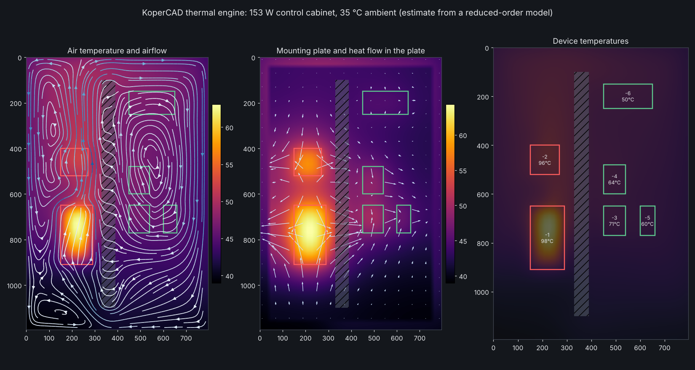

# Thermal and airflow simulation

Goes beyond the heat marks of `docs/design/thermal.md` (R3, #406): a physical
model of the enclosure interior that answers *where does the heat go, how hot
does each device get, and what would fix it*. Engine: new crate `novo-thermal`
(pure functions, plain numbers, no UI). Drawing it is the "Thermal simulation:
visuals" thread; the types it reads are `src/model.rs` and `src/result.rs`.

## 1. Honest scope: model, not CFD

This is a **reduced-order model**. It is physically grounded and its energy
balance closes, but it is not a CFD solver and says so next to every result.

| Is modelled | Is not modelled |
| --- | --- |
| Device losses into air and mounting plate | Turbulence structure, jets, wakes, separation |
| Conduction sideways in the plate | Exact 3D geometry; heat sinks and fins of a device |
| Wall heat loss by the IEC 60890 coefficient and effective surface | Solar load, wind, radiation between hot parts in detail |
| Buoyancy driven circulation, stack effect through vents | Re-circulation of exhaust air outside the enclosure |
| Fans (straight line curve), vents (orifice law), clutter and ducts as drag | Dust, filters clogging, condensation |
| Steady state and transient (heat-up, load steps) | Anything that depends on wire bundle layout |

Because of that every output carries an **uncertainty band**: the run is
repeated at the favourable and the unfavourable end of the stated
assumptions (`Params::cooling_favourable/unfavourable`: clutter drag, mixing,
plate-to-air coefficient, contact, radiation, wall k). A device is `Ok` only
when it stays within its limit even at the pessimistic end. The assumptions
and their ranges are returned in the result and shown to the user.

## 2. The model

A **2D slice**: the interior as seen from the front, gravity along +y, depth
averaged. Cells are about 20 mm. Three kinds of unknown:

- **Air temperature** `Ta` in every cell.
- **Plate temperature** `Tp` in cells the mounting plate covers.
- **Device temperature** `Td`, one node per device.

### 2.1 Heat paths

- Device: `P = Ga (Td - Ta) + Gp (Td - Tp)`. `Ga = h A` over the exposed
  surface (footprint plus sides to the device height), `h = h_conv + h_rad`:
  natural convection on a vertical plate (Churchill and Chu), forced
  convection on a flat plate (`Nu = 0.664 Re^1/2 Pr^1/3`) combined as
  `(hn^3 + hf^3)^(1/3)`, radiation `4 eps sigma T^3 F`. `Gp = h_contact A`.
- Plate: conduction `k t` sideways (sheet steel 50 W/mK, 2.5 mm: a spreading
  length of about 0.15 m, so it matters), exchange `h_in` with the air, and a
  path to the outside through the rear wall chosen so that, with no sideways
  flow, plate plus rear wall give exactly the IEC rear coefficient.
- Walls: each face loses `k b A (Ta - Tamb)`, with `k` of the material and `b`
  the IEC 60890 surface factor, **the same constants as `novo_layout::sizing`**
  (#402). Summed over a well mixed enclosure this is exactly the sizing
  estimate `Pv / (k Ae)`, which is the first validation.
- Air: advection `rho cp Q T` (upwind), conduction plus unresolved mixing
  `D = k_air + rho cp (mixing + 0.05 |u| l)`.

### 2.2 Airflow: a porous-medium flow field

Velocity from a pressure field, `u = -(grad p - b) / r(|u|)`:

- `b = rho g beta (T - Tamb)` is the buoyancy force (screen: warm air goes
  up). Referenced to the outside air so vents at different heights give the
  **stack effect** without special code.
- `r = 12 mu / d^2 + rho c |u|`: laminar gap friction plus quadratic drag.
  `c` = clutter drag per metre (default 1.5 /m, range 0.75 to 3) plus form
  drag of obstacles from their blockage `beta`: `zeta = 1.5 (beta/(1-beta))^2`.
  Blockage above 0.98 is solid. Devices block `height / depth`; ducts 0.7
  (air passes the slots); rails 0.15.
- Continuity `div(Q) = ports`. Vents: orifice law `Q = Cd A_free sqrt(2 dp/rho)`.
  Fans: `dp = pmax (1 - Q/Qmax)`, one linear port law per fan, no reverse flow.
  Solved as a symmetric pressure equation (conjugate gradient), Picard
  iteration on the drag and the buoyancy.

This gives rising plumes above hot devices, circulation cells in a closed
cabinet, stagnant corners behind obstacles, chimney flow through a low and a
high vent, and forced flow paths from fan to outlet. Speeds are right in
order of magnitude (about 0.05 to 0.3 m/s for buoyancy) and carry the
largest uncertainty of the model; that is why the clutter drag is the first
parameter in the band.

### 2.3 Steady and transient

Steady: Picard loop flow, device coefficients, then one sparse solve
(BiCGSTAB) of the coupled temperature system until the largest change is
under 0.01 K. Transient: implicit Euler on the same system with heat
capacities (air, plate 7850 kg/m3 x 490 J/kgK, devices 500 J/K per dm2
unless given), optional load schedule. Time constant and a time series are
returned.

### 2.4 Advice

Rules produce candidates, then **each is tried in the model** (on a 30 mm
grid, before and after alike, in parallel threads) and reported with the
margin it wins; candidates that win under 0.3 K are dropped:

1. Move the worst devices to the coolest free spots that fit (three tried each).
2. Add an intake fan low in the door and an exhaust fan high in the roof, from
   the flow the sizing helper's `3.1 W/K` rule asks for upwards; the smallest
   one that clears every limit is reported.
3. Add a bottom and a top vent (chimney).
4. A device that heats its own housing past its limit while the air around it
   is fine gets "keep its loss near X W, or use a larger device": moving or
   ventilating cannot fix that, and the model says so.

## 3. Result structure (for the visual thread)

`ThermalResult` in `src/result.rs`; frame is the interior frame, mm, `y` down.

| Field | Meaning |
| --- | --- |
| `air_temp`, `plate_temp` + `on_plate` | temperature fields, degrees C, bilinear `sample()` |
| `velocity` | air velocity vectors, m/s; `streamlines(seeds, ..)` helper |
| `plate_flux`, `air_flux` | heat flux vectors, W/m: conduction in plate, enthalpy carried by air |
| `devices` | per device: surface and local air temperature, band, limit, margin, `Status` |
| `hot_spots` | ranked list: device or air pocket, position, temperature, reason |
| `recommendations` | tried advice (move, fans, vents, loss cut) with before/after margin, ranked |
| `balance` | losses in, per-face wall losses, openings, residual, mean rise vs IEC |
| `openings` | flow, speed and operating point per vent and fan |
| `assumptions`, `notes` | what was assumed with ranges; the honesty line |

`TransientResult` adds `samples` (time series), `snapshots` (full fields) and
`time_constant_s`. Colour is never the only carrier: the visuals mark limits
and name hot spots.

## 4. Validation (tests that fail when the physics is wrong)

`crates/novo-thermal/tests/physics.rs` and `advice.rs`. Each check is a hand
calculation, a published formula or a conservation law, with the tolerance
stated in the test.

1. **Energy balance closes**: losses in = walls + openings + storage, residual
   below 0.1 percent, for closed, vented and fan cases, and during heat-up.
2. **IEC 60890 style estimate**: the well mixed mean rise is `Pv/(k Ae)` with
   the sizing helper's constants. The model agrees within 15 percent (IEC's own
   accuracy); heat going into the plate and out through the rear wall makes
   the air a little cooler than the lumped estimate, and the test shows both
   directions.
3. **Linearity**: doubling every loss doubles the rise, within 10 percent;
   a hotter ambient shifts everything equally.
4. **Symmetry**: a left-right mirrored layout gives a mirrored field and
   velocity (below 0.05 K).
5. **Fans**: mass in equals mass out; the air leaves warmer by
   `P / (rho cp Q)`, the `3.1 W/K` rule of the sizing helper; flow never
   exceeds the free-blow flow of the fan curve.
6. **Stack effect** against the chimney formula
   `Q = Cd A* sqrt(2 g H dT / T)` (CIBSE/ASHRAE), within 30 percent, inlet low
   and outlet high.
7. **Heat-up** reaches the steady state; the time constant is the lumped
   `C / (k Ae)` or up to 1.6 times slower (the air must carry the heat to the
   wall mass), never faster.
8. **Fin**: the plate temperature next to a line source decays with
   `exp(-y / L)`, `L = sqrt(k t / U)`, within 25 percent.
9. **Plume**: warm air rises above a hot device (`vy < 0`); a device above
   another runs in warmer air than beside it.
10. **Advice keeps its promise**: a loss cut or a move, made and run again on
    the full grid, wins the margin the advice claimed (within a few K).
11. No heat gives ambient everywhere; bad input is refused.

Known limits seen while validating: the buoyancy flow can swing between two
states when a plume leans left or right; the solver relaxes the temperature
the flow sees and cuts the relaxation until the swing dies out, and says so in
`converged` when it does not.

## 4a. Cost and use

`simulate_steady` runs three times (central plus the two ends of the
assumptions, the ends in parallel threads, warm started): about 1 s for a
cabinet of 1.0 m by 0.8 m on a 20 mm grid in a release build. Advice adds
about 10 coarse runs in parallel, 2 to 4 s. `simulate_steady_with` takes
`Options { bands, advice }` for a quick central run. A debug build is slow
unless the crate is optimised, so the workspace sets
`[profile.dev.package.novo-thermal] opt-level = 3`.

`cargo run -p novo-thermal --release --example demo` prints this case; with
`--json` it dumps the fields.

## 5. Where the user finds it

Cabinet view, **Heat** layer: a "Simulate" action beside the heat map
(thread "Thermal simulation: visuals" owns that UI), command palette
`cabinet.thermal.simulate` ("simulate heat", "warmte simulatie"). The engine
PR has no UI; the visuals thread reads `ThermalResult`. `sizing` (#402) is
unchanged; `Params::wall_k_scale` and the effective surface come from it, and
the sizing result strip can show `balance.iec_rise_k` next to the simulated
mean.

## 6. Not in the first version

True 3D (depth profile of temperature, door versus plate), radiation view
factors between parts, heat pipes and heat sinks, humidity. The grid and
solver are written so a third dimension can be added; until then the depth is
an averaged layer and the result says so.
