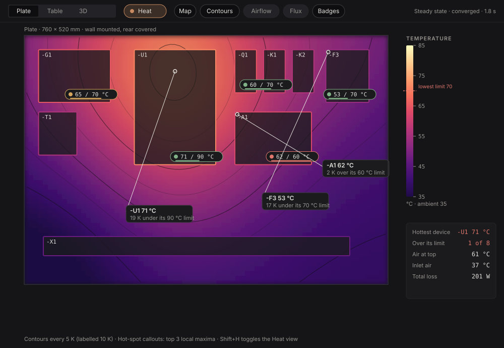
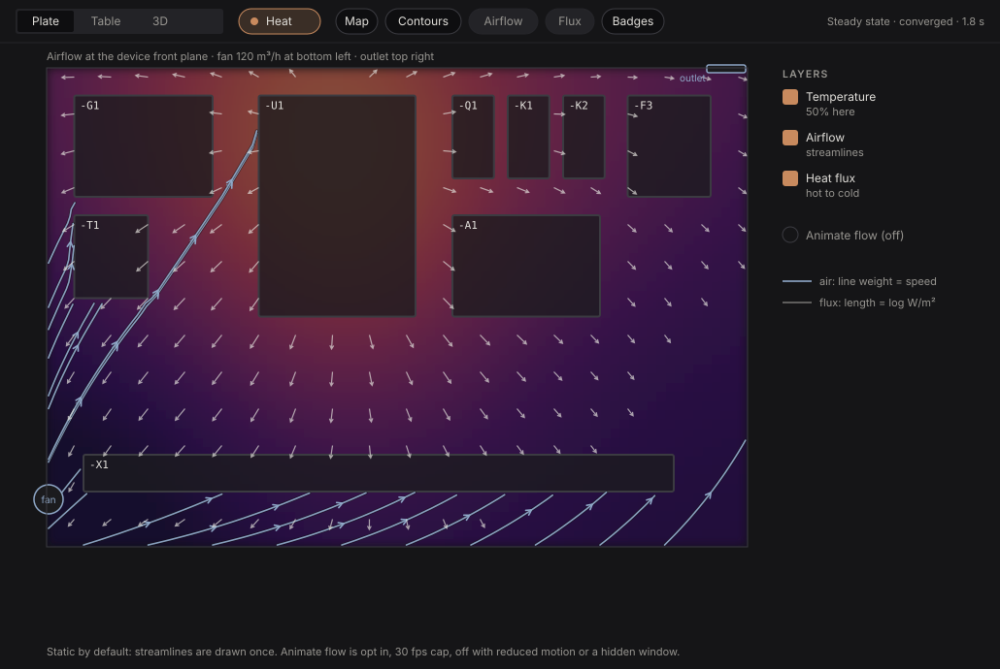
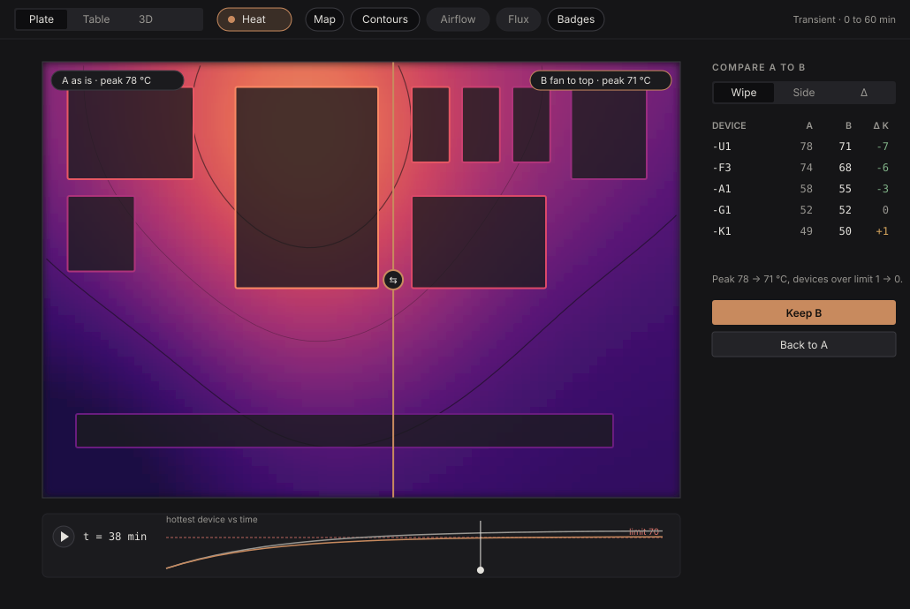

# Thermal visuals: how heat and airflow look

How KoperCAD shows the results of a thermal and airflow simulation: temperature maps, contours, hot spots,
airflow, heat flux, device limits, a time slider and an A/B compare. Owned by the "Thermal simulation:
visuals" thread. The physics (solver, airflow model, validation) belongs to the "Thermal simulation: physics
engine" thread; the first-order enclosure heat balance and the Cabinet heat layer (#406) belong to "Heat
model and cooling". This page only decides how results are drawn, where the user finds them, and the
contract between the engine and the pictures.

Mockups (SVG, drawn with the real colour ramp and tokens, data synthetic):

| | |
| --- | --- |
|  |  |
|  | |

## 1. Principles

1. **Quantitative first.** Every colour reads back to a number: a legend with ticks, contours with labels,
   callouts with values and units. A pretty field nobody can read is not a result.
2. **Honest about what it is.** The picture always says what produced it: steady or transient, converged or
   not, how old it is against the drawing. A result older than the last edit is dimmed and says so.
3. **The drawing stays on top.** The map is a backdrop under the symbols, never over them. Devices keep
   their outline, tag and the copper selection mark; heat adds a coloured rim, not a new look.
4. **Calm.** Static unless the user asks for motion. Nothing loops forever on its own (design system rule 7);
   reduced motion turns every animation off.
5. **Status colours mean status.** The temperature ramp is data, the three status colours (`success`,
   `warning`, `error`) are verdicts. A badge uses status colours with a dot and words, never colour alone.
   Copper stays "selected / active", so the ramp avoids a flat copper hue (it passes through coral and amber
   but never settles on `accent`).
6. **One result, many faces.** The solver is a real 3D conjugate heat transfer and airflow simulation, so
   the result is a volume. The 3D face shows it whole; the 2D plate view is a slice of the same volume.
   Both read the same structure (section 8), so a number is the same everywhere.
7. **Beautiful and readable before technical.** No debug plots: restrained colour, soft translucency, fine
   lines, labels only where they help. A first-time user should understand the picture without a legend.

## 2. Where the user finds it

- **Cabinet view, header:** a `Heat` chip next to the Plate / Table / 3D faces switch. On, it turns the
  heat layers on over whichever face is showing (Plate now, 3D when #481 lands). Shortcut `Shift+H`
  (checked against the keymap; `H` alone stays free for the wiring dock).
- **Layer chips** appear in the header only while Heat is on: Map, Contours, Airflow, Flux, Badges. Each is
  a toggle; the choice is remembered per project. Presets in the chip's menu: *Overview* (Map + Contours +
  Badges, the default), *Airflow* (Map at 50%, streamlines), *Flux*.
- **Legend and summary** sit in the right rail of the Cabinet workspace (where the heat legend open question
  in `handoff/ui-cabinet` points to). The summary is plain text: hottest device, count over limit, air at the
  top, inlet air, total loss. It is also the screen reader text.
- **Command palette** entries: `Heat: show` / `Heat: hide`, `Heat: run simulation`, `Heat: show airflow`,
  `Heat: show heat flux`, `Heat: animate airflow`, `Heat: compare with a saved result`, `Heat: keep this as
  A`, `Heat: temperature or rise over ambient`. Every entry is one command, so scripts and the Python layer
  reach it the same way.
- **Run** is `Ctrl+Enter` while Heat is on, or the chip's `Run` button. Until the engine can run, the chip
  shows the first-order #406 result (box average only) and says "estimate".

## 3. Temperature map

**What.** A smooth colour field over the plate (and later in the enclosure volume, section 8), drawn
under the devices at 90% opacity so the plate and rails stay readable.

**Ramp, "ember".** Ten stops derived from a perceptually uniform sequential scheme, first stop lifted off
the dark surface, last stop kept off pure white:

`#1F0C48 #3B0F70 #5F187F #8C2981 #B63679 #DE4968 #F7705C #FE9F6D #FECF92 #FCFDBF`

Lightness rises monotonically along the ramp, so the picture survives greyscale printing and the common
colour-vision deficiencies. It lives in `novo_theme` as `heat::RAMP` with a 256-entry lookup table (built by
interpolating in Oklab, so mid values do not go muddy). Light theme uses the same ramp; the map always has
its own backing, so the page colour does not change it.

**Range.** Minimum is the ambient temperature, maximum is the larger of the hottest cell rounded up to the
next 5 K and the highest device limit. The legend shows ticks at round values (every 10 K, every 5 K when
the span is under 30 K) and a dashed marker at the lowest device limit. *Rise over ambient* is a toggle
(`ΔT`) that relabels the legend and shifts it to start at 0 K.

**Smoothness.** The solver grid is coarse (cells of 5 to 20 mm). The map is uploaded as one `R32F`-style
texture and drawn with bicubic (Catmull-Rom) sampling on the CPU-built 256-colour lookup, so cell edges never
show and values between cells are interpolated, not repeated. Cells that are solid (device bodies, walls)
are masked and filled from the nearest air cell so the map does not bleed dark rectangles under devices.

**Dimming.** A stale result (model changed since the run) draws at 45% with a `Out of date, run again`
chip; nothing is hidden, so the user can still compare.

## 4. Contours

Marching squares on the same field, at fixed round levels (every 5 K, labelled every 10 K), at most eight
levels so the picture stays calm. 1 px lines in the surface colour at 30% (60% for labelled levels) so they
read on both ends of the ramp. Labels use the `caption` style with a 2 px halo of the surface colour, placed
where the line is straight and at least 120 px from another label. Contours are hidden below a plate zoom
where they would be closer than 8 px. Contours are in the same layer as the map's accessibility text: the
summary lists the level crossing the lowest device limit ("the 70 °C line passes around -F3").

## 5. Hot spots and device badges

**Callouts.** The three strongest local maxima (non-maximum suppression, minimum separation 60 mm) get a
leader line to a card: `-U1  71 °C`, then `19 K under its 90 °C limit`. Placement is greedy: try the free
side with most room, then nudge so cards never overlap each other, a badge, or the legend. Clicking a
callout selects the device (copper selection, inspector opens on its thermal section).

**Badges.** One pill per device that has a loss: dot, `65 / 70 °C`, a 2 px bar showing share of limit. Dot
and bar use `success` below 80% of the allowed rise over ambient, `warning` from 80% to 100%, `error`
above. Devices without a limit show `65 °C` with a neutral dot and a tooltip "no limit in the part data".
Badges appear at a zoom level where the pill fits inside its device; below that only the rim colour shows.
Hover tooltip: loss in W, inlet air temperature, margin in K, how the limit was derived (part data, derated
for altitude, default).

**Rim.** The device outline takes the ramp colour of its surface temperature at 2 px, so a drive glowing
amber among cool contactors is visible without reading anything.

## 6. Airflow and heat flux

**Airflow, static by default.** Streamlines computed once per result (Jobard-Lefer even spacing, minimum
distance 28 px, seeds from inlets and above each hot device), drawn as 1.6 px steel blue (`info`) lines over a
3 px dark halo, with an arrowhead every 70 px. Line weight maps to speed (1 to 2.4 px). Colour stays blue so
the temperature ramp and the flow never fight; speed is never colour.

**Animate flow, opt in.** The `Animate flow` toggle (off by default, off for reduced motion) advects 300 to
800 short trails along the same field (RK2, trail length proportional to speed, fade out at the tail). It runs
only while the toggle is on, the Cabinet view is visible and the window is focused, capped at 30 fps, and
asks egui for repaints only then. It is stateless apart from the particle list, so turning it off leaves
the static streamlines.

**Heat flux arrows.** A coarse lattice (every 40 px), arrow points from hot to cold, length is log-scaled from
the flux magnitude (6 to 16 px), colour `text.primary` at 70%. Cells below 5% of the peak flux are skipped.
They appear only at plate zoom where the lattice is at least 28 px.

**Fans and vents.** Drawn as small steel blue symbols at their positions (data from the model), with the
flow rate in the tooltip. Selecting one highlights the streamlines passing through it.

## 7. Time slider and compare

**Time slider (transient results).** A bar under the plate: play, the time as `t = 38 min`, a curve of the
hottest device against time with the limit as a dashed line, and a scrub handle. Dragging scrubs; `Left`
and `Right` step one frame, `Space` plays (opt in, runs until the end then stops, never loops). A steady
result hides the bar and shows `Steady state, converged (residual 1e-4)` in the header.

**Compare.** `Keep this as A`, change something (move a device, add a fan, change a load), run again, and the
new result is B. Three modes in a segmented control: **Wipe** (a draggable split, A left and B right, labels
in the corners), **Side** (two plates, synchronised pan and zoom) and **Δ** (a diverging map of B minus A on
a separate legend: cool steel for cooler, neutral at zero, ember for hotter, symmetric range). The right rail
lists devices with A, B and ΔK, sorted by absolute change, and the one-line verdict "Peak 78 → 71 °C,
devices over limit 1 → 0". `Keep B` accepts, `Back to A` restores the previous model through undo (the move
or fan was one command, so one undo).

## 8. Result contract

Types the engine produces and the visuals consume (the physics thread owns them; this section is the
agreed shape, kept in sync with their design note). Grids are regular; units mm, °C, m/s, W/m², s. One
structure serves the 2D plate view (a slice) and the 3D view (the volume):

```rust
struct Grid3 { origin_mm: [f64; 3], cell_mm: [f64; 3], dims: [usize; 3] } // x right, y up, z plate to door; nz may be 1
struct ScalarField { grid: Grid3, values: Vec<f32> }   // x fastest, then y, then z; NaN = solid
struct VectorField { grid: Grid3, u: Vec<f32>, v: Vec<f32>, w: Vec<f32> }
struct DeviceThermal { id: u64, loss_w: f64, surface_c: f64, hot_spot_c: f64, limit_c: Option<f64>, inlet_air_c: f64 }
struct SurfaceField { id: u64 /* device or wall */, tris: Vec<[[f32; 3]; 3]>, temperature_c: Vec<f32>, flux_w_m2: Vec<f32> }  // per triangle, from the conjugate solid/fluid interface
struct ThermalFrame { time_s: f64, temperature: ScalarField, velocity: Option<VectorField>,
                      heat_flux: Option<VectorField>, surfaces: Vec<SurfaceField>, devices: Vec<DeviceThermal> }
struct ThermalResult { ambient_c: f64, frames: Vec<ThermalFrame>, steady: bool, converged: bool,
                       residual: f64, notes: Vec<String> }   // steady: one frame
struct SolveProgress { level: u32, levels: u32, cells: u64, iteration: u64, residuals: Vec<f64> /* history, normalised */,
                       target_residual: f64, elapsed_s: f64, eta_s: Option<f64>, preview: Option<ThermalResult> }
```

`SolveProgress` is what a running solve publishes after each refinement level (and every few iterations):
`preview` is the current field, on the grid of that level. The pictures accept any `ThermalResult`
whatever its resolution, so a coarse preview and the final field are drawn by the same code.

The plate view draws the slice at the device front plane (`z` where most device fronts sit, with a
`Depth` control in the layer menu to look at the wall or the door side). Everything in sections 3 to 7 is
computed from this and nothing else, so a result loaded from a file looks identical to a fresh one.

## 9. Progress and progressive refinement

A real solve takes seconds to minutes, so the view is alive while it runs:

1. **Instant coarse preview.** The first level (a few thousand cells) arrives within a second; the map,
   contours and badges draw at once, marked `Preview, level 1 of 4`, with the map slightly dimmed and no
   callout numbers (they would be wrong digits). The picture is already the right shape.
2. **Refinement replaces it.** Each finer level cross-fades into the previous one over 250 ms (instant with
   reduced motion). Cell edges never show because the map is always interpolated (section 3). Callouts and
   badges turn solid and show digits when the level is final or the change per level is under 0.5 K.
3. **Progress indicator.** A slim bar in the header: level, cells, and a small residual sparkline on a log
   axis with the target as a dashed line, `converged` when below it. Elapsed time and ETA in text. `Esc`
   or the bar's cancel button stops the run and keeps the latest preview, labelled `Not converged`.
4. **No jumping.** Colour range changes during a run ease (the legend range only grows while running, then
   settles on the final value) so the picture does not flicker as the hot spot sharpens.
5. A run never blocks the UI; the model can be edited, which marks the preview `Out of date`.

## 10. The 3D face

The main face for results. Same ramp, same legend (see `3d-view.md` and `3d-look.md`; renderer #481).
Built after the 2D face is merged, in this order:

1. **Device and wall surfaces** take the ramp colour of their solid-fluid interface temperature
   (`SurfaceField`), smooth across each body, edges unchanged. Surface heat flux is a second mode of the
   same colouring (`W/m²`, own legend) so the user sees where heat leaves a drive or the door.
2. **Slice planes**: up to three planes (plate-parallel, vertical, horizontal), each draggable along its
   normal with the mouse (a thin copper handle on the plane edge, `[` and `]` nudge 10 mm). Each plane shows
   temperature as a ramp texture with contour lines, or speed as a second plane mode (a calm grey-blue ramp,
   so temperature and speed are never confused), plus velocity direction ticks. While dragging, planes
   re-slice live from the volume (CPU resample, under 2 ms for 200 000 cells).
3. **Isosurfaces**: a translucent shell at a chosen temperature (default: the lowest device limit, or
   ambient plus the allowed rise), 35% opacity, soft rim, depth-sorted; a second optional shell at a lower
   level makes a "heat bloom" around the hot parts. A small slider on the legend moves the level.
4. **Streamlines and tracers**: static streamlines drawn as thin tubes (seeded from inlets and above hot
   devices, Jobard-Lefer in 3D, colour steel blue, width by speed), and an opt-in `Animate flow` that moves
   short fading tracer particles (500 to 3000) along the 3D field. Off by default, stops when hidden,
   30 fps cap, still when reduced motion is on. Tracers can be coloured by temperature (a second toggle)
   to show the air heating up on its way.
5. **Cut-away and focus**: Heat view hides the door and ghosts the shell; a device click isolates its
   streamlines and shows its badge and the thermal inspector section.
6. Badges and callouts are 2D overlays anchored to device screen positions, as on the plate.

The renderer gets a small `HeatPlan` (layers, ramp, range, planes, iso levels); geometry for planes, shells
and tubes is built by `novo-heatview` (marching cubes, slice resampling, 3D streamlines), not recomputed per
face. The 2D plate view is the same pipeline with one slice plane locked to the plate side.

1. Device surfaces take the ramp colour of `surface_c` (replacing the material colour while Heat is on, edges
   unchanged).
2. **Cut planes**: up to three draggable slices through the volume (plate-parallel, vertical, horizontal)
   drawn as ramp-textured quads, with the contour lines of section 4 on them.
3. **Isosurface shell** at the lowest device limit: a translucent surface that shows where the air is above
   the limit, so a cramped corner glows.
4. Airflow: streamlines as tubes (same seeding in 3D), the animate toggle as in section 6.
5. Badges and callouts as 2D overlays anchored to device screen positions.

The renderer gets a small `HeatPlan` (layers, ramp, range, plane positions); the pictures are built from
the same `novo-heatview` data (section 11), not recomputed per face.

## 11. Where the code goes

- `novo_theme::heat`: the ramp, its lookup table, the diverging ramp and the status mapping (tokens).
- `novo-heatview` (new crate, a pure engine with no UI dependency; to be registered by the coordinator):
  field sampling, ramp lookup, slice resampling, contour lines, marching-cubes isosurfaces, hot-spot
  detection, 2D and 3D streamlines, particle advection, flux lattice, progressive result blending, compare
  (difference field, device table), range selection, a synthetic generator (3D, with refinement levels)
  for tests and the pre-engine demo. Fully unit tested.
- `novo-app` Cabinet view: the egui drawing of those primitives, layer chips, legend, badges, time bar,
  palette commands. Thin, as the rules ask.

## 12. Build order

1. This page and the mockups. Result contract agreed with the physics thread.
2. `novo_theme::heat` (ramp, LUT, tests for monotone lightness and contrast).
3. `novo-heatview` engine from a synthetic 3D field with refinement levels.
4. Cabinet Heat view (plate slice): map, contours, legend, badges, callouts, progress bar, palette entries.
5. Airflow, flux, animation toggle.
6. 3D face on #481: surfaces, slice planes, isosurfaces, streamlines and tracers.
7. Time slider and compare.

Each step is its own pull request and names, in its description, where the user finds the feature.

## 13. Open points

- Solver resolution decides the texture size: 150 by 100 cells is smooth with bicubic; below 60 by 40 we
  upsample first.
- Whether the lowest device limit or the user's `inside_max` from the sizing request drives the legend
  marker (default: the lowest device limit; the sizing limit is a second dashed marker when different).
- Printing: a PDF page of the heat map (vector contours, raster map) is a later step in `novo-pdf`.
