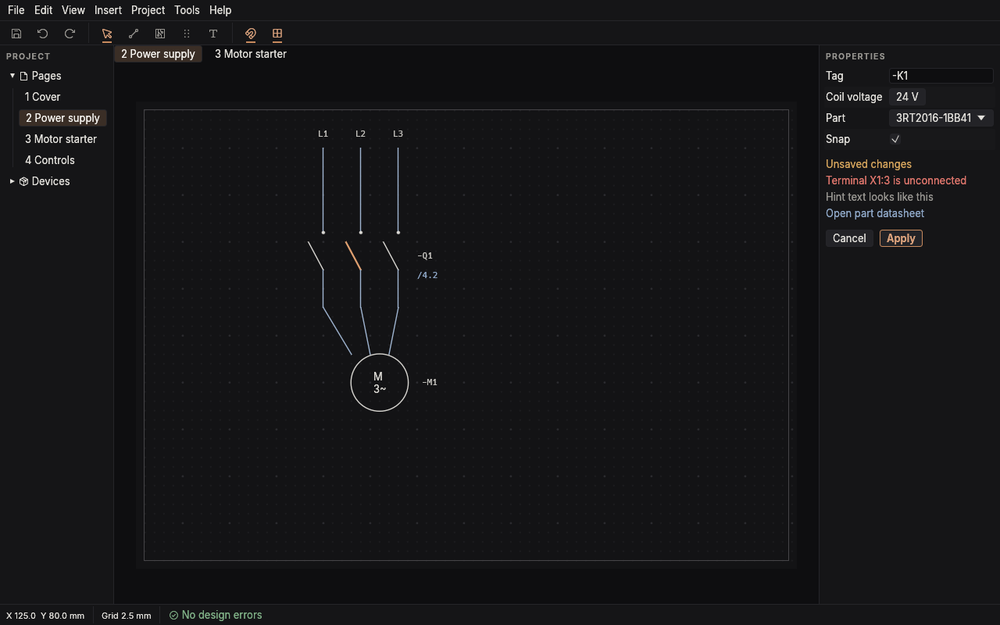

# Interface guidelines

How NovoElectric looks: the visual language. The look lives in
the `novo-theme` crate; this page says how to use it. Owned by the layout and
branding thread; how the work flows (shortcuts, steps, defaults) belongs to
the workflow thread.

The preview (`cargo run -p novo-theme --example preview`) is the Workbench
window from `docs/DESIGN.md` §3, drawn with these tokens and widgets.

## Principles

1. **Graphite, calm, dense.** One dark theme of near-neutral greys with a
   faint warm cast. The drawing is the brightest thing on screen; chrome
   stays quiet so the eye goes to the page. Hierarchy comes from value and
   spacing, not colour.
2. **One accent, copper, used rarely.** Copper (the conductor) marks focus,
   the active tool, the selection on the canvas, the primary button and the
   logo, plus the conductor joints and open wire ends on the canvas (the
   same copper dot as the logo). Nothing else is copper, so it always means
   "here". Copper is never a mark: proposals, problems, overrides and changes use other colours, so
   the selection is always unambiguous (DESIGN §5).
3. **Status colours mean status.** Muted green, amber and red only for OK,
   warning and error, always with an icon or text, never colour alone.
4. **Labels, not headlines.** Panels open with a small spaced uppercase
   section label (`widgets::section_label`), not a large bold heading.
5. **Tokens, not hex.** Screens use `novo_theme::tokens::*` and
   `novo_theme::widgets::*`. A raw colour in UI code is a review comment.

## Setup

The app shell calls `novo_theme::apply(&ctx)` once in the creation context.
It installs the Inter font, Phosphor icons and the dark style, and pins the
theme to dark. Any light, dark or system theme choice goes away
until a light theme exists.

## Tokens

| Token | Hex | Use |
| --- | --- | --- |
| `BG_0` | `#0E0E10` | Text fields, lists, around the sheet |
| `BG_1` | `#151517` | Top bar, outline, drawer |
| `BG_2` | `#1B1B1E` | Floating surfaces: inspector, dock, command field, tooltips |
| `BG_3` | `#232327` | Buttons and fields at rest |
| `BG_4` | `#2D2D32` | Hovered controls |
| `BORDER` | `#252529` | Hairlines |
| `BORDER_STRONG` | `#3B3B41` | Hovered or focused outlines |
| `TEXT` | `#E3E1DC` | Body text |
| `TEXT_MUTED` | `#989691` | Hints, units, section labels |
| `TEXT_FAINT` | `#858380` | Placeholders, coordinates, margin labels, disabled |
| `ACCENT` | `#C88A5E` | Copper: focus, active tool, canvas selection, primary button, logo |
| `ACCENT_SELECTION` | `#3A2E26` | Selected rows and selected text |
| `INFO` | `#8FA8C8` | Links, cross references, hover on the canvas |
| `SUCCESS` | `#7FB086` | OK |
| `WARNING` | `#D6A55C` | Warning |
| `ERROR` | `#E0766C` | Error |

Text sizes: body and buttons 13 pt, small 11 pt, headings 15 pt (Inter
SemiBold, for the inspector title and document pages such as Rules),
monospace 12 pt for device tags and part numbers. Controls are 22 pt high.
Corners: 3 pt on controls, 6 pt on floating surfaces.

Building blocks in `novo_theme::widgets`:
- `section_label` for panel and inspector sections.
- `segment` for two- or three-way switches (Schematic | Cabinet, outline
  modes, drawer tabs).
- `tool_button` (frameless icon, copper with an underline when active) for
  the dock.
- `issue_pill` for the issue count in the top bar, the only place it shows.
- `field` for a read-only label and value row in the inspector.
- `primary_button` (copper text and hairline, no solid fill) for the one
  main action of a project-level screen or a command preview ("Place 12
  devices"). The inspector edits live, so it has no Apply button. Dialogs
  are for things outside the drawing loop, never the default.

Unit tests hold every text colour to a contrast floor, so no text the user
has to read is decorative:

| Text | Minimum contrast | On |
| --- | --- | --- |
| `TEXT` | 7:1 | every surface |
| `TEXT_MUTED` | 4.5:1 | every surface |
| `TEXT_FAINT` | 4.5:1 | `BG_0` to `BG_2` (canvas, panels, cards) |
| Accent and status colours | 4.5:1 | `BG_0` to `BG_2` |
| Drawing colours | 4.5:1 | the sheet (`CANVAS_DARK`) |

Faint text is not for disabled-looking decoration: the HUD, page numbers in
the outline and column headers all use it, so it has to be readable.

## Layout and commands

Window structure, panels and how commands work are in `docs/DESIGN.md`.
This file covers only the visual language those screens use.

## Icons

Phosphor Regular, through `novo_theme::icons`. The modules follow the
design's vocabulary: `action` (commands), `tool` (the four dock tools),
`canvas` (Schematic, Cabinet), `panel` (outline modes, inspector, drawer
tabs), `mark` (proposal, override) and `status`. Use these names so the same
thing always has the same icon. Rows in the command field show the icon
before the label and the key after it; dock buttons show the icon only, with
the label and key in the tooltip.

## Canvas

`novo_theme::CANVAS_DARK` is the proposed screen palette for `novo-canvas`
(WS-03 owns rendering): warm light grey symbols and blue-grey wires on a
near black sheet, bright copper selection, steel blue hover and cross
references, muted green open connection points. Printing and PDF stay black on white.
The DESIGN.md §5 marks are in the palette too: proposals in the hover hue
at 55% (dashed, where hover is solid), a grey override diamond, and change
marks in the status colours at 50%. A test keeps every mark off copper.

Links and wire ends (`docs/design/canvas-feedback.png`): wires are a mid
saturated blue `#6F9BDB` and symbols near white `#ECEAE5`, at least 2:1
apart, so a wire never merges into a terminal outline. A filled copper
joint dot (`junction`, radius 3 px at 100% zoom, 3.5 px on a tee) marks
every place a wire meets a pin or another wire. A wire ended by double
click gets an open copper ring (`wire_end`, radius 4 px, 1.6 px line) and
a small amber flag (`unconnected_flag`, 16 px pole, 10 px pennant) with
the tooltip "Unconnected". Hollow means open, filled means joined. The
selection stays the brighter copper with a halo, so a selected net is still
told apart from its joints. The radial place picker (four wedges,
inner radius 38, outer 110, hovered wedge copper outline) and the
right-click menu (26 px rows, 236 px wide, shortcut right-aligned) are in
the same mock-up; behaviour is Workflow's spec.

The app maps it onto `novo_canvas::widget::CanvasStyle` (background, grid,
selection, hover, rubber band, snap marker) and `novo_canvas::model::ModelStyle`
(symbol, wire, tag text, sheet fill, frame) and applies it with
`PageScene::set_style`. novo-canvas itself keeps black on white defaults.

## Branding

- Name: NovoElectric, one word, capital N and E.
- Mark: "Nova", a four-ray star meeting at a copper junction dot
  (`assets/branding/icon.svg`).
- Tagline: "Electrical design, without the weight".
- Window icon and installer icon come from `assets/branding`; see its README.
