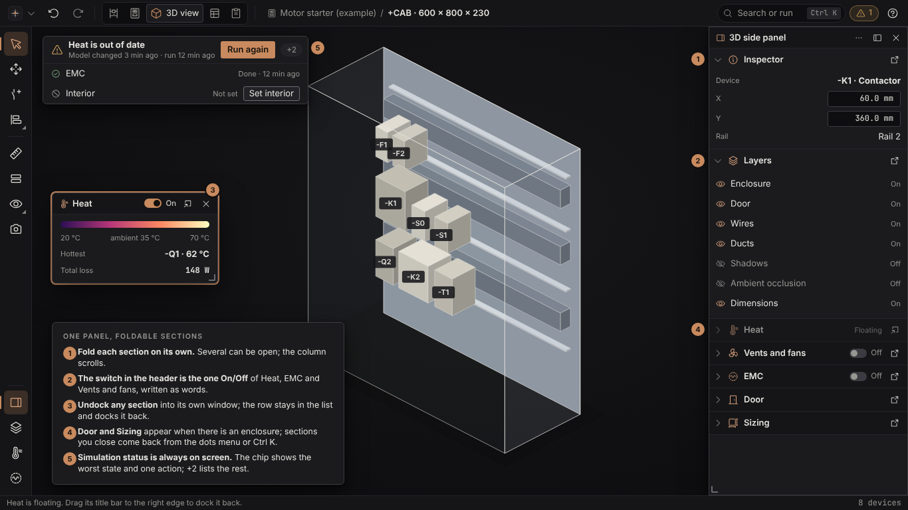

# Visual redesign addendum: 3D overlays and the side panel

Graphic design thread, 2026-10-28. Addendum to `visual-redesign.md` (sections 3.2 and 8 and lane V3b). It answers the owner's complaints of 2026-10-28 about the 3D view:

- EMC cannot be turned off in the 3D configuration panel.
- The configuration panel is frustrating in general.
- The other panels that can appear (Inspector, Temperature, Door, Sizing and so on) are separate popups that are hard to find, cannot be closed, and are not easy to open again.
- Buttons are doubled: turning heat off in the 3D panel leaves it on in the top bar.
- "Vents and fans" and "Heat" overlap each other. The owner's proposal: **one long panel on the right with individually foldable sections, each of which can be undocked into a floating window.** This page adopts that model.
- It is very hard to see whether the simulation was done and what its status is, especially with the sections folded. Section 4 adds an always-visible status chip.

| Board | Dark | Light |
| --- | --- | --- |
| 3D side panel: foldable sections, Heat undocked | [png](visual-redesign/images/side-panel-dark.png) | [png](visual-redesign/images/side-panel-light.png) |

The board `workspace-3d` still shows the earlier Layers flyout; the side-panel board supersedes it.

## 1. The causes this page designs against

Confirmed in the code by the 3D rework thread: `view3d.rs` sets the EMC state from the controls before the toolbar runs and writes it back after the panels, which undoes a click; Cabinet has its own EMC state; Heat has three owners (the controls, the Cabinet heat state and the 3D heat layers). Inferred from the owner's words: each overlay opened its own popup, so there is no list of what can be open and no single way to close them.

## 2. Rules

1. **One state, one owner.** Every 3D view option (a layer or an overlay) is one entry in one registry with one stored value. The section switch, a Layers row, a rail button, the Ctrl K command and a key all read and write that entry. No surface keeps a copy, and nothing recomputes the value from somewhere else each frame.
2. **The top bar carries no view toggles.** It holds the mark, undo and redo, the workspace segment, the page, search and issues (visual-redesign.md section 3.1). The existing top-bar heat button is removed in the same change that introduces the registry.
3. **The switch lives in the section header.** An overlay that has a section (Heat, Vents and fans, EMC) is switched on and off by the switch in its header, **written as the word On or Off next to the switch**, never by colour alone. Plain visibility layers are rows of the Layers section, with On or Off written at the right. The rail buttons for these do not switch anything: they open the side panel and unfold the section (section 5).
4. **Off means off.** Turning an overlay off hides its drawing and its legend, and survives selection changes, a new run and reopening the project. A test turns each option on and off from every surface and asserts the same value everywhere.
5. **Every section can be folded, undocked, closed and found again.** Section 3 says how.
6. **Keyboard and words.** Section headers, the switches and the Layers rows are reachable with Tab and the arrow keys; Enter or Space folds a section or flips a switch; Esc closes the topmost floating section. A switch is never colour only.

## 3. The side panel

One panel on the right (280 to 300 wide by default, resizable, dockable left or right, floatable as a whole, remembered per workspace layout; panel rules in visual-redesign.md section 8). Its sections, in the default order:

| Section | What it holds | Switch | Shown |
| --- | --- | --- | --- |
| Inspector | The selection: device, position, rail, clearance. Follows the selection | none | Always |
| Layers | Visibility rows: Enclosure, Door, Wires, Ducts, Shadows, Ambient occlusion, Dimensions, each with On or Off written. The Door row is visibility only; the angle lives in the Door section, so it is stored once | none (rows) | Always |
| Heat | The scale and legend, hottest device, total loss, run. Replaces the separate "Temperature" popup | On or Off | Always |
| Vents and fans | The cooling inputs (vents, fans, flow) that the Heat results depend on. A separate section because the owner asked for it; both read the same heat state | On or Off | Always |
| EMC | The legend and the rules list | On or Off | Always |
| Door | Door angle and clearance swing | none | When there is an enclosure |
| Sizing | Enclosure size read-outs; the sizing tool stays "Size enclosure" on the Cabinet rail | none | When there is an enclosure |

Behaviour of each section header (left to right: fold chevron, icon, title, switch where it has one, undock button):

- **Fold.** Click the header or press Enter. Several sections can be open at once; the column scrolls and the headers of open sections stick to the top while their body scrolls. Alt+click folds all the others (solo). Fold state is remembered.
- **Undock.** The undock button, or dragging the header out of the panel, turns the section into a floating window with the standard host header (icon, title, switch, dock back, close), resizable, remembered. The row stays in the list as a dimmed "Floating" row with a dock-back button, so nothing disappears from the panel. Dragging the floating window to the panel's edge docks it back; the dock-back button returns it to its place in the order.
- **Close.** Closing a section hides it. The dots menu in the panel header ("Sections") lists every section with its state, and Ctrl K has "Show <section>" for each, so a closed section is one click away. Closing a section never changes its On or Off value.
- **Esc** closes the topmost floating section; the panel itself closes with its X, the rail "Side panel" button, or Ctrl K.

The **same component** can serve the Cabinet workspace (its own section list, for example Inspector, Heat, Vents and fans, EMC on the plate, Placement rules, Cabinet table). It is a section list per workspace, a data table like the rail tables, so a new section adds one row.

## 4. Simulation status

Owner, 2026-10-28: in the 3D view it is very hard to see whether the simulation has been done and what its status is, especially when the sections are folded, because a normal user does not know which section to open. **Status never lives inside a section.**

- **An always-visible status chip** sits in the top-left corner of the 3D canvas (inset 12, clear of the view cube on the right; direction.md section 6 rule 6). It is there whether the side panel is open, folded, floating or closed.
- It shows the **most important state** of the analyses behind the view, as an icon, words, one detail line and **one action**. The `+N` button opens a short list of the others, each with its own state and action.

| State | Icon and words | Detail line | Action |
| --- | --- | --- | --- |
| Not run | play, "Heat has not been run" | What running gives, for example "Shows temperatures and the hottest device" | Run |
| Running | spinner, "Heat is running" | Progress and time left; the spinner stops moving with Reduce motion and the words stay | Cancel |
| Done | check-circle, "Heat is done" | Age ("3 min ago") | Open Heat (opens the side panel and unfolds the Heat section) |
| Out of date | warning, "Heat is out of date" | "Model changed 3 min ago · last run 12 min ago" | Run again |
| Failed | warning-octagon, "Heat failed" | The reason in plain words | Details, Run again |
| Not set | prohibit, "Interior is not set" | What is missing | Set interior |

- The same states apply to **EMC** ("EMC check is out of date") and any other analysis the 3D view shows; "Interior is not set" and similar missing inputs are states of the analysis that needs them.
- **Priority** when several apply: Failed, Running, Out of date or Not set, Not run, Done. When everything is Done the chip stays, quiet, with the age ("Heat done 3 min ago"), so the answer to "was it run?" is always on screen.
- **One owner:** each analysis has one status value (state, started, finished, the model revision it ran on, progress, error). "Out of date" is computed by comparing the model revision at the run with the current one, in one place. The chip, the Heat section header and Ctrl K read that value; nothing keeps its own copy.
- States are words and an icon, never colour alone (warning and error colours support them). The chip is keyboard reachable and the action runs with Enter.
- On a narrow canvas the chip shrinks to icon and the state word; the detail line moves to the tooltip.

## 5. The rail on the 3D workspace

The 3D rail (visual-redesign.md section 3.2) keeps its tools and assists. Its panels zone has four places: **Side panel** (show or hide the whole panel), **Layers**, **Heat** and **EMC**. The last three open the side panel if it is closed and unfold their section; they do not switch an overlay (rule 3). The zone stays at 4 base places, so the add-on slot (visual-redesign-addons.md section 3) fits as the fifth. "Build order" moves to the assists zone (5). "Wire runs" is the Wires row of Layers.

## 6. Tests

- **Single state:** for each registered option, set it from the section switch or row, Ctrl K and the key; assert all surfaces report the same value and that the drawing agrees.
- **No duplicates:** a test lists the options each surface shows and fails if an option has a second owner or appears in the top bar (rule 2).
- **Foldable, undockable, closable:** every section has fold, undock and close; undock then dock back restores the order; close then "Show" restores the section and its fold state.
- **Off survives:** turn EMC and Heat off, select another device, rerun, reopen the project; they stay off.
- **Keyboard:** the headers, switches, Layers rows and the status chip are reachable and operable without the mouse.
- **Status:** run, move a device, and assert the chip goes Done then Out of date with the right words and action; fail a run and assert the reason shows; with every section folded and the panel closed the chip is still drawn.

## 7. Order of work and lane V3b

Lane V3b (the 3D rail) is **built together with the 3D rework**, as one thread. Suggested order, each step its own PR:

1. **Registry, status and top bar** (needs nothing from the redesign): the view-option registry, rule 4's test, the top-bar heat button removed, EMC fixed, and the simulation status chip with its single status value (section 4). This ships on today's UI.
2. **Side panel** (today's panel helper; docking arrives with lane V1): the section column with fold, undock, close and the Sections menu; Inspector, Layers, Heat, Vents and fans, EMC, Door and Sizing as sections.
3. **3D rail** (needs lane V3a, the rail core): the rail of the board, with the panels zone of section 4.

## 8. Honest limits

The board is an HTML picture, not egui output. Dragging a header out of a panel to undock it is custom code on top of egui areas; lane V1 must prove it with scripted drag tests, and the undock button is the fallback if the drag proves unreliable. "Temperature" is merged into Heat on the assumption that they show the same data; the 3D thread confirms. Whether each analysis can report progress, a model revision and an error reason today is for the 3D thread to confirm in the code; where one cannot, the chip shows Done or Not run without a progress figure. Door and Sizing as top-level sections follow the owner's list; if either edits geometry rather than showing properties, it stays a tool and its section shows read-only values.
