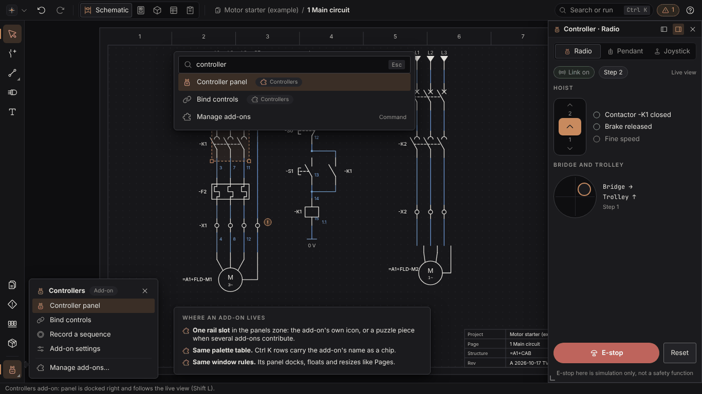
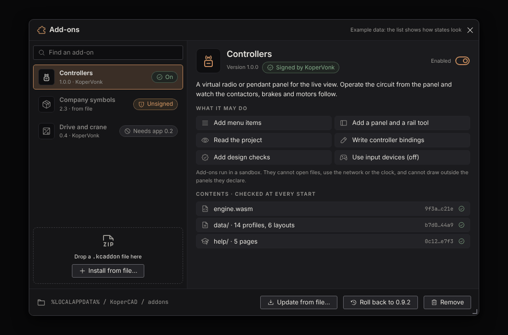

# Visual redesign addendum: add-ons

Graphic design thread, 2026-10-28. Addendum to `visual-redesign.md` (read sections 3, 5, 7, 8 and 9 first). It answers the owner's request that the add-on manager and the controller add-on are built **inside** the redesign, and settles the proposal of lane C0b (`handoff/addons/redesign-proposal.md`). Nothing here is built yet; the add-on lanes (C0b manager, C2 controller device, C3 controller panel UI) and the redesign lanes (V0, V1, V2b, V3a, V5) use it as their meeting point.

| Board | Dark | Light |
| --- | --- | --- |
| Add-ons in the app: rail slot and flyout, docked panel, Ctrl K | [png](visual-redesign/images/add-ons-in-app-dark.png) | [png](visual-redesign/images/add-ons-in-app-light.png) |
| Manage add-ons (centre window) | [png](visual-redesign/images/add-ons-manager-dark.png) | [png](visual-redesign/images/add-ons-manager-light.png) |

Boards are HTML pictures of the target (sources in `visual-redesign/mockups/`). The add-on names and states in the manager board other than Controllers are example data.

## 1. The rule

**An add-on adds rows to tables the base already owns; it never adds a surface.** The tables are: the command registry, the command presentation table, the rail tables, the menu areas, the panel host (`panel.rs`) and the manager window. An enabled add-on is indistinguishable in behaviour from a built-in feature, except for a small "Add-on" chip that says where it came from. A disabled or removed add-on leaves nothing behind in the menus, the rail or Ctrl K.

## 2. Where each contribution appears

| What the add-on provides | Where it shows | Rule |
| --- | --- | --- |
| The manager | Command `addons.manage`, label "Add-ons". Home: the **app-menu footer**, beside Preferences and About, with a puzzle-piece icon; also Ctrl K ("Manage add-ons"). Until lane V2b lands it may sit in File > Add-ons...; V2b moves it. File's budget stays 20 | One command id in both places. A badge with a count on the footer item appears when an add-on failed, needs a newer app or needs attention |
| A command with home `menu` | One of the eight existing areas (for example Simulate > Controller panel), at the foot of the area under the section label "Add-ons" | At most 4 rows per add-on per area, label 28 characters or fewer. Rows are not counted in the base menu budget; the budget test runs with no add-ons installed |
| A command with home `rail` | A row in the add-on's **flyout** on the rail (section 3), for the workspaces the manifest names | At most 6 rows per add-on and workspace; overflow becomes palette-only and the manager says so |
| A command with home `palette-only` | Ctrl K only | |
| A panel | A docked panel through `panel.rs` (section 5) | Toggled from the add-on's flyout and, where the add-on declares one, a key |
| Symbols and categories | A category after the base categories in the place palette, with the add-on chip | Drawn by the same renderer; tag prefix and pins as any symbol |
| Design checks | The Issues panel, like any check; the row names the add-on | |
| Help and lessons | The help page and lesson lists mark the add-on | |
| The "not installed" hint | Where the feature would be (for example the live-view card slot): empty state with a 32 pt icon, one sentence ("Controllers: add-on not installed"), one primary action "Manage add-ons". Never a banner over the canvas | |

## 3. The rail: one slot per workspace

The proposal of C0b appends add-on items to the assists or panels zone, at most 2 per add-on. With the base using 5 of the 6 places in most zones, that overflows at the second add-on. **Decision: one slot per workspace.**

- The panels zone (the last one) has room for one add-on button in every workspace (the base uses at most 5 of 6; Cabinet keeps to 5 because Cut list sits in its assists zone). When exactly one add-on contributes to the open workspace, the button shows **that add-on's icon**; with two or more it shows a puzzle piece. The button has the flyout notch.
- The flyout lists each contributing add-on as a section (icon, name, "Add-on" chip) with its rail rows, then a footer row "Manage add-ons...". Up to 6 rows per add-on; the flyout scrolls beyond that.
- Rail data stays registry-driven: the add-on's `home: rail` commands become rows of its flyout. The rail tables accept dynamic rows (section 6), so no add-on code touches the rail layout.
- A badge on the add-on button is a plain count the host draws; status colour only for a severity the manifest declares, and always with the tooltip text.
- The live view has no rail place today. Lane V3a adds a **Live** entry (the drawn `live` icon, `Shift+L`, the live-view key) as the sixth place of the Schematic assists zone, so the live-view toggle exists independently of any add-on. The Controllers panel is a card inside the live view and has **no key of its own**; the examples on the board show none.

## 4. Icons and the command presentation table

Decision on the three icon questions of the proposal:

1. **The add-on glyph is Phosphor `puzzle-piece`, not a new drawn icon.** The drawn set is for what Phosphor has no picture for. The puzzle piece is the established mark for extensions, reads at 14 pt in chips, and costs the base set nothing. Declare it once as the constant `ADDON_ICON` in `novo-theme`; V0's drawn set stays 40. (The proposed drawn `workflow-addon` icon is not added.)
2. **Icon resolution order for an add-on command:** the add-on's own icon data, then the built-in set (the 40 drawn icons, then the allowed Phosphor names), then `ADDON_ICON`. An unknown name never leaves a hole.
3. **Add-on icon data is shape data, never pixels.** An add-on may ship `data/icons.toml` with icons on the same 24 grid and the same shape list as the base set (line, polyline, rect, circle, arc; section 9.3 of the main doc). The host validates it at install (at most 48 shapes per icon, every coordinate inside 0 to 24, no fill except the junction dot, names namespaced `<addon-id>.<name>`) and paints it with `icons::paint`, so stroke, colour, hover, disabled, light theme and High contrast come for free. An add-on cannot bring a bitmap or an SVG. If lane C0b wants to defer own icons from add-on API v1, everything still works through the fallback order above, with the add-on glyph standing in.

The Controllers add-on is the worked example: `visual-redesign/icons/addon-example/` holds four icons it would ship (`controllers.radio`, `controllers.pendant`, `controllers.joystick`, `controllers.rocker`), drawn with the same rules (source: `ADDON_ICONS` in `tools/koper_icons.py`). They are not part of the base 40.

**Commands from add-ons** are runtime descriptors, not rows of the static `COMMANDS` slice:

| Field | Rule |
| --- | --- |
| id | `addon.<addon-id>.<name>` |
| short label | 28 characters or fewer; the manifest is refused at install otherwise |
| tooltip and description | The long sentence, used by the tooltip and the Ctrl K description |
| icon | Per the resolution order above |
| keywords | For search |
| key | Optional; a key already used by the base wins, and the conflict is shown in the manager's details |
| home | `menu` (an area), `rail` (workspaces) or `palette-only`; the same invariant as the base: **every command has a home** |

Menu, rail and palette all read **one function that merges the static and the extension commands** (`commands::all()` as proposed). The presentation lookup is the static table first, the extension descriptor second. The tests "every command has an icon, a label of at most 28 characters and a home" run over extension commands at install time, not only at compile time. The icon engine (lane V0) therefore takes shapes as `Cow<'static, [Shape]>`, so runtime data and compiled data are one type.

**Ctrl K.** Add-on commands appear like any other, with the type chip "Command" and a second chip with the puzzle piece and the add-on's name. Only while the add-on is enabled. If a query matches the name of an installed but disabled add-on, one row offers "Turn on <name>".

## 5. Panels and windows

An add-on describes its panels as data (the host widget set: button, rocker with steps, joystick with detents, lamp, label, table, tabs). The host draws them, so they are ordinary `panel.rs` panels and follow the window rules of section 8 of the main doc:

- Identity `panel::id("addon.<id>.<panel>")`; position, size, dock slot and visibility are remembered per workspace layout, like Pages.
- The header is the host's: icon, title, dock left, dock right, close. An add-on cannot remove or restyle it. Drag by the title bar, resize from any edge, never off screen, double click maximises, Reset layout recovers.
- The add-on declares a default slot (left, right, bottom or float) and a minimum size; the host clamps the minimum to the window, and the person may move it anywhere.
- **Pop-out is a floating panel**, never an operating-system window. Add-ons cannot open their own windows.
- Several panels (for example Radio, Pendant, Joystick) are tabs inside one panel or separate panels, as the add-on declares.
- Colour comes only from semantic roles (`neutral`, `accent` for the active thing, `ok`, `warn`, `error`, `info`), resolved by `ui_palette()`. Add-ons set no raw colours, so dark, light and High contrast work without the add-on knowing. A lamp is never colour alone: lit lamps carry a filled mark and text in the tooltip.
- Density and Touch size apply to add-on widgets. Reduce motion applies to rail and panel transitions.

## 6. Contract with the redesign lanes

| Lane | What it must provide for add-ons |
| --- | --- |
| V0 foundations | `ADDON_ICON`; `Icon` holds `Cow<'static, [Shape]>`; the presentation table can be merged with runtime rows; the tests accept a descriptor list |
| V1 window manager | Panels are keyed by string id so add-on panels register at runtime; centre class used by the manager (960 x 640, resizable) |
| V2b app menu | Footer item "Add-ons" beside Preferences and About, with a count badge; the "Add-ons" section at the foot of an area; anchor `menu.addons` |
| V3a rail core | Dynamic rows in the rail tables; the add-on slot and flyout (section 3); the Live entry; anchor `rail.addons` |
| V5 palettes | Add-on chip and "Turn on" row in Ctrl K; add-on symbol categories in the place palette |
| V7 lessons | Anchors for the manager and the add-on slot |
| C0b add-on manager | The manager window (section 7), manifest validation (labels, icons, homes, key conflicts), the registry that feeds `commands::all()` |
| C2 / C3 controller | Commands, icons, panel declarations and symbols per this page; no controller code or colours in the base |

## 7. The Manage add-ons window

A centre window (960 x 640, resizable). Left: the installed add-ons, each with its icon, name, version, publisher and a status pill; a find field; below, a drop target for `.kcaddon` files and "Install from file...". Right: the selected add-on: name, version, signature state, an enable switch, the description, **what it may do** (one row per permission with an icon), and **contents with their hashes**, each with a tick once verified at start. Footer: the install folder, "Update from file...", "Roll back to <version>", "Remove".

| State | Pill | Icon (never colour alone) |
| --- | --- | --- |
| Enabled | On | check-circle, success |
| Disabled | Off, row dimmed | toggle-left |
| Signed by KoperVonk | Signed | seal-check, success |
| Unsigned, from file | Unsigned | shield-warning, warning |
| Needs a newer app or API | Needs app 0.2 | prohibit, neutral |
| Failed (trap, timeout, budget) | Failed, with the reason in the details | warning-octagon, error |

Installing an unsigned file opens a 480 dialog: publisher, requested permissions, hash, and a tick "I trust this file"; the primary action stays off until the tick is set. A project opened without an add-on it uses keeps the add-on's data untouched and shows the "not installed" empty state of section 2 in the place of the panel.

The sandbox statement above, the "Signed by KoperVonk" state and the permission rows describe the design target of lane C0b; the pill and the file hashes on the board are example data. Nothing is signed or sandboxed until C0b builds and tests it.

## 8. Honest limits and open points

- The boards are pictures, not egui output. The radio icon in the example set is the least legible at 14 pt; lane V0's 16 and 20 pt screenshot check applies to add-on icons too, and an add-on whose icon fails falls back to the add-on glyph.
- The one-slot rail rule is my decision against the proposal of lane C0b (assists or panels zone, two items); the owner of C0b can object with a case where an add-on needs two direct rail buttons. Default if no objection: one slot.
- Add-on-shipped icon data is optional for add-on API v1 (section 4, point 3).
- A fixed add-on glyph (the puzzle piece) is a design choice, not a standard.
