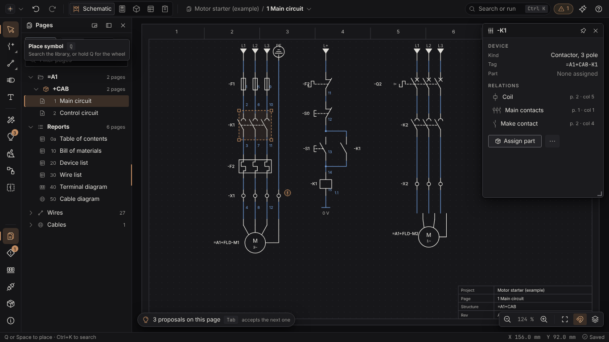
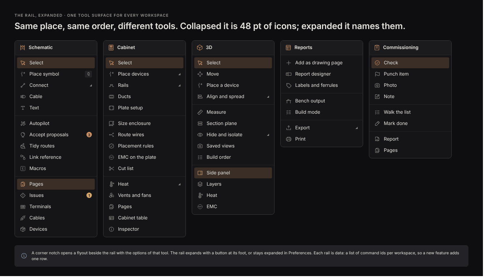
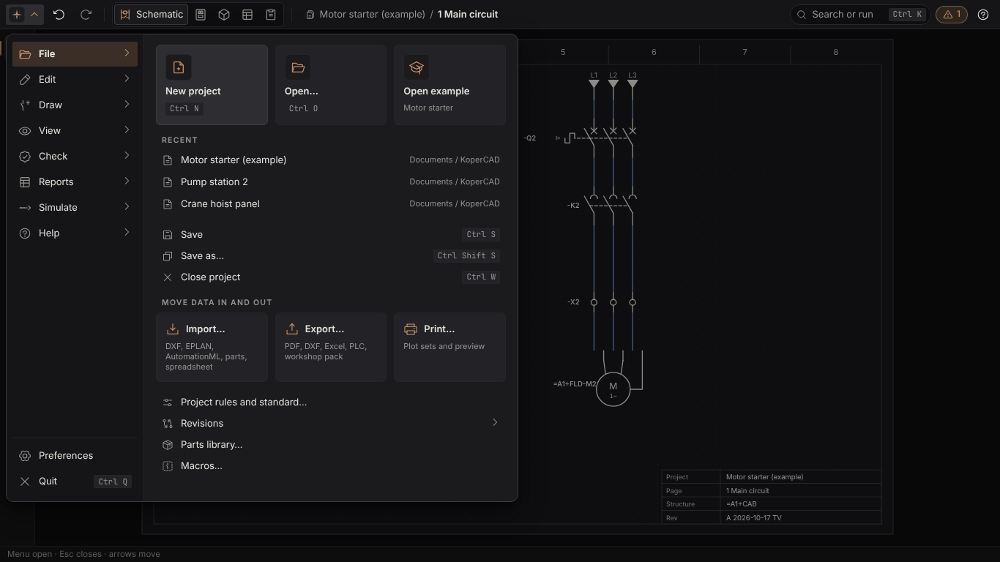
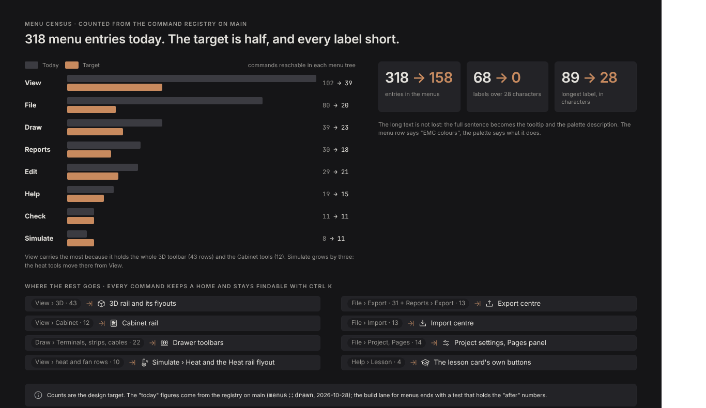
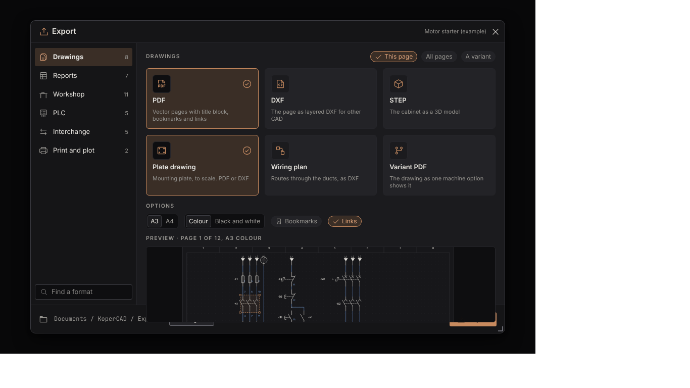
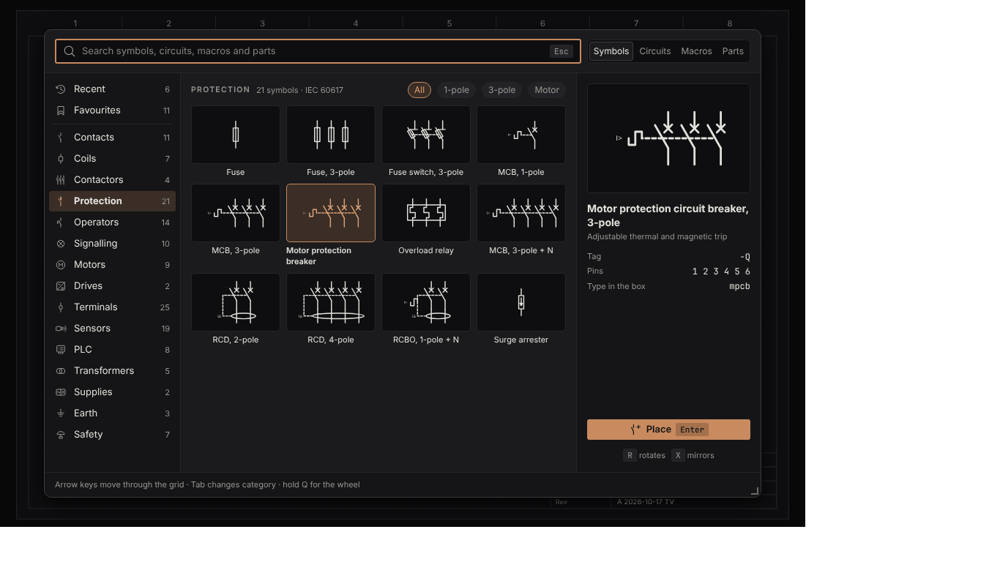
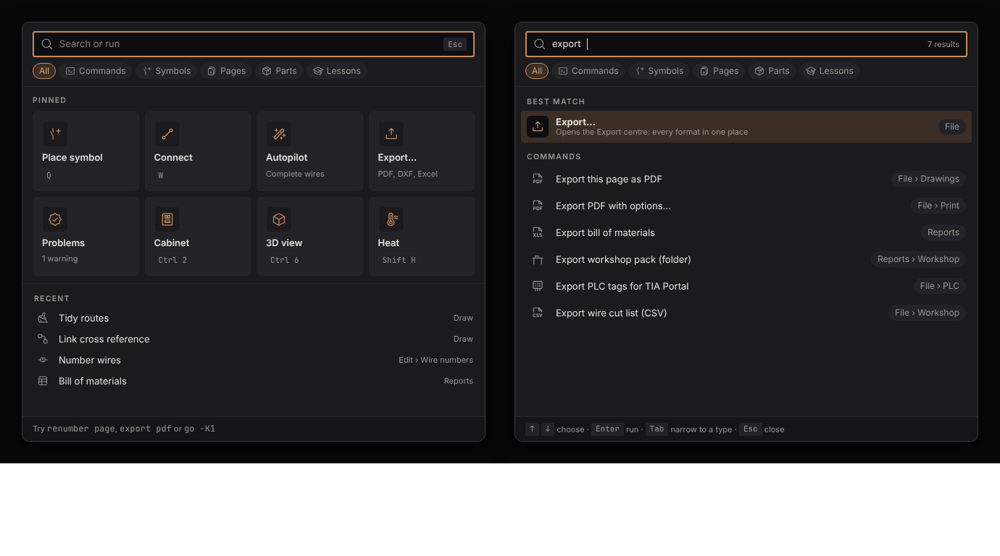
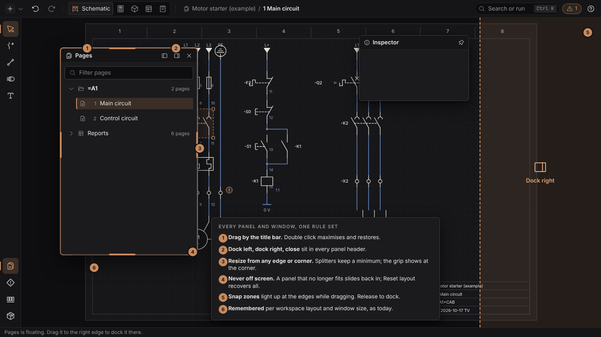
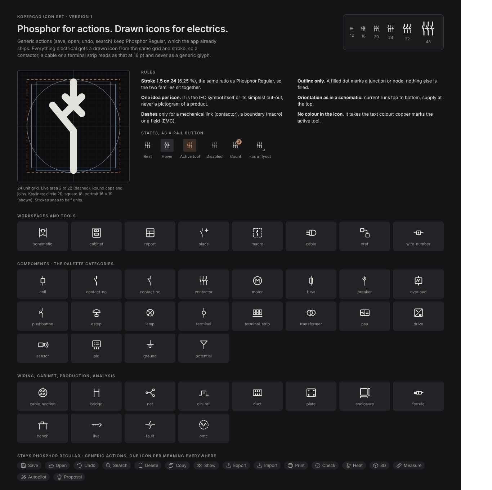
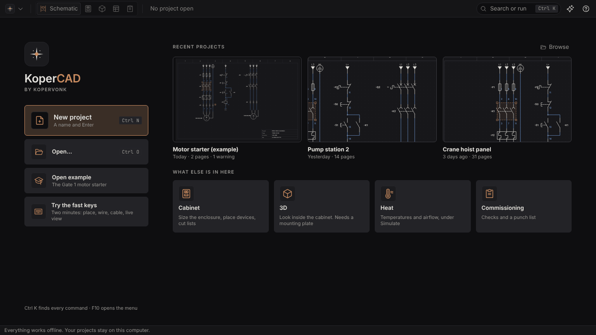

# Visual redesign: frame, menus, windows, icons

Graphic design thread, 2026-10-28. Companion to `direction.md` (what the product should feel like), `design-system.md` (tokens and widgets) and `workspaces.md` (zones and anchors). This page decides **how the frame of the program looks and behaves**: top bar, tool rail, menus, palettes, start screen, window handling and the drawn icon set. It amends the three pages above where section 2 says so, and cuts the work into build lanes (section 12).

Why now. The owner's words, 2026-10-28: "I'm not happy with the layout of the program and its navbar. Everything is text, and some menus are very long. I would like it to be more visual, use symbols where possible, and not just be a skinny navbar with a mountain of text. Many windows are not draggable or resizable, such as the main page navigator." The ambition rule stands: this is not a re-skin, and nothing here shrinks to "a few icons".

Mockups are HTML boards drawn from the real tokens, the real Phosphor icons, the new drawn icons and the real IEC 60617 symbols of `novo-symbols`. **They are pictures of a target, not egui output.** The build lanes recreate them in egui and are judged against these boards (section 11).



| Board | Dark | Light |
| --- | --- | --- |
| Main screen, schematic | [png](visual-redesign/images/main-dark.png) | [png](visual-redesign/images/main-light.png) |
| App menu (the eight menus in one) | [png](visual-redesign/images/app-menu-dark.png) | [png](visual-redesign/images/app-menu-light.png) |
| Top bar at every width | [png](visual-redesign/images/top-bar-fit-dark.png) | [png](visual-redesign/images/top-bar-fit-light.png) |
| Rails per workspace | [png](visual-redesign/images/rails-dark.png) | [png](visual-redesign/images/rails-light.png) |
| Menu census | [png](visual-redesign/images/menu-census-dark.png) | [png](visual-redesign/images/menu-census-light.png) |
| 3D workspace | [png](visual-redesign/images/workspace-3d-dark.png) | [png](visual-redesign/images/workspace-3d-light.png) |
| Windows: drag, dock, resize | [png](visual-redesign/images/windows-dark.png) | [png](visual-redesign/images/windows-light.png) |
| Export centre | [png](visual-redesign/images/export-centre-dark.png) | [png](visual-redesign/images/export-centre-light.png) |
| Place palette | [png](visual-redesign/images/place-palette-dark.png) | [png](visual-redesign/images/place-palette-light.png) |
| Command palette | [png](visual-redesign/images/command-palette-dark.png) | [png](visual-redesign/images/command-palette-light.png) |
| Start screen | [png](visual-redesign/images/start-screen-dark.png) | [png](visual-redesign/images/start-screen-light.png) |
| Icon set (40 drawn icons) | [png](visual-redesign/images/icon-set-dark.png) | [png](visual-redesign/images/icon-set-light.png) |

## 1. Evidence: what is wrong today

Counted from the command registry on main (`novo_workflow::menus::drawn`, 2026-10-28) and from the code.

| Fact | Number or place |
| --- | --- |
| Menu entries in the eight menus, whole trees | **318** (File 80, Edit 29, Draw 39, View 102, Check 11, Reports 30, Simulate 8, Help 19) |
| Labels over 28 characters | 68; 15 are over 40; the longest is 89 ("EMC net classes on the schematic: ...") |
| View > 3D alone | 43 entries; View > Cabinet 12 |
| Top bar | 8 menu words, 5 workspace words and a breadcrumb in one 42 pt row, one weight, one level (`menu_bar.rs`) |
| Schematic tools | the bottom dock, small icons plus text (`dock.rs`) |
| 3D and Cabinet tools | rows of text buttons |
| Start screen, command palette, place palette | text rows; no symbol is shown anywhere a symbol is chosen |
| Panels that cannot be moved or resized | `Panel::left("outline")` is `.resizable(false)` with a fixed size, and so is `reports_list`; about 15 non-test `resizable(false)` sites in `novo-app` (listed in section 8) |

The owner is right on every count. Two of the causes are structural: the menus were generated one command at a time with no budget, and the panel helper that already drags and resizes (`panel.rs`) was never applied to the two panels people use most.

## 2. Principles, and what this page amends

1. **The drawing is the brightest thing** (direction.md). Chrome gets thinner in height and richer in meaning: icons carry the meaning, words are the second layer.
2. **A symbol where a symbol exists.** A relay is drawn as a relay. Where IEC 60617 has the symbol, the picture is that symbol from `novo-symbols`, at one scale. Where there is none (workspaces, cabinet, production), a drawn icon from the set in section 9.
3. **Every command has a home and is findable with Ctrl K.** Moving a command out of a menu never removes it.
4. **One registry.** The rail, the menus, the palettes and the centres all read the command registry; none keeps its own list (workspaces.md section 5). The icon and the short label of a command live in one presentation table, not in each surface.
5. **One window rule set** (section 8).
6. **Copper means "here"** (direction.md section 2): active tool, selection, focus, one primary action.

Amendments, made in this PR where they are one-line pointers (`DESIGN.md` sections 8 and 9, `direction.md` section 8) and otherwise carried by the build lanes:

| Where | Today | Becomes |
| --- | --- | --- |
| `direction.md` section 4 | "Toolbar buttons keep their words ... icon-only is for the dock's tools, panel header buttons, tab icons and the pin" | Workspace tools are icons with a tooltip (name and key) on a rail that can expand to show words. Captioned groups remain in the expanded rail and in flyouts. The cabinet toolbar's *content and grouping* (cabinet-toolbar.md) is kept; its *form* becomes the Cabinet rail |
| `direction.md` section 1, count test | "No toolbar more than 7 controls at rest" | At most 6 per **zone** of the rail (tools, assists, panels); a flyout counts as one control. Menus: at most 12 top-level items, a submenu counts as one (unchanged). The census counts whole trees |
| `direction.md` section 6 rule 4 | The dock is the schematic tool surface | The left rail replaces the dock in every workspace; messages stay in the status bar |
| `direction.md` section 2 | The mark opens the About card | The mark plus caret opens the app menu; About is its footer |
| `direction.md` section 6 rule 7, `design-system.md` dialogs | Dialogs 360, 480 or 640 | Adds a resizable **centre** class, default 960 by 640, for Import, Export, Place and Settings (they are workbenches, not questions) |
| `DESIGN.md` section 9 | "Floating panels everywhere" and "Insert centre, symbol trees, ribbon" are left behind | Still true in spirit: the rail is registry-driven and per workspace, not a ribbon of every command, and panels dock by default; floating is a choice the person makes, not the default. Section 8 says what the person may do |
| `DESIGN.md` section 8 | "Menu: both, one registry" | Unchanged in principle. The menu is drawn as one two-pane app menu (section 5) instead of eight words in the bar; the names stay available as a setting |

Not copied from anyone: EPLAN's ribbon and Insert centre stay out. The rail is not a ribbon (it never shows more than about 15 tools), and the place palette is a search first, a gallery second.

## 3. The frame

One picture: top bar (40 pt), tool rail on the left (48 pt, 228 pt expanded), the canvas, panels docked left or right, the status bar. At 1366 x 768 the canvas gets about 92 percent of the window, more than today: the bottom dock is gone and the bar is 2 pt shorter (42 to 40). The 92 percent canvas share is an unmeasured estimate from the board geometry; lane V3a measures it in a screenshot.

### 3.1 Top bar, 40 pt

Left to right:

| Item | What it is |
| --- | --- |
| Mark and caret | The brand mark (copper junction dot) with a caret. Opens the **app menu** (section 5) |
| Undo, redo | Icon buttons (they leave the dock) |
| Workspace segment | Five icon buttons in one segment: Schematic, Cabinet, 3D, Reports, Commissioning. The active one shows its name and the accent wash. From 1500 pt every workspace shows its name |
| Breadcrumb pill | `Project / Page` with a caret; opens a **page switcher** (search, recent pages, add page) |
| Search pill | Magnifier, "Search or run", `Ctrl K` key cap. Opens the command palette |
| Issues pill | The status-coloured count, icon plus number, never colour alone |
| What's new, Help | Two icon buttons |

Breakpoints (the board *Top bar at every width* shows each):

| Width | Behaviour |
| --- | --- |
| 1500 and up | All workspace names, full breadcrumb, full search pill |
| 1366 | Only the active workspace carries its name |
| 1100 | Breadcrumb is cut (`Motor sta... / 1 Main`), search keeps only the key cap, what's new folds into the app menu |
| under 760 (a 1366 screen at 200 percent) | Icons only; breadcrumb is the page number and caret; the rest folds into a `...` button and the app menu |

The "Show menu names in the top bar" setting (Preferences, default off) puts the eight menu words back next to the mark for people who want them. They read the same registry, so the setting costs nothing to keep.

### 3.2 Tool rail

The rail replaces the bottom dock and the text toolbars. It has three zones separated by hairlines: **tools** (what the cursor does), **assists** (things the program does for you) and **panels** (toggles for docked panels). Contents are data: a list of command ids per workspace, so a new feature adds one row.



| Workspace | Tools | Assists | Panels |
| --- | --- | --- | --- |
| Schematic | Select, Place symbol (Q), Connect (flyout: Corners, Lines, Autowire), Cable, Text | Autopilot, Accept proposals (badge: count), Tidy routes, Link reference, Macros | Pages, Issues (badge), Terminals, Cables, Devices |
| Cabinet | Select, Place devices (flyout), Rails (flyout), Ducts, Plate setup | Size enclosure, Route wires, Placement rules, EMC on the plate, Cut list | Heat (flyout), Vents and fans, Pages, Cabinet table, Inspector |
| 3D | Select, Move, Place a device, Align and spread (flyout) | Measure, Section plane, Hide and isolate (flyout), Saved views, Build order | Side panel, Layers, Heat, EMC (the last three open the side panel and unfold their section; see `visual-redesign-3d.md`) |
| Reports | Add as drawing page, Report designer, Labels and ferrules | Bench output, Build mode | Export (flyout), Print |
| Commissioning | Check, Punch item, Photo, Note | Walk the list, Mark done (tooltip: "a working mark, not a compliance record") | Report, Pages |

Behaviour:

- A **corner notch** marks a flyout: a small card beside the rail with the options of that tool (wiring mode, 3D layers, heat). Click opens it, Esc or a click elsewhere closes it, a second click on the tool toggles it.
- **Badges** show counts (proposals, issues), warning-coloured only for issues. A badge is never the only carrier of meaning: the tooltip says it.
- The rail **expands** with a button at its foot, or stays expanded through a preference. Expanded, each tool shows icon, name and key.
- **Tooltips** carry the full name, the key and the one-line description from the command (the long sentence that used to be the menu label).
- Active tool: accent wash plus a 2 pt copper bar on the rail's outer edge (the squint test: one copper thing).
- The status bar hosts what the dock's hint line did (for example "Q or Space to place").
- **Add-ons** get one slot in the last zone and a flyout, not a zone of their own: see `visual-redesign-addons.md` (the Live entry of the Schematic assists zone is added there too).
- The 3D toolbar and the Cabinet toolbar become the 3D and Cabinet rails. The cabinet toolbar's captioned groups survive as the expanded form and in the flyouts.

## 4. Status bar

Left: the one-line message or hint. Right: cursor position in mm, zoom, autosave state ("Saved", with an icon). Unchanged in content, 22 pt high, `ui_palette()` colours.

## 5. Menus

### 5.1 The app menu

The mark opens one two-pane menu: a list of the eight areas on the left (File, Edit, Draw, View, Check, Reports, Simulate, Help, each with an icon), the commands of the hovered area on the right, a search field at the top that filters across all areas, About and Preferences in the footer. `F10` opens it, the arrow keys move, and each area keeps its mnemonic. Labels are 28 characters or fewer; the full sentence is the tooltip and the palette description. Shortcut keys sit right-aligned as key caps. Recently used commands are not added: the palette does that.



### 5.2 Budget and relocation



The targets below are design targets for the whole tree of each menu, not measured results. The build lane for menus ends with a test that holds them.

| Menu | Today | Target | What moves out, and where it goes |
| --- | --- | --- | --- |
| File | 80 | 20 | About 44 format rows go to the **Import centre** (13 rows) and the **Export centre** (31); Project and Pages commands (14) go to Project settings and the Pages panel |
| Edit | 29 | 21 | Duplicates of rail tools; the palette keeps them |
| Draw | 39 | 17 | Terminals, terminal strips and cables (22) go to **drawer toolbars** (the toolbar of the terminals and cables drawers) |
| View | 102 | 39 | View > 3D (43) goes to the **3D rail** and its flyouts; View > Cabinet (12) to the **Cabinet rail**; heat and fan rows (10) to Simulate > Heat and the Heat flyout |
| Check | 11 | 11 | none |
| Reports | 30 | 18 | Reports > Export (13) goes to the Export centre |
| Simulate | 8 | 11 | grows by three: the heat tools arrive from View |
| Help | 19 | 15 | Help > Lesson (4) goes to the lesson card's own buttons |
| **Total** | **318** | **152** | |

Label policy: at most 28 characters in a menu row (today 68 labels exceed it). The 89-character label becomes "EMC colours"; its sentence is the tooltip.

Registry invariant (replaces "every command is in a menu"): **every command has a home**: `menu | rail | centre | drawer toolbar | palette-only`. A test lists any command without one. Icons and short labels live in a presentation table (command id to icon id, short label, tooltip), with tests that every rail and menu command has an icon and that no short label exceeds 28 characters. This is deliberately not a new field on `CommandInfo`: `novo-workflow` stays presentation-free, and the table sits in `novo-theme` next to the icons.

## 6. Centres

Import and Export are workbenches, not menus of formats. Each is a **centre** window (960 by 640, resizable, section 8): formats as tiles with their icon and a one-line description on the left, the options of the selected format and a preview on the right, one primary action. The Export centre covers PDF, DXF, Excel, EPLAN and the other formats now spread over File > Export (31) and Reports > Export (13). Print has its own entry.



## 7. Palettes

**Place palette (Q).** Search at the top; the left column lists categories with an icon each (21 categories today in `novo-symbols`); the middle shows the symbols as real IEC 60617 drawings at one scale (the `to_svg` output and the existing `symbol_preview.rs` renderer already do this); the right shows the selected symbol large with its tag prefix, pins and the parts catalog entries. Recently used and macros are the first two categories. Arrow keys and Enter work without the mouse; typing filters by name, tag prefix and keyword.



**Command palette (Ctrl K).** One field, results with an icon (the same presentation table as the rail), a type chip (Command, Page, Device, Part, Lesson), the menu path as a chip (`View > 3D`) and the key cap. Pinned tiles for the person's most used commands appear while the field is empty. Descriptions are the long sentences taken out of the menus.



## 8. Windows

One rule set for every panel and window, built on the existing `panel.rs` (title-bar drag, edge resize, positions remembered per layout):

1. **Drag by the title bar.** Double click maximises and restores.
2. **Dock left, dock right and close** are in every panel header.
3. **Resize from any edge or corner**, with a minimum size, and a grip shown at the corner. Splitters between docked panels have a minimum and a double click resets.
4. **Never off screen.** A panel that no longer fits slides back in; Reset layout recovers all.
5. **Snap zones** light up at the left edge, the right edge and the bottom while dragging; release to dock.
6. **Remembered** per workspace layout and window size (as today).
7. Dialogs are 360, 480 or 640 wide and may be resized from 380 up; **centres** are 960 by 640 and resizable.



The Pages navigator becomes a dockable, floatable panel with a splitter (default 248 pt) like any other. Lane V1 first **audits** the non-test `resizable(false)` sites and decides each one (a dialog that is a question may stay fixed, a work surface may not): `app.rs` x2 (outline, `reports_list`), `parts.rs` x2, `assistant.rs`, `heat_layout.rs`, `cabinet.rs:1610`, `parts_quality.rs` x3, `heat_sweep.rs`, `commissioning_viewer.rs`, `cabinet_routes.rs`, `heat_whatif.rs`, `drawers.rs:103`; and the `collapsible(false)` sites in `terminal_edit`, `learn_suite`, `heat_layout`, `heat_sweep`, `commissioning_viewer`. The result is a table in the PR with a verdict per site.

egui has no native docking. V1 extends `panel.rs` with dock slots (left, right, bottom) and snap zones rather than taking a docking crate; if V1 finds that insufficient it asks the coordinator before adding a dependency.

## 9. Icons

### 9.1 Two sources, one look

- **Phosphor Regular** (MIT) stays for generic actions: undo, search, folder, gear, and so on. 16 pt in buttons, 14 in rows, 20 in panel headers (direction.md).
- **Drawn icons**, 40 of them, for what Phosphor has no picture for: the three workspaces, the electrical components, wiring, cabinet, production, workflow, analysis. They are the `icons::custom` set that design-system.md planned.



### 9.2 Specification of the drawn set

| Rule | Value |
| --- | --- |
| Grid | 24 x 24 units; live area 2 to 22 |
| Stroke | 1.5 units, which is 6.25 percent, the same ratio as Phosphor Regular, so the two sets sit together |
| Caps and joins | Round |
| Fill | Outline only. The one exception is the junction dot (a filled circle) where a wire joins |
| Current | Runs top to bottom, as in a schematic |
| Geometry | Only what egui's painter draws exactly: line, polyline, rect (with radius), circle, arc. No gradients, no clipping, no transforms |
| Colour | One colour, `currentColor` equivalent: the widget's text colour, so hover, active, disabled and the theme need no extra assets |
| Sizes | 12, 14, 16, 18, 20, 24, 32, 48 pt; stroke scales with size and is never below 1 px |
| Names | Lower-case, hyphenated nouns, the group is a prefix in the code (`workspace`, `component`, `wiring`, `cabinet`, `production`, `workflow`, `analysis`) |
| Metaphor | A component icon is the IEC symbol simplified to fit 24 units (a contactor shows its three poles), never a photograph or a product shape |

The 40 icons, by group:

| Group | Icons |
| --- | --- |
| workspace (3) | schematic, cabinet, report |
| component (20) | coil, contact-no, contact-nc, contactor, motor, fuse, breaker, overload, pushbutton, estop, lamp, terminal, terminal-strip, transformer, psu, drive, sensor, plc, ground, potential |
| wiring (6) | cable, cable-section, xref, bridge, wire-number, net |
| cabinet (4) | din-rail, duct, plate, enclosure |
| production (2) | ferrule, bench |
| workflow (2) | macro, place |
| analysis (3) | live, fault, emc |

### 9.3 Source and Rust representation

The source of truth is `visual-redesign/tools/koper_icons.py` (an `ICONS` dict of shapes on the 24 grid); it writes `visual-redesign/icons/*.svg` and a `sprite.svg`. Lane V0 turns each icon into Rust data in `novo-theme`:

```rust
pub enum Shape {
    Line([f32; 4]),                              // x1 y1 x2 y2
    Poly(&'static [[f32; 2]], bool),             // points, closed
    Rect { x: f32, y: f32, w: f32, h: f32, r: f32 },
    Circle { cx: f32, cy: f32, r: f32, filled: bool },
    Arc { cx: f32, cy: f32, r: f32, from: f32, to: f32 },
}
pub struct Icon { pub name: Cow<'static, str>, pub shapes: Cow<'static, [Shape]> } // owned data lets add-on icons load at runtime (visual-redesign-addons.md)
```

A small converter (`tools/`, run by hand, output committed) emits the Rust table from the Python source so the two never drift, and a test compares the shape count of every icon with its SVG. `icons::paint(painter, rect, icon, color)` scales the 24 grid to the rect and strokes with the stroke rule above. No image loader, no SVG parser in the app (consistent with `brand::paint_mark`). The theme crate's existing groups (`action`, `tool`, `canvas`, `panel`, `mark`, `status`) are unchanged.

## 10. Start screen

Tiles instead of a list: New project, Open project, Open example, each with an icon; the recent projects as cards with a thumbnail of their first page (the same renderer as the place palette, at page scale) and the path; and three capability cards (Cabinet and 3D, Reports and bench output, Learn) that open a lesson or a workspace. The brand mark and wordmark stay above (direction.md section 7). The empty state rule holds: one primary action, centred.



## 11. How this is checked

Every lane PR:

1. Names where the user sees the change.
2. Carries screenshots at 1366 x 768 and 1920 x 1080, dark and light, from `scripts/screenshot.sh` or the QA harness, **next to the matching board**.
3. Uses `crate::theme::ui_palette()`, not `tokens::WARNING/TEXT_*/BG_*`.
4. Has tests for what is data: the rail tables, the presentation table (every command has an icon and a short label of at most 28 characters), the home invariant, the menu budget, the window rules (never off screen, remembered).
5. Says what was not verified on Windows (fonts, 125 and 150 percent scaling, real GPU colour).
6. Updates lesson anchors that name a menu or a dock tool (`lesson-anchors.md`); lane V7 sweeps what remains.

Review: R3 (theme and UI) on every lane; design reviewer B on layout lanes.

### Mockup sources

`visual-redesign/mockups/*.dc.html` are the boards, with `@@KC@@` (the stylesheet) and `{{theme}}` placeholders. `visual-redesign/tools/` rebuilds everything:

```
npm pack @phosphor-icons/core@2.1.1           # MIT, gives package/assets/regular
python3 tools/koper_icons.py icons            # writes icons/*.svg and sprite.svg
python3 tools/build_kit.py <phosphor>/assets/regular /tmp/kc-kit
tools/render.sh Main dark                     # PNG in /tmp/kc-render (needs Playwright)
```

`tools/symbols-subset.json` holds 41 real library symbols as SVG, taken from `novo_symbols::to_svg`, so the boards show the real drawings. The same boards are published as a design canvas for the owner to look at and comment on.

## 12. Honesty and risks

- The boards are HTML. egui cannot do CSS masks or blur the same way; what is not reproducible in egui (for example shadow softness) is dropped in the lane PR and named in it. Layout, spacing, icons, counts and behaviour are binding; pixel exactness is not.
- Menu counts are design targets. The "today" numbers are measured; the "after" numbers are held only by the test of lane V2c.
- Drawn icons are small: at 12 and 14 pt a 1.5 unit stroke is about 0.75 pt and is raised to 1 px, so the finest details (cable sections, plc pins) are only legible from 16 pt. V0 checks every icon at 16 and 20 pt in a screenshot; icons that fail are simplified, not enlarged.
- Docking is custom code on top of egui areas; resizing and snapping can fight scroll areas and the canvas's own drag. V1 must prove it with scripted drag tests in the QA harness.
- Learning modules point at menus and dock tools by name. A menu or rail change that skips the anchors breaks lessons silently (workspaces.md section 5); V2 and V3 lanes update anchors in the same PR.
- Light theme is part of acceptance, not a later sweep.

## 13. Open questions (defaults apply if not answered)

| Question | Default |
| --- | --- |
| Rail replaces the bottom dock in all workspaces | Yes |
| One app menu instead of eight words in the bar | Yes, with the "show menu names" setting off by default |
| Workspace segment icons, names only for the active one below 1500 pt | Yes |
| Rail expanded by default on screens 1920 wide and up | No, collapsed with a preference |
| Own docking on `panel.rs` or a docking crate | Own, revisit in V1 |
| A symbol editor to let people draw their own symbols | Not part of this; stays out of scope |

## 14. Build lanes

Sizes are guides. Each lane is one pull request (or a few small ones) in the crate named, kept inside the workstream rules of `CLAUDE.md`: engines and tables first, UI thin. V0 first; the rest follow the dependency column.

| Lane | What it builds | Crates | Needs | Where the user sees it |
| --- | --- | --- | --- | --- |
| **V0 Foundations** | Icon engine and the 40 drawn icons as Rust data, the SVG-to-Rust converter, `icons::paint`; the **command presentation table** (icon id and short label per command) with tests; the registry home invariant as a test | `novo-theme`, `novo-workflow` | none | An icon gallery window (command palette: "Icon gallery"); tests |
| **V1 Window manager** | Dock slots, snap zones, double click maximise, edge and corner resize, never off screen; the Pages navigator and `reports_list` become dockable panels with a splitter; audit of the `resizable(false)` and `collapsible(false)` sites with a verdict table; resizable centre class | `novo-app` (`panel.rs`) | none | Pages and Reports panels; every dialog |
| **V2a Top bar** | 40 pt bar, workspace segment, breadcrumb pill with page switcher, search pill, issues pill, breakpoints; status bar re-homed hints | `novo-app` | V0 | Every workspace |
| **V2b App menu** | Two-pane app menu from the registry, `F10`, search inside the menu, the "show menu names" setting, About and Preferences footer, lesson anchors for `menu.<name>` | `novo-app`, `novo-workflow` | V2a | The mark in the top bar |
| **V2c Menu trimming** | Registry changes: label policy (28), relocation per the table in 5.2, the budget test; long text moves to tooltip and palette description | `novo-workflow` | V0 | Menus and palette |
| **V3a Rail core and schematic rail** | Rail widget (zones, flyouts, badges, expanded form), per-workspace data tables, the schematic rail replacing the dock, hints to the status bar | `novo-app`, `novo-workflow` | V0, V2a | Schematic |
| **V3b 3D rail** | 3D rail with its flyouts (Align, Hide) and the side panel of `visual-redesign-3d.md`, the 43 View > 3D rows leave the menu | `novo-app`, `novo-view3d` | V3a | 3D workspace |
| **V3c Cabinet rail** | Cabinet rail with the content and grouping of `cabinet-toolbar.md` in expanded form and flyouts | `novo-app` | V3a | Cabinet workspace |
| **V3d Reports and Commissioning rails** | The two small rails, Export flyout | `novo-app` | V3a | Reports, Commissioning |
| **V4 Import and Export centres** | Centre window, format tiles, options, preview; Print; File > Import and both Export menus reduce to one entry each | `novo-app`, `novo-interop`, `novo-pdf` | V1, V2c | File menu, Reports |
| **V5 Palettes** | Place palette with real symbols and preview pane, command palette with icons, chips and pinned tiles, part thumbnails in part pickers | `novo-app`, `novo-symbols` | V0 | Q, Ctrl K |
| **V6 Start screen** | Tiles, recent project cards with thumbnails, capability cards | `novo-app` | V0 | Launch with no project |
| **V7 Lessons, anchors, QA sweep** | Update every lesson anchor and lesson text that names a menu or a dock tool; QA scenarios for every board at both sizes in dark and light; fix list | `novo-learn`, `novo-tests`, QA harness | V2 to V6 | Lessons, QA report |

Acceptance for the redesign as a whole: each board is reproduced in the app at 1366 x 768 and 1920 x 1080, dark and light, with no text longer than the label policy in a menu, no permanently non-resizable work surface, and the tests of section 11 green. Every rail tool, flyout and the app menu is reachable and operable from the keyboard alone (Tab order, arrow keys, Enter, Esc), and rails and flyouts honour High contrast (a visible border and a focus ring that does not depend on colour) and Reduce motion (flyouts and expand appear without animation). The reproduction is shown to the owner side by side with the boards.
