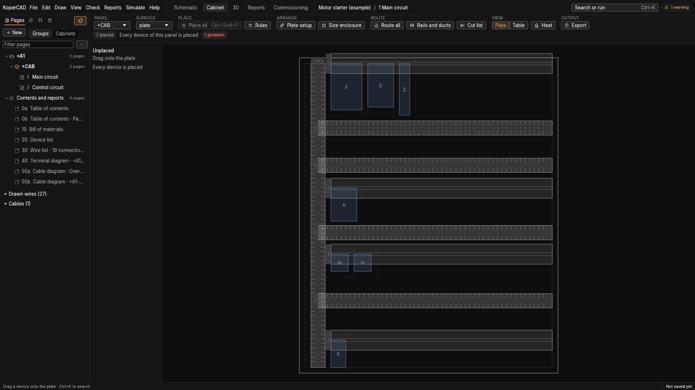
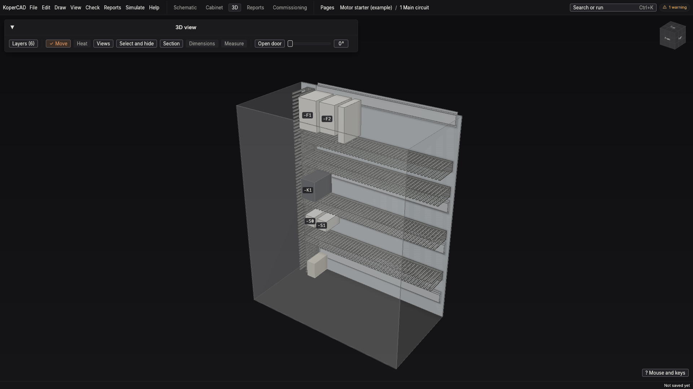

# Workflow: the cabinet

The Cabinet workspace (**Ctrl+2**) lays the devices of the schematic out on a mounting plate; the 3D view shows the result.

## Size the enclosure and the plate

1. Open the Cabinet workspace (View > Workspace > Cabinet). If the project has no cabinet yet, the workspace offers to create one.
2. Set the enclosure size and depth, door and plate. The program warns when the devices cannot fit.
3. **Place all** (View > Cabinet > Place all devices) puts every device on a rail or on the bare plate, using each part's size. A size that is a guess (no part data) is said so on the device.

## Rails and ducts

Add rails and wire ducts from the cabinet toolbar (View > Cabinet > Rails and ducts). Devices snap to rails and keep their gaps; a red gap means the spacing is too small, green means it is fine. The duct fill shows how full each duct is.

## Route the wires

**Route all** (View > Cabinet > Route all wires) sends every wire through the ducts. After routing, wire lengths are measured along the path, plus service loops. Until then they are an estimate shown with a tilde (~); see [Model or exact?](numbers.md#wire-lengths).

## The 3D view

**Ctrl+6** opens the 3D view of the same cabinet. Drag to rotate, scroll to zoom. The section slider cuts the enclosure open. Wire runs show the routed paths. Select a device in 3D and it is selected in the plan, and the other way round. In the 3D view **Shift+D** shows or hides the door, **Ctrl+H** hides the selection, **Ctrl+I** isolates it, and **Ctrl+Shift+H** shows everything.

### Heat

With heat on (**Shift+H**), a temperature field is drawn on the plate and in the air. This is a physical model with a stated accuracy, not a certified thermal calculation. Read [Heat and airflow](numbers.md#heat-and-airflow) before relying on a temperature.

## Drawings from the layout

The plate drawing is exported from File > Export (Export plate drawing, also as DXF); the bench output is in the Reports menu; see [the workshop pack](workshop.md).
