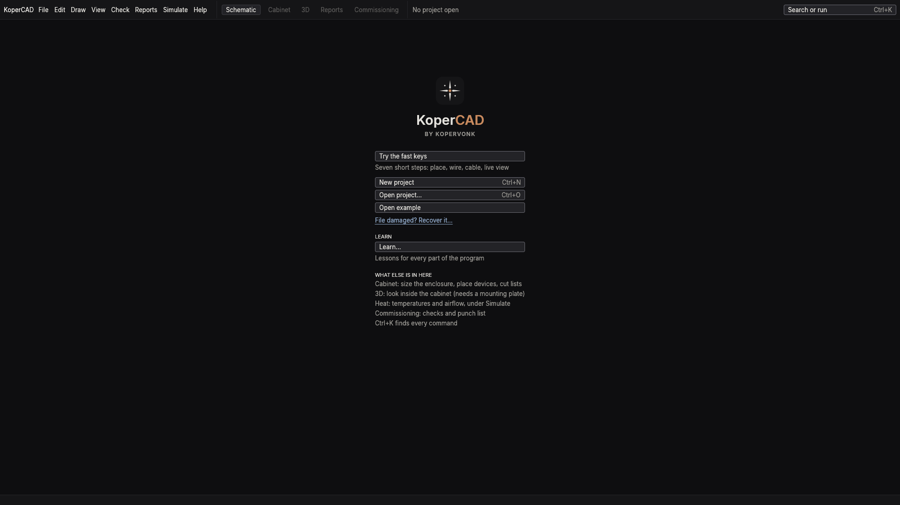
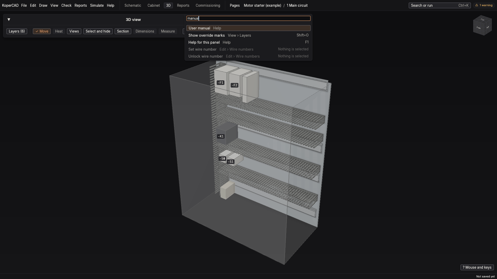
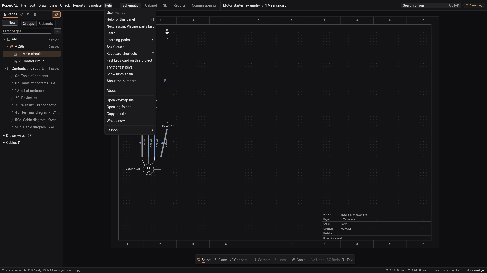
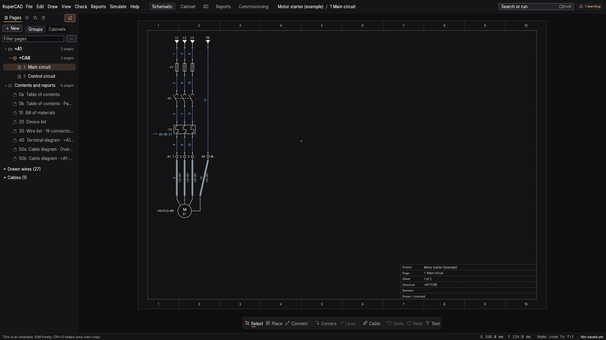

# Your first hour

This page takes you from a first start to a saved and printed drawing. Nothing here can damage a file: the example opens as an untitled copy.

## Start and look around

1. Start KoperCAD. On the start screen choose **Open example**. A motor starter opens over two pages.
2. Press **Ctrl+K** and type a few letters of anything: `cabinet`, `export`, `wire numbers`. The command search finds every command and says which menu it lives in. If you remember one key, remember this one.

3. Press **?** on the drawing for the list of keys, or **F1** for the manual page that fits what is in front of you.
4. Switch workspace with the buttons in the top bar: Schematic, Cabinet, 3D, Reports, Commissioning. **Ctrl+1** is the schematic, **Ctrl+2** the cabinet, **Ctrl+6** the 3D view, **Ctrl+7** commissioning.
5. Right-click anywhere for the commands that fit what you clicked.

## Draw a circuit

Start a new project (File > New project) and use the keyboard; it is faster than the mouse.

| Key | What it does |
| --- | --- |
| **Q** | Tap: search for a symbol and place it. Hold: the place wheel |
| **W** | Draw a wire from the pin under the pointer |
| **R** | Rotate the symbol (X mirrors) |
| **Ctrl+D** | Duplicate and continue the pattern, with the next free tags |
| **Tab** | While wiring, the next connection point of a multi-pin part |
| **Home** | Fit the page in the window |

Place a breaker, a contactor, an overload relay and a motor. Tags (`-Q1`, `-K1`, `-M1`) follow IEC 81346 and are given as you place. See [the motor starter workflow](motor-starter.md) for the full circuit.

### Wires

There are two wiring modes, switched with **Shift+W**, also in the middle of a wire:

- **Corners** (the default): you click corner points, or drag from pin to pin and the router finds a path.
- **Lines**: straight lines between points.

Where two facing pins can be joined, KoperCAD shows a proposal; **Tab** jumps to the next one and **Enter** accepts it. Wires carry a potential (such as L1 or 24 V) and the program keeps wire numbers in step; see [Wire numbers](motor-starter.md#wire-numbers).

## Save and print

- **Ctrl+S** saves. A project is one `.kopercad` file; see [Files](files.md).
- While you work the program also saves a recovery copy. After a crash it offers the recovered work again; see [Troubleshooting](troubleshooting.md).
- File > Export has the PDF of the drawing, with bookmarks and links between pages. Use Print preview first.

## Learning paths

Help > **Learn** has short lessons that run inside the program and check your work as you go: placing parts, wiring, wire numbers, terminal strips, cable screens, cabinet layout, the live view and more. Help > Next lesson continues where you stopped. Lessons marked Early access work but are less polished.

The **fast keys walk-through** (Help > Fast keys card on this project) lists the keys that make drawing quick and ticks each one when you really use it.

## Where to go next

- A complete circuit with numbers and parts: [Workflow: a motor starter](motor-starter.md)
- Laying it out in the cabinet: [Workflow: the cabinet](cabinet.md)
- Anything that looks like an estimate: [Model or exact?](numbers.md)
