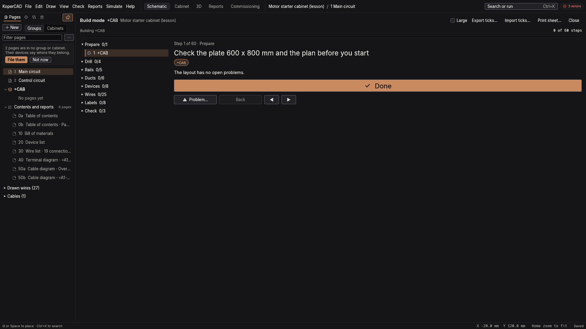

# Workflow: the workshop pack and Build mode

KoperCAD assumes the wires are cut and the holes drilled **by hand**, so the output is made for the bench: large type, one task at a time, nothing that needs a screen to read.

## Reports and bench output

The Reports menu holds the pages that are generated from the drawing:

- **Parts list (bill of materials)**, wire list, cable list, terminal diagram, device list
- **Cut list**: every wire with its length, cross-section, colour and both ends
- **Labels** for devices, wires and terminals (CSV and PDF; there are no label printer drivers)
- Reports > **Bench output...** gathers the cut list, ferrule table, label sheets, assembly checklist and the workshop pack (a folder)
- **Plate drawing** and drilling template at 1:1 (File > Export > Export plate drawing)

## Kitting and the shopping list

Before the first cut, Reports > **Bench output... > Kitting** (or Reports > Export > **Export kitting list (PDF)**, or Ctrl+K "kitting") works out what to take from the shelf and what to buy:

- **Rails and ducts** of every cabinet are packed into the bar lengths you buy (default 2000 mm, a list such as `2000, 1000` is allowed) with the saw cut taken off every cut. The search is exact for a normal cabinet; it says when it stopped early. A bar bought for a few short pieces is bought in the shortest length that holds them. Offcuts you keep (100 mm or longer by default) are named: "cut R3 from the offcut left by R1".
- **Stock on hand** is typed one item per line (`rail 1200 x2`, `duct 50x60 1500`, `wire 1.5 BK 37.5 m`, `have A1.5-10 x40`). Offcuts and part reels on hand are used before anything is bought.
- **Wire** is packed per cross-section and colour onto reels (default 100 m, a percentage of every reel is held back for re-cuts). Cable cores come from their cable and are listed by the metre.
- **Ferrules, lugs, screws and label sheets** are counted with spares and bought in packs.
- A **pick list per build phase** (Prepare, Mount, Wire, Label) with tick boxes, and **one shopping list** that merges these with the parts list. Give a stock item an order number (`Item = order number` in the Kitting settings) and it merges into the parts-list line with that number.

The printed list says which numbers come from the drawing (counts of rails, devices, wires, holes) and which are planning values you set (bar and reel lengths, saw cut, packs, allowances). It is also in the workshop pack as `3 Kitting list.pdf`.

Lengths marked **~** are estimates until the cabinet is laid out and the wires routed. Wires to the door are marked **~ door**: the distance between plate and door and the hinge loop are not included, so add them when you cut the wire.

Reports export to PDF and Excel. Report text can be switched to Dutch.

## Build mode

Reports > **Build mode** (or **Ctrl+K**, `build mode`). **Esc** closes it.

For every cabinet with a mounting plate it shows one step at a time in large type, in the order the workshop works:

1. **Prepare**: the plate and layout problems that would make later steps wrong
2. **Drill**: holes one drill diameter at a time, then cut-outs, with positions
3. **Rails and ducts**: cut and fit
4. **Devices**: clip-on devices after their rail, then devices on the bare plate
5. **Wires**: power, then control, then earth
6. **Labels**, then **Check**

Each step has **Done** (Space or Enter also tick it), **Problem** (the note goes to the punch list in Commissioning with a link to the device or wire), and **Back**. "Also ready now" lists steps that can be done at the same time, so two people can work in parallel.

### Honest limits

- A step says what to cut or drill and where; it does not drive a machine.
- Guessed part sizes, estimated lengths and a missing cross-section are said on the step.
- The power, control and earth grouping is the usual practice (green-yellow is earth, 2.5 mm² and up is power), not a reading of the schematic.
- A ticked step remembers a fingerprint of its text. If the design changes so the step reads differently, it shows as **Changed** and counts as open again.

### Print sheet and the tablet

**Print sheet...** writes `<project> build sheet.pdf` next to the project: every step, who ticked it and when, and a box for pencil on the open ones.

To build on a tablet, carry the project over, build, then export a `.kcfield` file (**Export ticks...**) and import it at the desk (**Import ticks...**). Per step the newer decision wins. Desk and tablet should run the same build.
