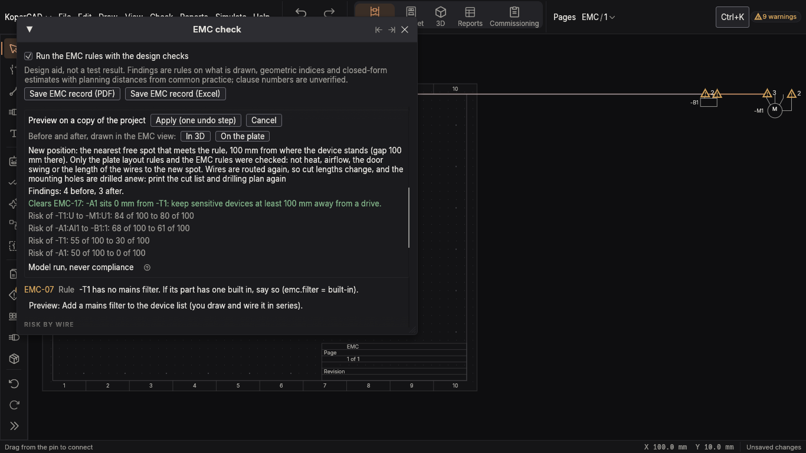

# KoperCAD QA run

Platform linux, window sizes 1366x768. 1 run(s): 1 passed, 0 failed; 1 finding(s) (0 blocking, S1 to S3).

Program: `/home/claude/target/debug/kopercad`, built 1793797638 (unix time), source at git 13da1cd6ad.

App: 1366.0x768.0 points at scale 1.0.

## Scenarios

| Scenario | Area | Size | Result | Findings | Pictures |
|---|---|---|---|---|---|
| EMC findings are triangles on the drawing, with a popover and a fix preview (1366x768) (9511-emc-triangles-popover-1366x768) | Check | 1366x768 | pass | F-001 | 4 |

## Findings

| # | Sev | Area | Size | Title | Evidence |
|---|---|---|---|---|---|
| F-001 | S4 | Check | 1366x768 | 1 pair(s) of controls may overlap (dialogs and docks can stack on purpose; check the picture) | shots/9511-emc-triangles-popover-1366x768-1366x768-04-finding-1.png |

### F-001 S4 1 pair(s) of controls may overlap (dialogs and docks can stack on purpose; check the picture)

Scenario `9511-emc-triangles-popover-1366x768` at 1366x768. Kind: layout-maybe.

Steps:

1. `open qa/fixtures/emc-cabinet.novo`
2. `wait 20`
3. `key ctrl+k`
4. `text EMC check`
5. `key enter`
6. `wait 10`
7. `click_text "Run the EMC rules with the design checks"`
8. `wait 10`
9. `key Escape`
10. `wait 10`
11. `shot emc-triangles`
12. `check_layout`
13. `click 255 158`
14. `wait 6`
15. `expect "Open EMC check"`
16. `expect "Sensitive device near drive"`
17. `expect "Preview the fix"`
18. `shot emc-popover`
19. `check_layout`
20. `click_text "Preview the fix" Button`
21. `wait 12`
22. `expect "EMC check"`
23. `expect "Preview"`
24. `shot emc-fix-preview`
25. `check_layout`

- Expected: every control fully visible and not overlapped
- Saw: 'Cabinet' over 'Close window'

Severity: S1 data loss, crash or cannot start. S2 a core workflow cannot be finished, a wrong number is shown as fact, or the window is blank. S3 everything else that is wrong or confusing. S4 polish and accessibility.
